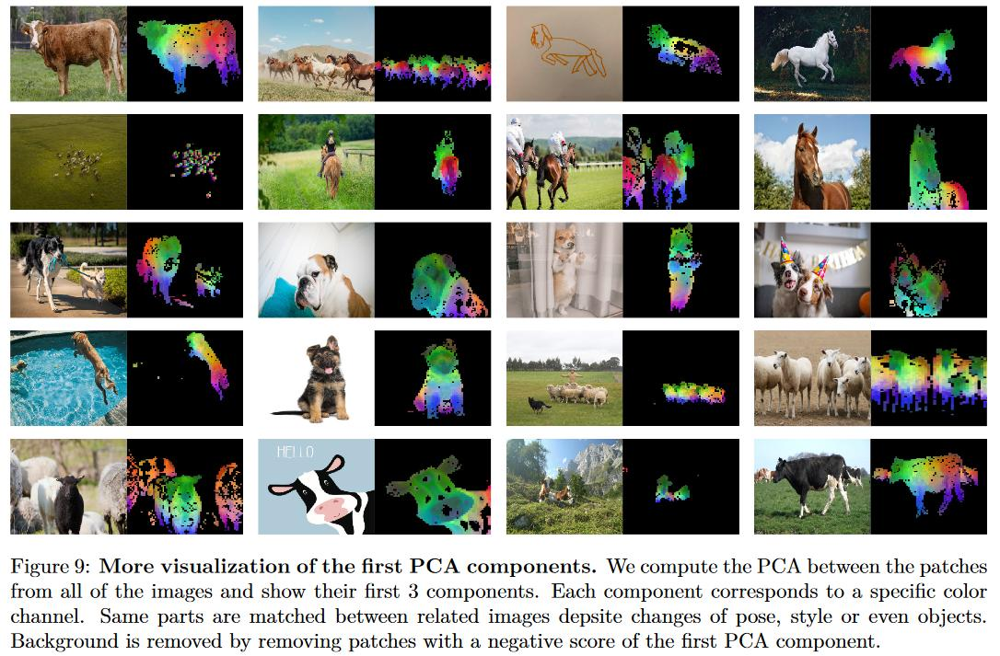

# DINOv2 详解：从图像像素到通用视觉特征



**DINOv2 最重要的作用，是把一张图像变成“包含物体、部件、场景等信息的特征”，而不是直接输出物体名称、检测框或三维坐标。**

上图中的彩色结果，是把 DINOv2 的高维特征经过 PCA 降维后画出来的。颜色不是人工规定的“红色代表头、蓝色代表腿”，而是特征结构的一种可视化。论文观察到，一些具有相似语义的部件，即使来自不同姿态、不同风格的图像，也会表现出相近的特征结构。

下面以**机器人看到一张包含网球、球拍和球场的图像**为主线，分别讲清：

**图像如何变成特征 → 特征怎么使用 → 没有人工标签时怎么训练 → 为什么这些设计有效。**

---

## 1. 先分清：DINOv2、Transformer 和目标检测器是什么关系？

“DINOv2（Distillation of knowledge with NO labels v2）”在不同语境中通常指两件相互关联的事情：一套用于学习视觉表示的自监督训练方法，以及使用该方法训练出来的一系列视觉编码器。其主要骨干采用 Vision Transformer，简称 ViT。[1] [2]

把“网络结构”和“训练方法”分开，就容易理解它与 Transformer 的关系：

> **ViT 主要规定图像在网络中怎样计算；DINOv2 主要规定怎样训练这个网络，使它学到通用视觉表示。**

因此，DINOv2 不是 Transformer 的替代品，而是利用 Transformer 进行视觉编码，并配合特定的自监督训练目标。

### 1.1 裸模型输出的是特征，不是已经命名的类别

一张包含网球、球拍和球场的图像输入后，模型可能产生如下形式的数据：

```text
整张图像的特征：
[0.12, -0.83, 1.24, ..., 0.37]

某个网球区域的特征：
[0.91, 0.13, -0.25, ..., 0.62]

某个地面区域的特征：
[-0.48, 1.32, 0.07, ..., -0.16]
```

这些数值仅用于说明输出形式。

它们不是：

```text
[网球概率, 球拍概率, 球场概率]
```

而是学习出来的表示坐标。单独查看某一维，通常不能给它赋予“网球程度”“圆形程度”这样的确定语义；特征的价值主要体现在整个向量，以及不同向量之间的关系上。

### 1.2 视觉主干与下游任务头的区别

| 使用方式 | 主要输入 | 直接输出 |
|---|---|---|
| DINOv2 主干 | 图像 | 整图特征、patch 特征 |
| 整图特征接分类头 | 整图特征 | 图像类别分数 |
| 局部特征接分割头 | patch 特征 | 空间位置上的类别分数 |
| 局部特征接深度预测头 | patch 特征或多层特征 | 深度预测 |
| 直接比较特征 | 两张图像或两个区域的特征 | 相似度、候选对应关系 |

官方代码提供了分类、分割和深度估计等下游使用方式。

需要区分两个概念：

**冻结主干**，表示下游训练时不更新 DINOv2 的参数。

**不需要下游训练**，表示连任务头或其他适配模块都不训练。

二者不等价。冻结 DINOv2 后训练一个分类头，仍然需要分类标签；直接做相似图像检索则可以不训练分类头，但检索结果也不等于自动获得了有名称的类别。

---

## 2. 固定一个模型和一张图像

### 2.1 本文推理示例使用 ViT-S/14

为了把形状和数值保持一致，推理部分固定使用 ViT-S/14：

也就是不带 register tokens 的 DINOv2 ViT-S/14。

| 参数 | 本文使用的值 | 含义 |
|---|---:|---|
| patch 边长 | 14 | 每个初始图像块为 14×14 像素 |
| 特征维度 | 384 | 每个 token 用 384 个数表示 |
| Transformer block 数量 | 12 | 连续进行 12 次信息加工 |
| 注意力头数 | 6 | 每层使用 6 个注意力头 |
| 单个注意力头的维度 | 64 | 384÷6 |
| 前馈网络隐藏维度 | 1536 | 384×4 |
| register 数量 | 0 | 本节使用普通版本 |

这里的 `/14` 表示 patch 大小，不表示网络层数；`S` 表示 Small。

### 2.2 固定输入尺寸

假设经过预处理后，输入图像为：

$$
224\times224
$$

像素。

定义：

$$
B=1,\qquad C=3,\qquad H=W=224.
$$

其中，$B$ 是 batch size，即一批图像的数量；$C$ 是颜色通道数；$H$ 和 $W$ 分别是高度和宽度。

输入张量为：

$$
X\in\mathbb R^{1\times3\times224\times224}.
$$

再定义：

$$
P=14,\qquad D=384.
$$

$P$ 是 patch 边长，$D$ 是每个 token 的特征维度。

于是 patch 数量为：

$$
N=\frac HP\frac WP=16\times16=256.
$$

这里的 $N$ **只计算图像 patch，不包含 CLS 或 register tokens**。

### 2.3 先看完整推理链路

```text
RGB 图像
[1, 3, 224, 224]
        ↓
Patch embedding
[1, 256, 384]
        ↓
加入 CLS token 和位置编码
[1, 257, 384]
        ↓
12 个 Transformer blocks
[1, 257, 384]
        ↓
最终 LayerNorm
[1, 257, 384]
        ├── CLS 整图特征       [1, 384]
        └── patch 局部特征     [1, 256, 384]
```

## 3. 从 RGB 像素到 patch tokens

### 3.1 像素标准化：整数颜色变成浮点输入

原始 RGB 图像通常用 0 到 255 的整数表示。官方预处理使用以下通道均值和标准差：

$$
\mu=[0.485,0.456,0.406],
$$

$$
\sigma=[0.229,0.224,0.225].
$$

对某个颜色通道的像素值 $x$，先转换到 $[0,1]$，再标准化：

$$
x'=\frac{x/255-\mu}{\sigma}.
$$

其中的 $\mu$ 和 $\sigma$ 应取对应通道的数值。

例如，一个像素是：

$$
[R,G,B]=[128,200,50].
$$

计算后：

$$
R'=\frac{128/255-0.485}{0.229}\approx0.0741,
$$

$$
G'=\frac{200/255-0.456}{0.224}\approx1.4657,
$$

$$
B'=\frac{50/255-0.406}{0.225}\approx-0.9330.
$$

也就是说，这个像素进入网络时大致为：

```text
[0.0741, 1.4657, -0.9330]
```

**为什么要这样做？**

最直接的原因是让推理输入遵循预训练时的数值处理方式。模型参数是在特定输入分布下学习的，随意改变 RGB 顺序、数值范围或标准化方式，会改变后续计算的输入条件。

标准化不会改变张量形状：

```text
[1, 3, 224, 224] → [1, 3, 224, 224]
```

改变的是每个位置上的数值。

### 3.2 图像切块：224×224 变成 16×16 个 patch

因为 patch 大小为 $14\times14$，所以每行有：

$$
224/14=16
$$

个 patch，整张图共 256 个。

从 0 开始按行编号：

```text
p0    p1    p2    ...  p15
p16   p17   p18   ...  p31
...
p240  p241  p242  ...  p255
```

每个 patch 包含三个颜色通道，因此共有：

$$
14\times14\times3=588
$$

个数。

把第 $i$ 个 patch 展开为行向量：

$$
r_i\in\mathbb R^{588}.
$$

这里 $i$ 是 patch 编号。

### 3.3 线性投影：588 个像素数值变成 384 维特征

对每个 patch 使用相同的可学习线性投影：

$$
e_i=r_iW_E+b_E.
$$

其中：

$$
W_E\in\mathbb R^{588\times384}
$$

是投影矩阵，

$$
b_E\in\mathbb R^{384}
$$

是偏置，

$$
e_i\in\mathbb R^{384}
$$

是该 patch 的初始 embedding，也就是初始 token。

所有 patch 共享 $W_E$ 和 $b_E$。这意味着网络用同一套可学习规则把不同位置的像素块转换为特征，而不是给每个位置单独设置一个完全不同的投影器。

**为什么不直接把 588 个像素数值当作最终特征？**

因为原始像素主要描述颜色强度。线性投影让模型能够学习局部像素之间的组合，并把各区域统一映射到后续 Transformer 所使用的 $D=384$ 维空间。

但此时还只是初始局部表示，不能认为一个线性层就已经“识别出了网球”。

### 3.4 为什么代码里用卷积实现切块

官方的 patch embedding 使用卷积完成这一步：

```python
nn.Conv2d(
    in_channels=3,
    out_channels=384,
    kernel_size=14,
    stride=14,
)
```

卷积核覆盖一个 $14\times14$ 区域，步长也为 14，因此各窗口恰好对应不重叠的 patch。输出通道数为 384，对应每个 patch 的 384 维投影结果。

这和“先展平 patch，再使用共享线性层”在运算结构上等价，只是实现方式不同。

数据尺寸为：

```text
输入图像
[1, 3, 224, 224]
        ↓ 卷积投影
[1, 384, 16, 16]
        ↓ 展开空间维度并调整排列
[1, 256, 384]
```

### 3.5 一个像素具体对应哪个 patch

固定一个位于网球内部的像素：

$$
(u,v)=(145,90).
$$

$u$ 是横向坐标，$v$ 是纵向坐标；两者都使用**预处理后图像的坐标**，从 0 开始。

对应的 patch 列号为：

$$
c=\left\lfloor\frac{145}{14}\right\rfloor=10.
$$

行号为：

$$
r=\left\lfloor\frac{90}{14}\right\rfloor=6.
$$

每行有 16 个 patch，因此展平后的编号为：

$$
i=r\times16+c=6\times16+10=106.
$$

这个 patch 的像素范围是：

$$
u=140\ldots153,\qquad v=84\ldots97.
$$

所以，后面读取第 106 个 patch 的输出特征，就读取了与这个网格位置对应的向量。

这里有一个重要区别：

> patch 的**空间索引**会保留，但经过 Transformer 后，它的**内容信息**可以来自整张图像，不再只取决于这 14×14 个像素。

---

## 4. CLS（Classification Token） token 与位置编码

### 4.1 CLS token：为整图信息提供一个汇聚位置

CLS token 是一个额外的可学习向量：

$$
e_{\mathrm{CLS}}\in\mathbb R^{384}.
$$

它不对应某个具体图像块。

加入之前：

```text
[p0, p1, ..., p255]
```

加入之后：

```text
[CLS, p0, p1, ..., p255]
```

张量形状变为：

$$
[1,256,384]\rightarrow[1,257,384].
$$

刚进入网络时，同一组模型参数下的 CLS 初始向量对不同图像相同。经过注意力计算，它会读取当前图像中的 patch 信息，从而变成与当前图像有关的整图表示。

**为什么增加它，而不是直接选一个 patch 代表整张图？**

因为普通 patch 有明确的空间位置。额外设置 CLS，可以给整图汇聚和整图训练目标提供一个专门的输出位置。

这并不意味着 CLS 在每一层都已经包含“完美的整图摘要”，它的作用是通过训练逐渐形成的。

### 4.2 位置编码：让网络区分图像区域的位置

切块之后，模型看到的是一串向量。注意力的相似性计算本身不会自动赋予某个 token “左上角”或“右下角”的几何含义。

因此，在 embedding 上加入位置编码：

$$
z_i=e_i+a_i.
$$

其中，$e_i$ 是 token 内容向量，$a_i$ 是该位置的编码，$z_i$ 是加入位置信息后的 token。

需要特别注意，位置编码本身不读取当前 patch 的像素内容。以这里使用的**绝对位置编码**为例，模型会为网格中的不同位置预先设计或学习不同的编码。左上角 patch 使用左上角对应的编码，右下角 patch 使用右下角对应的编码；即使换了一张图，只要 patch 仍处在同一个网格位置，加入的初始位置编码仍来自同一个位置。位置编码是否不同，以及具体怎样表示位置，取决于模型一开始采用的设计。它可以是可学习的绝对位置编码，也可以是按照相对距离计算的相对位置编码。

DINOv2 使用可学习的位置编码；输入分辨率改变时，对 patch 位置编码进行插值，适配新的空间网格。

这里的位置表示是图像网格位置，不是相机三维坐标，也不是物体的世界坐标。

### 4.3 token 的编号要区分两种情况

对于不带 register 的模型：

```text
完整序列下标 0     → CLS
完整序列下标 1     → patch 0
完整序列下标 107   → patch 106
```

所以：

$$
\text{完整序列下标}=\text{patch 下标}+1.
$$

这一区别在观察 Transformer 中间输出时尤其重要。

---

## 5. Transformer block：注意力、残差与前馈网络

### 5.1 一个 block 的输入

现在输入为：

$$
Z\in\mathbb R^{1\times257\times384}.
$$

$Z$ 表示当前层接收到的所有 token。

一个 block 不会把 257 个 token 变成更少的 token。它主要改变每个 token 内部的数值，也就是更新这些位置的表示。

### 5.2 Q、K、V 分别承担什么作用

注意力使用三个可学习投影生成：

$$
Q=ZW_Q,\qquad K=ZW_K,\qquad V=ZW_V.
$$

这里暂时省略 LayerNorm 和投影偏置，先看信息混合的主体运算。

$W_Q$、$W_K$、$W_V$ 分别是生成查询、键和值的学习参数；$Q$、$K$、$V$ 是当前输入经过这些参数计算出的结果。

可以这样理解：

- **Query，查询**：当前位置以什么方式寻找相关信息。
- **Key，键**：其他位置以什么方式参与相关性匹配。
- **Value，值**：确定权重后，实际被加权传递的信息。

这些描述只是帮助理解计算功能，不代表网络内部存在显式的自然语言问题。[7]

### 5.3 多头注意力的真实张量形状

本文模型有 6 个头，每个头的维度为：

$$
d_h=384/6=64.
$$

其中 $d_h$ 是单个注意力头的特征维度。

形状变化如下：

```text
输入 Z
[1, 257, 384]
        ↓ 线性投影并拆分头
Q: [1, 6, 257, 64]
K: [1, 6, 257, 64]
V: [1, 6, 257, 64]
        ↓ Q 与 K 计算两两打分
[1, 6, 257, 257]
        ↓ softmax
每个头的注意力权重
[1, 6, 257, 257]
        ↓ 对 V 加权求和
[1, 6, 257, 64]
        ↓ 拼接 6 个头并做输出投影
[1, 257, 384]
```

对某个头，计算公式为：

$$
A=\operatorname{softmax}\left(\frac{QK^T}{\sqrt{d_h}}\right),
$$

$$
Y=AV.
$$

$A$ 是注意力权重矩阵，$Y$ 是加权汇总后的信息。softmax 对每个查询对应的所有键进行归一化，所以 $A$ 的每一行之和为 1。

### 5.4 为什么要除以根号下的头维度

假设向量各分量的尺度相近，点积会随着维度增大而更容易产生幅度较大的数值。过大的打分进入 softmax 后，可能让概率过早地集中到极少数位置。

除以 $\sqrt{d_h}$ 是一种尺度调整，用来缓解这种随维度增长的影响。

这不会决定网络“必须关注哪个物体”，它只是改善注意力打分的数值尺度。

### 5.5 用五个 token 手算一次注意力

为了让每一步都可以检查，把真实的 257 个 token、384 维，缩小为：

```text
5 个 token，每个 4 维。
```

假设某一层的输入为：

| token | 输入向量 |
|---|---|
| CLS | [0.5, 0.5, 0, 0.5] |
| 网球区域 A | [1, 1, 0, 1] |
| 网球区域 B | [1, 0.9, 0.1, 0.8] |
| 球场地面 | [0, 0.6, 0, 0] |
| 白色场线 | [1.1, 1.1, 1, 0] |

这里的名字只是标记 token 在示例中来自什么区域，不表示某一维已经有人工命名的语义。

为了简化算术，设：

$$
W_Q=W_K=W_V=I.
$$

$I$ 是单位矩阵，因此：

$$
Q=K=V=Z.
$$

同时暂时省略 LayerNorm、多头拆分、输出投影和 LayerScale。这个例子用于解释加权混合，不是完整真实 block 的数值复现。


---

## 6. 最终输出是什么，如何理解这些向量

### 6.1 整图特征

取最终 CLS token，得到：

$$
g\in\mathbb R^{1\times384}.
$$

$g$ 表示整张图像的视觉描述。


### 6.2 局部特征

去掉 CLS 后，得到所有 patch 的输出：

$$
F\in\mathbb R^{1\times256\times384}.
$$

$F$ 是局部特征集合，其中 $F_i$ 表示第 $i$ 个 patch 的 384 维特征。为简洁起见，在讨论单张图时常省略 batch 维度。


它可以恢复成空间特征图：

$$
[1,256,384]\rightarrow[1,16,16,384]\rightarrow[1,384,16,16].
$$


整图特征和局部特征来自同一个骨干，不是两个互不相关的网络。

### 6.3 局部输出有网格位置，但不再局限于局部像素

第 106 个 patch 的输出仍然对应第 6 行、第 10 列。

然而，这个位置经过注意力与其他 token 交换过信息。因此：

$$
F_{106}\neq\text{只由该 14×14 区域独立算出的描述}.
$$

更准确地说：

> 它是以该网格位置为索引、结合图像上下文得到的描述。

这解释了为什么局部特征可能具有超出局部颜色的语义信息，也解释了为什么不能把它机械地当成某一个精确像素的独立物理属性。

### 6.4 `x_norm_*` 不是已经完成余弦归一化

这里的 `norm` 指模型末尾的 LayerNorm。

LayerNorm 和单位长度归一化是两种不同运算。

LayerNorm 对一个 token 的各通道进行均值、方差归一化，并包含可学习的缩放和平移。

而用于余弦相似度的 L2 归一化为：

$$
\hat f=\frac{f}{\|f\|_2}.
$$

$f$ 是原特征，$\hat f$ 是长度为 1 的特征，$\|f\|_2$ 是向量的欧氏长度。

因此，即使已经取出 `x_norm_patchtokens`，计算余弦相似度时通常仍应显式使用：

```python
unit_features = torch.nn.functional.normalize(
    patch_features, p=2, dim=-1
)
```

---

<a id="sec-7"></a>

## 7. 特征的具体用途：匹配、分类、分割与可视化

### 7.1 例子一：用参考区域寻找相似区域

继续使用参考图像中的像素：

$$
(u,v)=(145,90).
$$

它属于 patch 106，因此可以取参考区域特征：

$$
f_{\mathrm{ref}}=F_{106}.
$$

现在对另一张图像提取所有 patch 特征，并逐个与 $f_{\mathrm{ref}}$ 比较。

数据流为：

```text
参考图像 A → DINOv2 → 取出 patch 106 的特征
                                   │
                                   ├→ 逐区域计算相似度
                                   │
目标图像 B → DINOv2 → 所有 patch 特征
                                           ↓
                                     区域相似度图
```

DINOv2 论文展示了利用局部特征进行跨图像 patch 匹配的现象。[1]

#### 7.1.1 用四维向量手算相似度

把真实的 384 维缩小为 4 维，假设：

$$
f_{\mathrm{ref}}=[0.9,0.1,0.3,0.1].
$$

目标图像中三个候选区域的特征是：

$$
f_1=[0.85,0.12,0.28,0.08],
$$

$$
f_2=[0.1,0.9,0.1,0.3],
$$

$$
f_3=[0.2,0.2,0.9,0.1].
$$

用余弦相似度：

$$
\operatorname{sim}(a,b)=\frac{a^Tb}{\|a\|_2\|b\|_2}.
$$

$a$ 和 $b$ 是需要比较的两个向量。

例如，第一个候选与参考向量的点积为：

$$
f_{\mathrm{ref}}^Tf_1
=0.9\times0.85+0.1\times0.12+0.3\times0.28+0.1\times0.08
=0.869.
$$

两者长度分别为：

$$
\|f_{\mathrm{ref}}\|_2=\sqrt{0.92},\qquad
\|f_1\|_2=\sqrt{0.8217}.
$$

所以：

$$
\operatorname{sim}(f_{\mathrm{ref}},f_1)\approx0.9995.
$$

全部结果为：

| 候选区域 | 教学设定中的内容 | 余弦相似度 |
|---|---|---:|
| $f_1$ | 另一块网球区域 | 0.9995 |
| $f_2$ | 球场地面 | 0.2609 |
| $f_3$ | 球拍区域 | 0.5275 |

在这组教学数据中，第一块区域最接近参考特征。

#### 7.1.2 为什么比较特征比直接比较 RGB 更有意义

RGB 主要反映局部颜色，而经过训练的视觉特征能够包含上下文和结构信息。因此，特征相似度提供了不同于像素差值的比较空间。

但它不是任意条件下都可靠的保证。不同物体、相似纹理、重复结构或很小的目标都可能造成混淆。

必须记住：

$$
\text{相似度高}\not\Rightarrow\text{类别概率高},
$$

$$
\text{语义相似}\not\Rightarrow\text{同一个物理点}.
$$

0.9 的余弦相似度，不代表“90% 的概率是网球”；两个不同网球也可能具有相似的特征。

### 7.2 例子二：整图分类与检索

如果要判断整张图片属于“网球场”“室内房间”还是“街道”，可以把整图特征 $g$ 送入一个分类头：

$$
\ell=gW_c+b_c.
$$

其中 $\ell$ 是类别分数，$W_c$ 和 $b_c$ 是需要学习的分类器参数。

如果有 $C_{\mathrm{task}}$ 个类别，则：

$$
W_c\in\mathbb R^{384\times C_{\mathrm{task}}}.
$$

$C_{\mathrm{task}}$ 是任务类别数，与图像颜色通道数以及训练 prototype 的数量都无关。

另一种使用方式是不接分类头，直接比较数据库中各图像的整图特征，返回最相似的图像。这样得到的是检索排序，而不是自动命名的类别。

**冻结 DINOv2 的分类使用方式，是让分类器学习怎样利用已有特征，而不是让整个视觉网络重新从像素开始学习。**

### 7.3 例子三：用局部特征做三类分割

假设需要区分：

```text
0：网球
1：球拍
2：背景
```

对每个 patch 的特征施加同一个线性分类器：

$$
\ell_i=F_iW_c+b_c.
$$

在这个例子中：

$$
W_c\in\mathbb R^{384\times3},\qquad b_c\in\mathbb R^3,
$$

$$
\ell_i\in\mathbb R^3.
$$

$\ell_i$ 是第 $i$ 个 patch 的三个类别分数。

完整流程为：

```text
图像
[1, 3, 224, 224]
        ↓ DINOv2
patch 特征
[1, 256, 384]
        ↓ Linear(384, 3)
[1, 256, 3]
        ↓ 恢复空间排列
[1, 3, 16, 16]
        ↓ 上采样类别分数图
[1, 3, 224, 224]
        ↓ 对类别维取 argmax
[1, 224, 224]
```

最后的 `argmax` 选择每个位置分数最高的类别。

这里 DINOv2 提供表示能力，而“编号 0 是网球、编号 1 是球拍”由下游标签和分类头赋予。官方分割评估包含冻结主干、训练简单任务头的做法。

还要注意：

> 把 16×16 的分数图插值到 224×224，只增加了输出采样点，不会自动恢复已经丢失的精细边界。

---

## 8. 自监督训练的起点：同一图像的不同观察

前面已经知道图像怎样变成特征。现在需要回答真正关键的问题：

> 没有人工标签，网络为什么会学到有用的视觉表示，而不是一组任意数值？

DINOv2 构造的学习信号主要包含两个层级：

**整图层面：同一图像不同裁剪的表示应保持一致。**

**局部层面：学生在部分区域被遮挡时，仍要预测教师对对应位置给出的表示。**

前者对应 DINO 目标，后者对应 iBOT 目标。除此之外，还需要防止不同输入全部输出相同特征。

用一张小图走完 DINOv2 的一次训练：

把一张图裁下来，盖住右下角的一块。学生看不到这块的像素，谁来告诉它预测得好不好？DINOv2 让另一份网络看完整的裁剪，把它对这个位置算出的结果当作本轮的答案。这份提供答案的网络叫**教师**，练习作答的网络叫**学生**，因此在训练里，存在两份网络。

同一张图还可以出另一道题。给学生看一个裁剪，给教师看另一个裁剪，让两者对整个裁剪的描述也尽量接近。这两道题共用学生提取特征的那部分网络，叫**主干**。所以，看懂某一块和看懂整张图，最终都能影响主干里保存的参数。

### 8.1 同一张图，教师和学生各看哪一部分？

用 `1` 表示亮、`0` 表示暗。下面是原图，方括号标出了我们要跟踪的中心像素。

```text
1   0   0
0  [1]  0
0   0   0
```

从原图取出三个**视图**。本例把一个像素当作一个图像块（patch），每份裁剪里的块都从左到右、从上到下重新编号。

| 视图 | 从原图哪里取 | 按行展开的灰度 | 教师看到什么 | 学生看到什么 |
|---|---|---|---|---|
| 甲（全局裁剪） | 左上角 2×2 | `[1, 0, 0, 1]` | 完整的甲 | 甲的右下角被遮住 |
| 乙（全局裁剪） | 右下角 2×2 | `[1, 0, 0, 0]` | 完整的乙 | 完整的乙 |
| 小裁剪（局部裁剪） | 只取正中心 | `[1]` | 教师只处理甲、乙 | 完整的小裁剪 |

在甲里，四块依次叫 `p0、p1、p2、p3`，原图的中心成了甲的 `p3`。同一个像素到了乙，却在左上角，叫乙的 `p0`。后面提到“被遮住的位置”，指的都是**甲的 p3**。

每份裁剪独立经过网络。即使学生网络在使用乙训练看到了那个亮像素，在使用甲的 `p3` 时，它能读取的也只有甲里的信息。

### 8.2 遮住 p3 以后，学生怎样给它算出特征？

从这里开始，直接沿用前面 Transformer 的术语。下面的手算仍然描述一个 Transformer block，只是把投影矩阵固定成容易计算的数值，并且只保留一层、一个注意力头。为了让数值与前面的例子对应，本例暂时不把位置编码、LayerNorm 和 FFN 展开到计算式中，先单独看清 MASK 位置怎样通过 self-attention 读取可见 token。真实的 DINOv2 会先加入位置编码，再堆叠多个 Transformer block，在这些 block 中执行归一化、注意力、残差和前馈网络。

#### 8.2.1 先给每个位置放一行数

网络要把一块图像变成一串能运算的数（线性层），这一步叫 **patch embedding**。为方便手算，规定灰度 `x` 变成 `[w × x, 1]`。其中 `w` 是网络保存、训练时可以调整的参数，第二个数固定为 `1`。训练刚开始，教师从学生复制一份参数，两边的 `w` 都是 `1`。于是亮块变成 `[1, 1]`，暗块变成 `[0, 1]`。

在最前面再放一行 **CLS**。它是专门留给整个裁剪的汇总位置，初值设成 `[0, 0]`。学生遮挡 `p3` 的方法，是把那一行的输入替换为占位向量 **MASK**，本例也取 `[0, 0]`。

| 甲的输入行 | 教师 | 学生 |
|---|---|---|
| CLS | `[0, 0]` | `[0, 0]` |
| p0（亮） | `[1, 1]` | `[1, 1]` |
| p1（暗） | `[0, 1]` | `[0, 1]` |
| p2（暗） | `[0, 1]` | `[0, 1]` |
| p3（亮，学生侧遮挡） | `[1, 1]` | `[0, 0]` |

网络把每个位置作为一个 **token** 处理，表里一行就是一个 token。两边都是五行、每行两个数，写成形状就是 `[5, 2]`。学生的遮挡表 `[否, 否, 否, 是]` 依次对应四个图像块，最后一个“是”让学生替换第五行。这样 `p3` 的位置还在，内容换成了 MASK。暗块则保留自己的特征 `[0, 1]`。

#### 8.2.2 让每一行读取周围，再看 p3 那一行

按照前面介绍的 self-attention，设输入矩阵为 X，先计算：

$$
Q=XW_Q,\qquad K=XW_K,\qquad V=XW_V.
$$

为了让本例可以手算，设 W_Q=0、W_K=0、W_V=I，输出投影也取恒等映射。于是：

$$
QK^T=0,\qquad
A=\operatorname{softmax}(QK^T/\sqrt{d})=
\begin{bmatrix}
1/5&1/5&1/5&1/5&1/5\\
1/5&1/5&1/5&1/5&1/5\\
1/5&1/5&1/5&1/5&1/5\\
1/5&1/5&1/5&1/5&1/5\\
1/5&1/5&1/5&1/5&1/5
\end{bmatrix}.
$$

所以注意力输出 AV 是五行输入的平均值。再执行 Transformer 中的第一次残差相加 Y=X+AV，就得到下面的结果。为了集中观察遮挡信息，只展示 CLS 和 p3 两行。

| 只计算甲 | 教师看完整的甲 | 学生看遮挡的甲 |
|---|---|---|
| 五行相加后除以 5 | `[2, 4] / 5 = [0.4, 0.8]` | `[1, 3] / 5 = [0.2, 0.6]` |
| CLS 输出 = 本行输入 + 平均 | `[0, 0] + [0.4, 0.8] = [0.4, 0.8]` | `[0, 0] + [0.2, 0.6] = [0.2, 0.6]` |
| **p3 输出** = 本行输入 + 平均 | `[1, 1] + [0.4, 0.8] = [1.4, 1.8]` | `[0, 0] + [0.2, 0.6] = [0.2, 0.6]` |

学生 `p3` 的第一个数 `0.2` 从哪来？甲里还露着左上角的亮块 `p0`，它贡献了 `1/5`。第二个数 `0.6` 来自三个可见块，它们各贡献 `1/5`。**盖住的是这个位置自己的像素，它仍能接收同一裁剪里其他位置的信息。** 这两个数合起来，就是学生给 `p3` 算出的**特征**。虽然教师和学生此时都用 `w = 1`，它们看到的内容不同，已经算出了不同的特征。

在这个小网络里，学生的 CLS 和被遮的 `p3` 恰好算出了同一对数，因为两行都从零出发、又加上了同一个平均值。第 3 步取 `p3` 那一行，评价被遮位置的预测。第 4 步取 CLS 那一行，比较整个裁剪的描述。

这里的注意力权重矩阵 A 由 softmax 得到。由于本例把 Q 和 K 都设为零，五个位置的 attention score 完全相同，所以每一行的权重都是 1/5。

### 8.3 学生对 p3 的预测有多接近教师？（iBOT）

教师有了 `[1.4, 1.8]`，学生有了 `[0.2, 0.6]`。各自在主干后接一个小模块，把特征变成可以比较的分数，这个模块叫**训练头**。读取图像块特征的是 **iBOT 头**。

本轮开始时，头的三个分数依次取“第一维、第二维、零”。例如学生的 `[0.2, 0.6]` 变成 `[0.2, 0.6, 0]`。这三个原始分数叫 **logits**，每一项对应一个可学习的输出方向，通常叫 **prototype**。三个 **prototype** 都没有预先指定的物体名称。

为了比较教师和学生给每个 **prototype** 分了多少比重，把分数转成总和为 1 的比例。做法是逐项取指数，再除以三个指数之和，这就叫 **softmax**。在这轮手算里，教师和学生都直接使用这个公式，相当于温度取 1。先用学生算一遍。

```text
三个分数          [0.2,    0.6,    0   ]
各自取指数      ≈ [1.2214, 1.8221, 1   ]
各项除以 4.0435 ≈ [0.3021, 0.4506, 0.2473]
```

| 甲的 p3 | 主干给出的特征 | iBOT 头给出的分数 | softmax 后的分布 |
|---|---|---|---|
| 教师目标 | `[1.4, 1.8]` | `[1.4, 1.8, 0]` | `[0.3652, 0.5448, 0.0901]` |
| 学生预测 | `[0.2, 0.6]` | `[0.2, 0.6, 0]` | `[0.3021, 0.4506, 0.2473]` |

光看第三项就能判断方向。教师只分给它约 **9.0%**，学生却分了 **24.7%**。学生需要把一部分比重移到前两项。这道局部预测题用的始终是**同一裁剪、同一位置**的两份分布，教师的答案包含它亲眼看到的 `p3` 以及周围的信息。

怎样给这次作答算一个损失？把教师分布记作 `T`，学生分布记作 `S`。对每一项算 `−ln(学生给的比例)`，再按教师给这一项的比重求加权和。这是**交叉熵**，`ln` 表示自然对数。

$$
H(T,S)=-\sum_{k=1}^{3} T_k \ln S_k
$$

例如第一项用教师的 `0.3652` 给学生的 `−ln(0.3021)` 加权，约得 `0.4372`。三项都这样算再相加，得到 **`H(教师甲 p3, 学生甲 p3) ≈ 0.997216`**。文中小数作了舍入，结果用完整精度计算。固定教师目标时，学生分布与它完全一致，交叉熵达到最小值。像这里有多个非零目标分量时，这个最小值仍大于零。

在本例中，甲只遮一块，乙没有遮挡，乙对这项损失贡献为零。先在每个全局裁剪内平均被遮位置的损失，再对两个全局裁剪取平均，所以 **`L_iBOT = (0.997216 + 0) / 2 ≈ 0.498608`**。

### 8.4 换一个裁剪，整图描述还接近吗？（DINO）

取出每份裁剪最前面的 **CLS 行**，交给专门比较整图的 **DINO 头**。这里说的“整图”是网络当前收到的整份裁剪。因此，从小裁剪取 CLS，走的也是 DINO 头。上一节走 iBOT 头，是因为取了甲里一个具体图像块的输出。

乙的四块是 `[1, 0, 0, 0]`，两边都看得到。加上 CLS，五行的和为 `[1, 4]`，所以乙的 CLS 输出是 `[0.2, 0.8]`。小裁剪只送给学生，它只有零初值的 CLS 和一个亮块，平均值就是 `([0, 0] + [1, 1]) / 2 = [0.5, 0.5]`。

DINO 头和 iBOT 头各有自己的权重。为了手算，两者起初都把 `[h1, h2]` 变为 `[h1, h2, 0]`。像上一步一样做 softmax，就得到了整图的预测和目标。

| 谁在读哪份裁剪 | CLS 特征 | 用于整图比较的分布 |
|---|---|---|
| 教师读甲 | `[0.4, 0.8]` | `[0.3162, 0.4718, 0.2120]` |
| 学生读遮挡的甲 | `[0.2, 0.6]` | `[0.3021, 0.4506, 0.2473]` |
| 教师读乙、学生读乙 | `[0.2, 0.8]` | `[0.2747, 0.5005, 0.2249]` |
| 学生读小裁剪 | `[0.5, 0.5]` | `[0.3837, 0.3837, 0.2327]` |

**DINO 要求换个裁剪也能给出相近的整图描述。** 学生读甲，就向读乙的教师学习。学生只读小裁剪，就分别向教师的两份全局裁剪学习。沿用上节的交叉熵，四道题的分数如下。

| 学生用哪份预测 | 教师用哪份目标 | 交叉熵 `H(教师, 学生)` |
|---|---|---:|
| 甲的 CLS | 乙的 CLS | 1.041905 |
| 乙的 CLS | 甲的 CLS | 1.051548 |
| 小裁剪的 CLS | 甲的 CLS | 1.064011 |
| 小裁剪的 CLS | 乙的 CLS | 1.070457 |

四项整图损失取平均，再把两种任务的损失相加。手算里两种任务的权重都取 1。

```text
整图 DINO 损失 = (1.041905 + 1.051548 + 1.064011 + 1.070457) / 4 ≈ 1.056980
局部 iBOT 损失 = (0.997216 + 0) / 2                             ≈ 0.498608
本轮总损失     = 1.056980 + 0.498608                              ≈ 1.555588
```

到这里完成的是**前向计算**，即从像素一路算到损失。网络已经给这组参数打出了分数，主干参数 `w` 此刻依然是 `1`。

### 8.5 损失怎样改到学生，教师又怎样跟上？

<a id="gradients"></a>

#### 8.5.1 沿着 p3 的误差，往回找到一个可调的数

把教师算出的目标固定下来，只沿学生这条路径求梯度。本轮的温度为 1，用 softmax 后的分布算交叉熵，学生三个原始分数的梯度就是 `S − T`。汇总时，`p3` 的交叉熵除以了全局裁剪数 2，它传回的梯度也要乘 `1/2`。

```text
总损失对学生 p3 三个分数的梯度
= (学生预测 − 教师目标) / 2
≈ [−0.031555, −0.047074, +0.078629]
```

**梯度表示，把一个数稍微调大，损失会往哪个方向变、变多快。** 第三个梯度为正，单独调高第三个分数会让损失增大。要降低损失，就倾向于调低这个分数。前两个分数的方向相反，和刚才从比例表读出的判断一致。

再顺着第一个分数往回走。起初它直接取学生 `p3` 特征的第一维。甲里唯一可见的亮块贡献 `w`，五行平均后，这一维就是 `w/5`。因此 `w` 每变一点，传到第一个分数的变化只有五分之一。这条路径传回 `w` 的梯度为 `−0.031555 × 1/5 ≈ −0.006311`。把沿途的影响相乘，叫**链式法则**。

四个整图配对也用同一个 `w`，它们传回的梯度合计为 `+0.021341`。把经过同一参数的影响相加，就是**反向传播**在这里做的事。

```text
w 的总梯度 = 整图传回的梯度 + 遮挡位置传回的梯度
           ≈ 0.021341 − 0.006311 = 0.015030
```

#### 8.5.2 先更新学生，再用同一张图检查效果

本例用梯度下降更新参数，**学习率**取 `0.5`，也就是每个参数都减去 `0.5 × 自己的梯度`。单看 `p3` 的误差，`w` 倾向于增大。把两个任务合起来，总梯度为正，这次 `w` 会略微减小。

```text
新学生 w = 1 − 0.5 × 0.015030333 ≈ 0.992484834
```

学生的两个头也按各自的梯度同时更新。每个头有三行、每行两个权重，加上主干的 `w`，本轮一共更新 `6 + 6 + 1 = 13` 个数。这一步才真正改动网络保存的参数，执行它的程序叫**优化器**。

把同一份遮挡的甲再给新学生，继续用刚才的教师答案核对。学生 `p3` 的预测变成 `[0.302956, 0.454043, 0.243002]`。原来给第三项的比重是 `0.247309`，现在降到了 `0.243002`，朝教师给的 `0.090051` 靠近了一点。把所有配对也重新算一遍，总损失从 **1.555588** 降到 **1.552512**。

#### 8.5.3 学生更新完，教师才移动一步

教师在本轮给出固定目标。等学生更新完，教师把自己原有的参数和学生的新参数逐个加权平均。举例说，让教师保留 99% 的旧值，加入 1% 的新学生值。

```text
新教师 w = 0.99 × 旧教师 w + 0.01 × 新学生 w
         = 0.99 × 1 + 0.01 × 0.992484834
         ≈ 0.999924848
```

这叫**指数移动平均（EMA）**。平均的对象是主干和两个头里对应位置的参数。从读入这批图片，到学生和教师分别完成参数更新，就走完了一次**训练迭代**。下一批图片到来时，教师会用这份更新后的参数给出新的目标。

### 8.6 概念：温度、Sinkhorn 和 KoLeo 分别在哪一步起作用？

前五步只使用普通 softmax 生成教师目标，温度取 1，总损失只计 DINO 和 iBOT。换成许多原图，还要考虑一件事。如果所有图片都得到同一种描述，师生也可能彼此一致，特征却失去了区分图片的能力，这种退化称为**表示坍塌**。下面都从**更新前**的数据出发，分别观察改变分数、平衡分配和拉开特征距离会发生什么。

#### 8.6.1 温度改变一行分数的分配比例

教师甲的 CLS 分数是 `[0.4, 0.8, 0]`。在 softmax 之前把每个分数除以一个正数 `τ`，这个数就叫**温度**。

| 温度 | 实际送入 softmax 的三个数 | 教师甲的分布 |
|---|---|---|
| `τ = 1` | `[0.4, 0.8, 0]` | `[0.3162, 0.4718, 0.2120]` |
| `τ = 0.5` | `[0.8, 1.6, 0]` | `[0.2721, 0.6056, 0.1223]` |

本来就是第二项最大，降低温度后，它分到的比重从 47.18% 升到 60.56%。教师和学生可以分别设置温度。若学生温度为 `τ_s`，单个交叉熵对学生原始分数的梯度就是 `(S − T) / τ_s`。

#### 8.6.2 Sinkhorn-Knopp 看一整批教师输出怎样使用各个 **prototype**

把更新前教师甲、乙的 CLS 分数并排看，两份裁剪都偏向第二个 **prototype**。如果一整批图总把大部分比重给少数几个 **prototype**，许多输出位置就很少用到。**Sinkhorn-Knopp** 在生成教师目标时，一起调整这批数据的分配。

用同一组分数和温度 1 演算。在下表里，一行代表一个教师视图，一列代表一个 **prototype**。先把分数逐项取指数。

| 教师视图 | prototype 1 | prototype 2 | prototype 3 |
|---|---:|---:|---:|
| 甲 | 1.4918 | 2.2255 | 1.0000 |
| 乙 | 1.2214 | 2.2255 | 1.0000 |

最终每一行的和应为 1。两行合计有 2 份比重，平均分到三列，每一列的目标总量就是 `2/3`。交替做两件事即可。

1. **按列缩放。** 各列先除以自己的列和，再乘 `2/3`。例如第一列变成 `[1.4918, 1.2214] / 2.7132 × (2/3) ≈ [0.3666, 0.3001]`。另两列里的两个数原本就相等，缩放后各得 `1/3`。
2. **按行缩放。** 每行再除以自己的行和。甲这一行从约 `[0.3666, 0.3333, 0.3333]` 变为 `[0.3548, 0.3226, 0.3226]`。此时行和为 1，列和会略微偏离 `2/3`，于是回到第一步。

做三轮后，教师甲的目标约为 `[0.355531, 0.322235, 0.322235]`，乙的约为 `[0.311136, 0.344432, 0.344432]`。逐列相加都接近 `0.666667`，同时每个视图仍可以有自己的偏好。沿用原来的学生乙，与新的教师甲配对，交叉熵就从 `1.051548` 变为 `1.163323`。目标已经变了，这轮的损失和梯度都要用新目标重算。

iBOT 会把选中的教师 patch 分数另放在一张表里做同样的整理。本例那张表只有 `p3` 一行，按列平衡就会得到 `[1/3, 1/3, 1/3]`。真实训练会一起处理来自一批图片的许多位置。所有行都均匀也能满足总量平衡，图像能否被区分还取决于数据和其他训练约束。
#### 8.6.3 KoLeo 的原理与损失函数

DINO 和 iBOT 通过交叉熵让学生接近教师。只依靠这两项时，所有图片都输出同一种特征，师生之间仍然可以保持一致。KoLeo 增加了一项直接作用在**学生主干 CLS 特征**上的正则损失，给特征分布增加“不要过度拥挤”的训练压力。KoLeo 的名称来自 Kozachenko–Leonenko 微分熵估计器。局部样本越密集，最近邻距离越小，估计得到的特征熵越低；负对数最近邻距离就把这种局部拥挤转成了可优化的损失。DINOv2 使用的是这个思想对应的简化实现。

KoLeo 使用学生主干输出的 CLS 特征。它不经过 DINO 或 iBOT 训练头，也不使用教师目标、prototype 分配或人工类别标签。

##### 8.6.3.1 这一项损失从哪些特征开始？

设同一个全局裁剪分组中有 B 张不同原图。学生主干输出：

$$
X=\{x_1,x_2,\ldots,x_B\},\qquad x_i\in\mathbb{R}^{D}.
$$

这里的 x_i 是第 i 张原图的 CLS 特征。真实 DINOv2 有两个全局裁剪分组。每个分组包含每张原图的一份全局裁剪，因此同一张原图的两份全局裁剪进入不同分组。官方实现分别对两个分组计算 KoLeo，并把两组损失相加。这样计算时，模型会比较不同原图的特征，保留同一原图两份裁剪之间由 DINO 建立的一致性。

前面的教学网络取三张图作为一个分组：

| 原图 | 学生 CLS 特征 |
|---|---|
| A，甲的右下角被遮 | [0.2, 0.6] |
| B，四块全暗 | [0, 0.8] |
| C，四块全亮 | [0.8, 0.8] |

这些向量来自学生主干的 CLS 位置。KoLeo 直接处理它们，后面不会把它们变成三个 logits 或三个 prototype 分配比例。

##### 8.6.3.2 第一步：L2 归一化

不同特征的数值长度可能不同。KoLeo 先把每个向量除以自己的 L2 长度：

$$
\hat{x}_i=
\frac{x_i}{\max(\lVert x_i\rVert_2,\varepsilon)}.
$$

ε 是防止除零的小数。上面三行得到：

| 原图 | 原始 CLS | L2 长度 | 归一化后的特征 |
|---|---|---:|---|
| A | [0.2, 0.6] | √0.4 ≈ 0.632456 | [0.316228, 0.948683] |
| B | [0, 0.8] | 0.8 | [0, 1] |
| C | [0.8, 0.8] | √1.28 ≈ 1.131371 | [0.707107, 0.707107] |

归一化后，每个向量的长度都约为 1。模型需要改变特征的方向才能改变这些点之间的距离，单纯同时放大一个向量的所有分量不会制造有效的分离。

##### 8.6.3.3 第二步：为每张图找最近邻

对每个样本 i，在同组的其他样本中寻找距离最小的一个：

$$
d_i=\min_{j\ne i}\lVert\hat{x}_i-\hat{x}_j\rVert_2.
$$

本例的两两距离为：

| 起点 | 到 A | 到 B | 到 C | 最近邻距离 d_i |
|---|---:|---:|---:|---:|
| A | 0 | 0.320364 | 0.459506 | 0.320364 |
| B | 0.320364 | 0 | 0.765367 | 0.320364 |
| C | 0.459506 | 0.765367 | 0 | 0.459506 |

A 的最近邻是 B，B 的最近邻是 A，C 的最近邻是 A。KoLeo 每张图只取自己的最近邻距离，当前示例没有把所有成对距离都相加。

官方实现先对归一化特征计算两两内积，选出内积最大的其他特征，再计算对应的欧氏距离。因为归一化后：

$$
\lVert\hat{x}_i-\hat{x}_j\rVert_2^2
=2-2\hat{x}_i^\mathsf{T}\hat{x}_j,
$$

所以最大余弦相似度对应最小欧氏距离。

##### 8.6.3.4 第三步：计算 KoLeo 损失

最近邻距离经过负对数后取平均：

$$
\boxed{
L_{\mathrm{KoLeo}}
=
-\frac{1}{B}
\sum_{i=1}^{B}
\log(d_i+\varepsilon)
}.
$$

代入本例：

$$
\begin{aligned}
L_{\mathrm{KoLeo}}
&=-\frac{1}{3}
\left[
\log(0.320364)
+\log(0.320364)
+\log(0.459506)
\right]\\
&\approx 1.018065.
\end{aligned}
$$

负对数决定了距离和惩罚之间的关系：

- d_i 越小，log(d_i) 越小，−log(d_i) 越大。
- d_i 越大，−log(d_i) 越小。
- 当 d_i = 0.01 时，单个样本的惩罚约为 −log(0.01)=4.605170。

对距离求导可以直接看到近邻样本受到的压力：

$$
\frac{\partial[-\log(d_i+\varepsilon)]}{\partial d_i}
=
-\frac{1}{d_i+\varepsilon}.
$$

距离越小，导数的绝对值越大。反向传播会沿着选中的最近邻距离，把梯度传回对应的 CLS 特征，再传回学生 Transformer 主干。KoLeo 因此鼓励一个 batch 内的特征保持分散。

##### 8.6.3.5 它如何加入总损失？

KoLeo 与 DINO、iBOT 的损失加权相加：

$$
L_{\mathrm{total}}
=
\lambda_D L_{\mathrm{DINO}}
+\lambda_I L_{\mathrm{iBOT}}
+\lambda_K L_{\mathrm{KoLeo}}.
$$

本例若取 λ_K=0.1，这一组 KoLeo 对总损失的贡献为：

$$
0.1\times1.018065\approx0.101807.
$$

这项梯度直接作用于学生主干的 CLS 路径。DINO 和 iBOT 的梯度也会作用于同一学生主干，三者相加后由优化器更新学生参数。教师网络、DINO 头和 iBOT 头不会作为 KoLeo 的输入。

KoLeo 约束的是特征空间的分布。它不提供“猫”“网球”等语义标签，也不要求所有不同图片之间距离都一样大。它只对每张图当前最接近的邻居施加惩罚，从而减少大量特征挤在同一区域的情况。

## 9. 把一次训练迭代完整串起来

### 9.1 总损失如何组成

用概念形式写：

$$
L_{\mathrm{total}}=
\lambda_D L_{\mathrm{DINO}}+
\lambda_I L_{\mathrm{iBOT}}+
\lambda_K L_{\mathrm{KoLeo}}.
$$

$\lambda_D$、$\lambda_I$、$\lambda_K$ 是三个损失项的权重。

例如，官方默认配置给出 DINO、iBOT 和 KoLeo 的对应权重为 1.0、1.0 和 0.1；实际复现应以最终合并后的配置以及各损失的归一化方式为准。

不能仅比较三个未经归一化的原始数值，就断言某项一定主导训练。

### 9.2 一张图在训练中的完整分流

```text
原始图像 I
    │
    ├── 生成全局裁剪 G1、G2
    │       │
    │       ├── 不遮挡 → 教师主干
    │       │                ├── CLS → 教师 DINO 头 → 整图目标
    │       │                └── patch → 教师 iBOT 头 → 局部目标
    │       │
    │       └── 对选定 patch 加遮挡 → 学生主干
    │                                ├── CLS → 学生 DINO 头
    │                                │           ↓
    │                                │      与另一全局视图的教师目标匹配
    │                                │
    │                                ├── 遮挡位置输出 → 学生 iBOT 头
    │                                │                      ↓
    │                                │               与同位置教师目标匹配
    │                                │
    │                                └── CLS 特征 → KoLeo 正则
    │
    └── 生成局部裁剪 L1 ... L8
                ↓
            学生主干
                ↓
              CLS
                ↓
          学生 DINO 头
                ↓
          与教师全局目标匹配

各项损失加权汇总
        ↓
反向传播，仅更新学生参数
        ↓
用更新后的学生参数更新 EMA 教师
```


### 9.3 训练完成后，哪些东西还需要保留

普通图像特征提取不需要同时运行教师和学生，也不需要继续生成十个训练裁剪，不需要计算 DINO、iBOT 或 KoLeo 损失。

通常加载一个已训练好的主干，按预处理要求输入图像，就可以得到 CLS 和 patch 特征。

因此，使用成本不能简单等同于完整预训练系统的成本。

## 10. 为什么能学到语义，以及数据与规模的作用

### 10.1 不是“用了 Transformer 就自动懂物体”

仅凭网络结构，不能推出特征一定具有语义。

可以从训练压力来理解模型需要解决什么问题：

如果只依赖固定 RGB 数值，颜色增强会使跨视图匹配变困难。

如果只依赖固定位置，随机裁剪与缩放会改变这些线索。

如果只记住完整背景，局部裁剪可能无法得到相近的整体表示。

如果完全不利用上下文，被遮挡位置就难以预测教师表示。

如果对所有输入输出一样，**prototype** 的使用和特征分布又会受到相应约束。

因此，一种有利的解决方向是学习那些在变化下相对稳定、又足以区分不同内容的结构，例如局部形状、纹理组合、物体部件和场景组织。

**这是一种对训练机制的解释，不是这些损失必然推出人类语义的数学定理。**


### 10.2 数据质量与数据规模不能省略

DINOv2 的预训练数据集 LVD-142M 包含约 1.42 亿张经过整理的图像。它不是只把一个新损失函数应用到任意杂乱数据上。

为什么这件事重要，可以从训练约束本身理解：

如果训练数据里某些模式高度重复，网络可能把容量集中到这些模式上；如果输入覆盖的外观和场景过于单一，就没有充分条件学习跨分布稳定的表示。

因此，特征质量需要联合考虑训练目标、数据质量、多样性、网络容量和优化过程。

“没有为每张预训练图像使用类别标签”也不等于“没有数据整理、没有训练规则、没有监督信号”。这里的监督信号来自图像自身构造的任务以及教师输出。

### 10.3 为什么整图与局部目标使用分开的投影头

DINO 整图目标作用在 CLS 上，强调跨裁剪的一致性；iBOT 局部目标作用在具体位置上，强调空间内容的对应。

指定的大模型训练配置使用分开的 DINO 和 iBOT 头，但共享同一套学生主干；教师分支也有相应的头。

可以理解为：

```text
共享主干：学习通用视觉表示。

不同训练头：把同一主干的不同输出映射到各自目标空间。
```

这不是训练两个完全互不相关的视觉编码器。

### 10.4 为什么高分辨率阶段也有作用

本文一直使用 224×224 便于手算，但不能由此认为 DINOv2 只能处理这一尺寸。

原始训练方案还包含末期较短的高分辨率适配阶段，图像尺寸提高到 518×518。

对 `/14` 模型：

$$
518/14=37,
$$

因此 patch 数量变为：

$$
37\times37=1369.
$$

不带 register 时，加上 CLS 共 1370 个 token。

这个变化不会把特征维度 $D$ 变大，而是让空间网格更密。

从表示角度看，更高输入分辨率有机会保留小物体和边界细节；从计算角度看，token 增多会增加注意力等模块的成本。普通全连接注意力的两两打分数量随 token 数量的平方增长。

因此，不能只看输入像素数增加多少，就线性推断完整推理或训练成本。

### 10.5 为什么只提高输出图尺寸不能替代高分辨率输入

考虑两个过程：

```text
过程 A：先把原图缩得很小，再提取粗网格特征，最后上采样。

过程 B：用较高分辨率输入，直接提取更密的空间特征。
```

如果某个小目标在过程 A 的第一步就已经消失，最后的插值无法重新观察到它。

所以，DINOv2 的空间分辨率限制既与 patch 大小有关，也与预处理后目标实际占据多少像素有关。

这不是说一个 patch 绝对不能保留亚 patch 尺度的信息，而是说不能把粗网格的特征或插值结果等同于已经获得了可靠的精细定位。

---

## 11. 补充理解 register tokens

前文的普通 ViT 序列由一个 CLS token 和图像 patch tokens 组成。DINOv2 的部分模型变体在模型名中加入 _reg，表示序列中还加入了 register tokens。

register token 是一个可学习的 token。它参与当前图像的 Transformer 注意力计算，却没有对应的图像 patch。可以把它理解为主干内部专门准备的计算位置。官方 DINOv2 register 版本使用 4 个 register tokens。

### 11.1 为什么需要 register tokens？

一些 ViT 会借用低信息量背景 patch 的 token 作为内部计算的临时空间。这样会让某些背景位置产生异常大的特征范数，并在局部特征图中形成伪影。

register tokens 为这类内部计算提供了额外的可学习位置。相当于额外提供一个中转站来临时缓冲。Transformer 可以把中间信息写入这些位置，再在后续层读取，从而减少对背景 patch 的借用，改善 patch 特征的稳定性。

register 的作用发生在特征提取过程内部。它们不对应新的图像区域，也不代表新的物体类别。

### 11.2 加入 register 后，序列和张量形状怎样变化？

以 224×224 输入和 patch size 为 14 为例：

$$
224/14=16,\qquad 16\times16=256.
$$

因此图像产生 256 个 patch tokens。

普通模型的序列是：

~~~text
[CLS, p0, p1, ..., p255]
~~~

register 模型的序列是：

~~~text
[CLS, REG0, REG1, REG2, REG3, p0, p1, ..., p255]
~~~

完整序列的长度分别为：

$$
1+256=257,
\qquad
1+4+256=261.
$$

对应的输出形状如下：

| 输出 | 不带 register 的 ViT-S | 带 4 个 register 的 ViT-S |
|---|---|---|
| 完整序列 | [1,257,384] | [1,261,384] |
| CLS 特征 | [1,384] | [1,384] |
| register 特征 | 无 | [1,4,384] |
| patch 特征 | [1,256,384] | [1,256,384] |

增加 register 改变的是 Transformer 序列中的计算位置。patch 特征仍然对应原来的 256 个图像网格位置，CLS 和 register 特征分别从各自的位置读取。

### 11.3 register 的状态范围

register 的初始向量是模型参数。处理一张新图像时，模型使用这组已经学好的 register 参数，并让它们与当前图像的 CLS 和 patch tokens 进行注意力交互。经过 Transformer 后，register 的输出也会随当前图像变化。

连续处理多张图像时，每一帧都会从同一组已学习的 register 参数开始，再结合当前帧的 token 计算。跨帧记忆、运动状态和跟踪关系需要额外的时序模块或跟踪模块，register 本身只承担当前图像前向计算中的内部位置。

register 版本属于 DINOv2 的模型变体。使用普通 ViT-S/14 时，序列中仍然只有 CLS 和 patch tokens。

---
