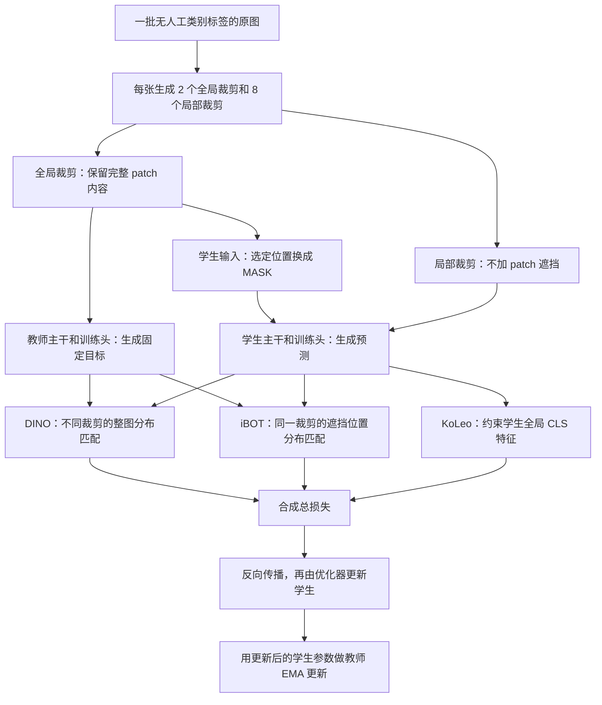

**DINOv2 最重要的作用，是把一张图像变成“包含物体、部件、场景等信息的特征”，而不是直接输出物体名称、检测框或三维坐标。**它既指一套自监督视觉训练方法，也常指用这套方法训练好的视觉编码器。其主干网络采用 ViT，也就是视觉 Transformer。[GitHub](https://github.com/facebookresearch/dinov2?utm_source=chatgpt.com)

你在 DINOv2 示意图中看到的彩色结果，常常是把特征经过 PCA 降维后画出来的。PCA 在这里用于把一长串数字压缩成少量数字，再用颜色展示；这是观察特征的一种方式，理解训练过程时可以先跳过。颜色不是人工规定的“红色代表头、蓝色代表腿”。论文观察到，一些具有相似语义的部件，即使来自不同姿态、不同风格的图像，也会表现出相近的特征结构。[arXiv](https://arxiv.org/html/2304.07193v2)

下面以**“机器人看到一张包含网球、球拍和球场的图像”**为主线，分别讲清：

**图像如何变成特征 → 特征怎么使用 → 没有人工标签时怎么训练 → 为什么这些设计有效。**

其中，真实模型的尺寸和结构来自官方实现；手算中的小向量、概率和权重是教学示例，不是某张网球图片的实测结果。

**第一次阅读，建议按这条顺序：[先补齐基础词汇](#dinov2-basics) → [第四章：一张照片怎样参与训练](#dinov2-training) → 第五章：其他方法各自解决什么问题。**真实尺寸、公式和训练伪代码放在文末选读附录。

---

<a id="dinov2-basics"></a>

# 零、先补齐几个词：后面每一步都要用到它们

这里按“你了解 DINO，但其他相关词还不熟悉”的起点来讲。第一次读，先看本节、第四章和第五章；第一至三章的公式、后面的应用扩展和附录，可以等训练过程清楚后再看。

## 0.1 参数是网络保存的数，特征是网络算出来的数

先看一个极小的计算器：

```text
输入一个数 → 乘以 w → 输出一个数
```

这里的 `w` 就是一个**参数**：它被保存在计算器中，可以通过训练调整。如果 `w=2`，输入 3 就输出 6，输入 5 就输出 10。

视觉网络也有很多这样的可调数字。**训练是在调整这些参数；使用模型时，则用学好的参数处理新图片。**

一张图片经过网络，会算出一串数，例如 `[0.8, 0.1, -0.3, 0.6]`。我们把这串数叫作**特征**，也常叫“表示”或“特征向量”。“向量”在这里先理解成“有顺序的一串数”，“四维向量”就是四个数。

参数与特征要分清：换一张图片，网络通常会算出另一串特征；只有执行训练更新，参数才会改变。也不要把某个特征维度直接当成“网球程度”，模型并没有得到这种人工定义。

## 0.2 一张图片切成小格子，每个格子有自己的描述

`patch` 就是**图像中的一个小块**。网络先把每一块像素转换成一串数，这串数作为该位置的 `token` 参与后续计算。

```text
某个小块的像素 → 数字描述 → 与其他位置交换信息 → 更新后的数字描述
```

每个小块保留自己的位置，最后可以分别取出它们的描述。网络还会放入一个特殊位置，用于汇集整张图的信息，叫 **CLS token**。因此可以得到两种结果：

| 取哪个位置的输出？ | 得到什么？ | 后文怎样称呼？ |
|---|---|---|
| CLS 位置 | 整张图的一串描述数字 | 整图特征、CLS 特征 |
| 某个 patch 位置 | 这个区域结合周围信息后的一串描述数字 | 局部特征、patch 特征 |

CLS 并不是人工写好的图片摘要。它参与网络计算，训练逐渐使它的输出适合表达整图信息。

## 0.3 主干负责提取描述，训练头负责把描述变成可比较的输出

**主干**是网络中主要的图像处理部分。**头**是接在后面、负责某个具体输出的小网络；它也有需要学习的参数。

```text
图片 → 主干 → 特征，例如 4 个数 → 训练头 → 比较用的分数，例如 3 个数
```

“4 个数变成 3 个数”不是挑出其中三个数，而是通过有参数的计算重新组合。真实维度往往更大，这里只用小数字解释关系。

在接下来的训练讲解中，整图特征接 DINO 头，局部特征接 iBOT 头；它们共用前面的主干。普通使用模型时，通常直接取主干特征。

## 0.4 batch、张量和形状，是装数据的方式

**batch** 就是“一批一起处理的原图”。例如这一轮取两张照片，原始 batch 大小就是 2；每张照片还可以再裁出多个版本。

**张量**可以先理解成“按多个维度排列的数据”。**形状**说明每一维有多少项。例如：

```text
[2, 16, 4]
 2：两张图
16：每张图有十六个小块
 4：每个小块用四个数描述
```

看到形状时，先把每个数字翻译成“一共有多少个什么”。后面的真实模型形状表放在附录 A，理解训练过程时可以先不看。

## 0.5 像素计算章节里的其他词，可以先这样读

下面这张表供遇到生词时回查，不需要先背下来。

| 词语 | 在本文中先怎样理解？ |
|---|---|
| embedding，嵌入 | 把输入转换成供网络处理的向量；patch embedding 就是把一块像素变成一串数 |
| 注意力 | 一个位置有选择地读取其他位置的信息，再更新自己的描述 |
| MLP，多层感知机 | 对一串数做几层带参数的变换；可以用来改变维度、重新组合信息 |
| FFN，前馈网络 | Transformer 中进一步处理每个位置内部特征的模块，常用 MLP 实现 |
| 残差连接 | 把某层处理前的输入与处理结果相加，让原有信息也有一条直接通路 |
| 位置编码 | 加入与网格位置有关的数字，让网络区分小块位于哪里 |
| LayerNorm，层归一化 | 调整每个 token 内部各维数值的尺度，帮助网络稳定计算 |
| L2 归一化 | 按向量长度缩放，使它变成单位长度；用于比较时减少长度差异的影响 |
| Transformer block | 注意力、前馈网络等步骤组成的一层处理单元，网络会重复使用多层 |

“归一化”是一个泛称。调整 token 内部数值、把向量变成单位长度、把分配比例整理到总和为 1，是不同操作，遇到时要看具体处理什么数据。

---

# 一、先分清：DINOv2、Transformer 和目标检测器是什么关系？

先把“网络怎样计算”和“怎样把网络训练好”分开看：

> **ViT 规定“图像在网络里怎么计算”；DINOv2 主要规定“怎样训练这个网络，让它学到通用的视觉特征”。**

所以，DINOv2 不是 Transformer 的替代品，而是利用 ViT 作为视觉主干，再通过特定的自监督目标进行训练。官方发布的模型可以输出整图特征和局部图像块特征。[GitHub](https://github.com/facebookresearch/dinov2?utm_source=chatgpt.com)

对同一张网球场图像，可以把三类东西区分开：

| 模块 | 输入 | 直接输出 |
|---|---|---|
| DINOv2 视觉主干 | 图像 | 整图特征、局部特征 |
| 在特征后接分类头 | 整图特征 | “网球场”等类别分数 |
| 在特征后接分割、深度等任务头 | 局部特征 | 类别图、深度图等任务结果 |

DINOv2 官方提供的下游使用方式，包括在冻结的特征后面接简单分类器，以及用于分割、深度估计的任务头。**“主干不用微调”不等于“所有下游任务都不需要标签或训练”。**[GitHub](https://github.com/facebookresearch/dinov2)

例如，裸 DINOv2 的输出可能是：

```text
整张图像：
[0.12, -0.83, 1.24, ..., 0.37]

网球所在区域：
[0.91, 0.13, -0.25, ..., 0.62]

球场地面区域：
[-0.48, 1.32, 0.07, ..., -0.16]
```

这些向量并不是：

```text
[网球概率, 球拍概率, 球场概率]
```

而是网络学出来的**表示坐标**。它们的用途在于：不同图像或不同区域之间的关系，可以通过这些向量进行比较、分类和进一步预测。

---

# 二、一张图像进入 DINOv2 后，数据究竟怎么流动？

我们固定使用一个具体模型：

**DINOv2 ViT-S/14，不带 register tokens 的版本。**

这里：

- `S` 表示 Small。
- `/14` 表示图像块大小为 \(14\times14\)。
- 每个 token 的特征维度为 384。
- 网络包含 12 个 Transformer block，每个 block 有 6 个注意力头。[GitHub](https://raw.githubusercontent.com/facebookresearch/dinov2/main/dinov2/hub/backbones.py)

为了统一后面的计算，假设预处理后的图像为：

\[
224\times224
\]

像素。

## 2.1 第一步：RGB 图像变成浮点张量

输入张量采用：

\[
X\in\mathbb{R}^{1\times3\times224\times224}
\]

四个维度分别表示：

```text
1   ：这一批只有一张图
3   ：RGB 三个通道
224 ：图像高度
224 ：图像宽度
```

官方预处理使用的通道均值和标准差为：

\[
\mu=[0.485,0.456,0.406]
\]

\[
\sigma=[0.229,0.224,0.225]
\]

每个通道的像素先除以 255，再进行标准化。[GitHub](https://raw.githubusercontent.com/facebookresearch/dinov2/main/dinov2/data/transforms.py)

例如，某个像素为：

\[
[R,G,B]=[128,200,50]
\]

则标准化后：

\[
\begin{aligned}
R'&=\frac{128/255-0.485}{0.229}\approx0.0741\\
G'&=\frac{200/255-0.456}{0.224}\approx1.4657\\
B'&=\frac{50/255-0.406}{0.225}\approx-0.9330
\end{aligned}
\]

因此，送入网络的并不是原始整数 RGB，而是这样的浮点数。

**为什么要这样做？**

最直接的原因是：预训练模型是在这种输入数值分布下学习的。使用时遵循相同的预处理，才能让输入和模型学到的参数相匹配。

---

## 2.2 第二步：把图像切成 256 个 patch

每个 patch，也就是一个图像块，大小为：

\[
14\times14
\]

因此，横向和纵向各有：

\[
224/14=16
\]

个 patch，总数为：

\[
N=16\times16=256
\]

此处 \(N\) 表示**图像块的数量，不包含之后添加的 CLS token**。

排列方式可以理解为：

```text
p0    p1    p2    ...  p15
p16   p17   p18   ...  p31
...
p240  p241  p242  ...  p255
```

每个 patch 包含的数值个数为：

\[
14\times14\times3=588
\]

把第 \(i\) 个 patch 展开为行向量：

\[
r_i\in\mathbb{R}^{588}
\]

随后进行线性投影：

\[
e_i=r_iW_E+b_E
\]

其中：

\[
W_E\in\mathbb{R}^{588\times384}
\]

是学习得到的投影矩阵，

\[
b_E\in\mathbb{R}^{384}
\]

是偏置，

\[
e_i\in\mathbb{R}^{384}
\]

就是这个 patch 的初始 token。

官方实现使用一个卷积核和步长均为 14 的卷积层，完成这个“切块加线性投影”的过程，再把结果展开成 token 序列。[GitHub](https://raw.githubusercontent.com/facebookresearch/dinov2/main/dinov2/layers/patch_embed.py)

因此数据尺寸发生如下变化：

```text
图像
[1, 3, 224, 224]
        ↓
每个 14×14 区域投影到 384 个数
[1, 384, 16, 16]
        ↓
展开空间网格
[1, 256, 384]
```

### 一个具体的空间对应关系

假设在缩放后的图像中，网球内部有一点：

\[
(u,v)=(145,90)
\]

这里 \(u\) 是横向像素坐标，\(v\) 是纵向像素坐标，均从 0 开始。

它属于：

\[
\text{列}=\lfloor145/14\rfloor=10
\]

\[
\text{行}=\lfloor90/14\rfloor=6
\]

对应的 patch 编号为：

\[
i=6\times16+10=106
\]

也就是说：

> **之后读取第 106 个 patch 的特征，就可以读取与这个图像区域对应的向量。**

这个 patch 覆盖的区域是：

\[
u=140\ldots153,\qquad v=84\ldots97
\]

不过要注意：经过后面的注意力计算，它的特征会包含其他区域的信息，不再只是这 \(14\times14\) 像素的独立描述。

---

## 2.3 第三步：加入 CLS token 和位置编码

### CLS token 是什么？

CLS token 是一个额外的、可学习的向量。

它不对应某个具体图像块，而是作为一个“整图信息汇聚位置”。刚进入网络时，它的初始值对不同图像相同；经过注意力计算后，它会变成与当前图像有关的特征。

添加之后：

```text
[CLS, p0, p1, ..., p255]
```

因此：

\[
[1,256,384]
\rightarrow
[1,257,384]
\]

### 为什么还要加入位置编码？

切块之后，网络拿到的是一串向量。

如果没有位置信息，仅从 token 集合中，它无法直接知道“这个区域在上方还是下方”。因此，需要给 token 加上与位置有关的向量：

\[
z_i=e_i+a_i
\]

其中 \(a_i\) 是位置编码。

DINOv2 使用可学习的位置编码；输入分辨率变化时，会对图像块的位置编码进行插值。官方代码随后把整个 token 序列送进 Transformer blocks。[GitHub](https://raw.githubusercontent.com/facebookresearch/dinov2/main/dinov2/models/vision_transformer.py)

**这里的位置编码是图像网格上的位置信息，不是相机坐标、三维坐标或机器人位姿。**

---

## 2.4 第四步：Transformer 让图像区域交换信息

现在输入某个 Transformer block 的张量为：

\[
Z\in\mathbb{R}^{1\times257\times384}
\]

单个注意力头的维度为：

\[
d_h=384/6=64
\]

注意力中的三个量分别是：

\[
Q=ZW_Q,\qquad K=ZW_K,\qquad V=ZW_V
\]

为了突出注意力本身，这里暂时省略输入归一化和偏置。

它们可以直观理解为：

**\(Q\)：当前区域需要寻找什么信息。**

**\(K\)：其他区域可以按什么特征被匹配到。**

**\(V\)：匹配到之后，实际传递什么信息。**

计算为：

\[
A=\operatorname{softmax}
\left(
\frac{QK^T}{\sqrt{d_h}}
\right)
\]

\[
Y=AV
\]

其中 \(A\) 是区域之间的信息混合权重，\(Y\) 是混合之后的新信息。实际实现会把 6 个头的结果拼接，再进行输出投影。[GitHub](https://raw.githubusercontent.com/facebookresearch/dinov2/main/dinov2/layers/attention.py)

真实模型中的数据尺寸为：

```text
输入
[1, 257, 384]
        ↓
Q、K、V 分成 6 个头
各为 [1, 6, 257, 64]
        ↓
注意力权重
[1, 6, 257, 257]
        ↓
加权汇总、拼接各个头
[1, 257, 384]
```

### 用一组具体数字看：一个网球区域如何混入上下文？

把真实的 257 个 token、384 维，缩小为下面这个手算例子：

**5 个 token，每个 4 维。**

假设某一层的输入为：

| Token | 输入向量 |
|---|---|
| CLS | \([0.5,0.5,0,0.5]\) |
| 网球区域 A | \([1,1,0,1]\) |
| 网球区域 B | \([1,0.9,0.1,0.8]\) |
| 球场地面 | \([0,0.6,0,0]\) |
| 白色场线 | \([1.1,1.1,1,0]\) |

这些数值只用于说明运算，不代表真实特征的某一维具有固定含义。

为了让算术容易检查，我们在这个玩具注意力层里取：

\[
W_Q=W_K=W_V=I
\]

也就是：

\[
Q=K=V=Z
\]

并暂时省略 LayerNorm、多头和输出投影。

对于“网球区域 A”，查询向量为：

\[
q_A=[1,1,0,1]
\]

它与所有 token 的打分为：

\[
\frac{q_AK^T}{\sqrt4}
=
[0.75,\ 1.5,\ 1.35,\ 0.3,\ 1.1]
\]

例如，对网球区域 B 的打分是：

\[
\frac{
1\times1+1\times0.9+0\times0.1+1\times0.8
}{2}
=1.35
\]

经过 softmax：

\[
\alpha_A
\approx
[0.1429,\ 0.3026,\ 0.2605,\ 0.0911,\ 0.2028]
\]

随后计算加权和：

\[
\begin{aligned}
y_A={}&
0.1429\,z_{\mathrm{CLS}}
+0.3026\,z_A\\
&+0.2605\,z_B
+0.0911\,z_{\mathrm{地面}}
+0.2028\,z_{\mathrm{场线}}
\end{aligned}
\]

得到：

\[
y_A
\approx
[0.8577,\ 0.8863,\ 0.2289,\ 0.5824]
\]

再加上残差：

\[
z_A'=z_A+y_A
\]

所以：

\[
z_A'
\approx
[1.8577,\ 1.8863,\ 0.2289,\ 1.5824]
\]

这一步的意义是：

> **网球区域 A 的新特征，不再只来自它自己的像素，还混入了另一块网球区域、地面、场线以及整图汇聚位置的信息。**

同样计算 CLS token，加入注意力残差后，可以得到：

\[
z_{\mathrm{CLS}}'
\approx
[1.2965,\ 1.3559,\ 0.2289,\ 1.0237]
\]

它也从初始向量变成了与图像内容有关的向量。

但这组手工设置的参数只说明“信息怎样流动”，**还不能证明模型已经理解了网球。哪些区域应该交换什么信息，需要依靠后面讲的训练来学出来。**

---

## 2.5 第五步：残差、归一化和前馈网络进一步处理特征

真实的 DINOv2 block 不只有注意力，还包含 LayerNorm、残差连接、LayerScale 和前馈网络。

推理时可以写成：

\[
U
=
Z+
\gamma_1\odot
\operatorname{Attention}(\operatorname{LN}(Z))
\]

\[
Z'
=
U+
\gamma_2\odot
\operatorname{FFN}(\operatorname{LN}(U))
\]

其中：

- \(\operatorname{LN}\) 是 LayerNorm，调整每个 token 内部的数值分布。
- \(\operatorname{FFN}\) 是逐 token 的前馈网络，进行非线性的通道变换。
- \(\gamma_1,\gamma_2\) 是可学习的逐通道缩放系数。
- \(\odot\) 表示逐元素相乘。

对于这里的 ViT-S，前馈网络的维度变化为：

\[
384\rightarrow1536\rightarrow384
\]

注意力负责**区域之间交换信息**，前馈网络负责**对每个区域内部的特征做进一步加工**。这些模块和残差结构对应官方实现。[GitHub](https://raw.githubusercontent.com/facebookresearch/dinov2/main/dinov2/layers/block.py)

经过 12 个 block 后：

```text
[1, 257, 384]
        ↓
Block 1
        ↓
Block 2
        ↓
...
        ↓
Block 12
        ↓
最终 LayerNorm
[1, 257, 384]
```

token 的数量和维度没有变，**变化的是每个向量包含的信息**。

---

## 2.6 最终得到两类特征

把 CLS 和 patch tokens 分开：

### 整图特征

\[
g\in\mathbb{R}^{1\times384}
\]

在官方接口中是：

```python
features["x_norm_clstoken"]
```

### 局部特征

\[
F\in\mathbb{R}^{1\times256\times384}
\]

在官方接口中是：

```python
features["x_norm_patchtokens"]
```

局部特征可以恢复成网格：

\[
[1,256,384]
\rightarrow
[1,384,16,16]
\]

这些输出来自同一个主干的不同 token，并不是两个独立网络。[GitHub](https://raw.githubusercontent.com/facebookresearch/dinov2/main/dinov2/models/vision_transformer.py)

整个推理过程可以总结为：

```text
RGB 图像
[1,3,224,224]
        ↓
Patch embedding
[1,256,384]
        ↓
加入 CLS 和位置编码
[1,257,384]
        ↓
12 层 Transformer
[1,257,384]
        ↓
最终归一化
        ├── 整图特征 [1,384]
        └── 局部特征 [1,256,384]
```

---

# 三、这些特征到底有什么用？先看两个具体例子

## 3.1 例子一：给定一个网球区域，寻找其他相似区域

继续使用前面的像素：

\[
(u,v)=(145,90)
\]

它对应 patch 106。

我们可以取：

\[
q=F_{106}
\]

这里的 \(q\) 表示“参考区域的特征”，不是前面注意力内部的查询矩阵 \(Q\)。

为了手算，把 384 维特征缩成 4 维。假设参考网球区域的特征为：

\[
q=[0.9,0.1,0.3,0.1]
\]

另一张图中的三个候选区域为：

\[
f_1=[0.85,0.12,0.28,0.08]
\]

\[
f_2=[0.1,0.9,0.1,0.3]
\]

\[
f_3=[0.2,0.2,0.9,0.1]
\]

用余弦相似度比较：

\[
s(q,f)
=
\frac{q^Tf}{\|q\|_2\|f\|_2}
\]

其中 \(\|\cdot\|_2\) 表示向量长度。

得到：

| 候选区域 | 教学设定中的内容 | 余弦相似度 |
|---|---|---:|
| \(f_1\) | 另一块网球区域 | 0.9995 |
| \(f_2\) | 球场地面 | 0.2609 |
| \(f_3\) | 球拍区域 | 0.5275 |

所以，按照特征相似度，第一块区域是最接近参考网球区域的候选。

完整数据流是：

```text
参考图像 → DINOv2 → 取出网球区域特征 q
                                    │
另一张图 → DINOv2 → 所有区域特征 F ───┤
                                    ↓
                             逐区域计算相似度
                                    ↓
                               相似度分布图
```

DINOv2 论文确实展示了利用 patch 特征进行跨图像匹配的能力；但上面的具体数值只是示例，不是对网球任务准确率的承诺。[arXiv](https://arxiv.org/html/2304.07193v2)

这里有两个重要边界：

**相似度不是“网球概率”。**例如 0.9 不意味着“90% 的概率是网球”。

**语义相似不等于同一个物理点。**两个不同网球，甚至同一物体上结构相近的区域，都可能具有相似特征。因此，几何匹配还需要结合其他约束。

---

## 3.2 例子二：训练一个很小的分类头，实现球场区域分割

假设任务只有三类：

```text
0：网球
1：球拍
2：背景
```

我们不重新训练整个 DINOv2，而是在每个 patch 特征后面接一个线性层：

\[
\ell_i=F_iW_c+b_c
\]

其中：

\[
W_c\in\mathbb{R}^{384\times3}
\]

是分类头权重，

\[
b_c\in\mathbb{R}^{3}
\]

是偏置，

\[
\ell_i\in\mathbb{R}^{3}
\]

是第 \(i\) 个区域的三个类别分数。

数据流为：

```text
DINOv2 patch 特征
[1,256,384]
        ↓
Linear(384,3)
[1,256,3]
        ↓
恢复空间排列
[1,3,16,16]
        ↓
上采样到输入图像大小
[1,3,224,224]
        ↓
每个位置选择类别
```

DINOv2 的价值在于：**大量通用视觉知识已经包含在特征中，下游不必完全从原始像素开始学习。**官方提供了冻结主干后训练线性分割头等使用方式。[GitHub](https://github.com/facebookresearch/dinov2)

但要区分：

> DINOv2 学会了有用的表示；  
> “第 0 类叫网球、第 1 类叫球拍”这件事，是下游标签和任务头赋予的。

另外，把 \(16\times16\) 的分数图插值到 \(224\times224\)，只是增加输出采样点，并不自动补回已经丢失的精细边界。

---

<a id="dinov2-training"></a>

# 四、从你熟悉的 DINO 出发，理解其他部分怎样参与训练

你了解的 DINO，可以先作为这条主线的起点：**同一张照片生成不同版本，让学生对这些版本的整图判断，接近教师给出的整图目标。**这部分只作衔接，下面重点解释其他概念。

这一章先讲从头进行自监督预训练。所谓**自监督**，就是从图片本身和人为设计的任务中产生学习信号，不需要人工为每张训练图片标出类别。教师在这个阶段怎样产生、怎样更新，会在 4.5 节说明；已经训练好的大模型指导小模型，是第六章的另一个阶段。

## 4.1 用同一张照片做两道题：整图题与局部题

继续使用网球场照片。先给它准备两个较大的裁剪版本：

```text
网球场原图
├── 大裁剪甲：可能看到网球、球拍和一部分球场
└── 大裁剪乙：另一个较大的区域，内容可能与甲部分重叠
```

“裁剪版本”也叫**视图**。这里是同一张二维照片的不同取景，不要求移动相机。还可以改变亮度、颜色或模糊程度，这些人为变化统称为**数据增强**。

为了方便理解，先只看这两个大裁剪。实际训练还会生成多个小裁剪；小裁剪主要参加你熟悉的整图 DINO 学习，具体数量不会改变下面的基本逻辑。

现在有两道不同的题：

| 题目 | 学生拿到什么？ | 学生要靠近什么目标？ |
|---|---|---|
| 整图题：DINO | 这张原图的某个裁剪版本 | 教师对同一原图另一个裁剪版本给出的整图分布 |
| 局部题：iBOT | 某个大裁剪，但有几块内容被遮住 | 教师看到该裁剪完整内容后，对这些位置给出的局部分布 |

**DINO 关注整张裁剪的表示，iBOT 关注裁剪内部的某些小块。**它们在同一轮训练中共同起作用。[官方训练流程](https://github.com/facebookresearch/dinov2/blob/main/dinov2/train/ssl_meta_arch.py)

## 4.2 iBOT：教师看得到这一块，学生要利用周围信息作答

把“大裁剪甲”简化画成 4×4 个小块。这个小网格仅用于讲解，真实数量见附录。

```text
教师拿到：                         学生拿到：

地面  地面  球拍  地面             地面  地面  球拍  地面
地面  网球  网球  地面             地面  遮住  网球  地面
场线  场线  地面  地面             场线  场线  地面  地面
地面  地面  地面  地面             地面  地面  地面  地面
```

这些文字是为了让我们知道图中有什么，训练程序接收的是图像数字，没有“这里是网球”的人工标签。两边的格子位置一一对应。

实际代码里，“遮住”发生在小块像素转换成数字描述之后：**用一个专门的占位向量替换这一块的初始描述**。这个占位向量叫 **MASK token**，含义相当于“这里内容暂时不可见”。格子的位置仍然保留。[遮挡实现](https://github.com/facebookresearch/dinov2/blob/main/dinov2/models/vision_transformer.py)

学生处理这张图时，被遮住的位置仍参与计算。它可以通过注意力从旁边的网球部分、场线和其他可见位置获取信息，所以最后也能在这里输出一串数字。这里的“注意力”先理解为：一个位置有选择地读取其他位置的描述。

**iBOT 就要求：这串输出经过学生训练头后，要接近教师在同一位置给出的目标分布。**[iBOT 损失实现](https://github.com/facebookresearch/dinov2/blob/main/dinov2/loss/ibot_patch_loss.py)

```text
大裁剪甲，内容完整                   同一个大裁剪甲，某块内容被遮住
        ↓ 教师主干                           ↓ 学生主干
该位置的局部特征                     该位置利用周围信息得到的局部特征
        ↓ 教师 iBOT 头                       ↓ 学生 iBOT 头
教师目标分布                         学生预测分布
        └────────────────┬──────────────────┘
                         ↓
                   比较两者的差异
```

这样设计，是为了给网络一个“需要利用区域关系与上下文”的学习任务。它不要求学生把遮住的像素画回来，也不保证每一块都能被准确猜出；训练是在大量图片上持续改进这种预测能力。

这里必须固定的是**同一个裁剪的同一个位置**。换成“大裁剪乙”的同编号小块，里面可能已经是另一片地面，不能直接拿来当这块网球的局部目标。

## 4.3 分数、分布、原型：训练头究竟输出了什么？

先把网络输出分成三个阶段：

```text
小块的特征                 训练头输出的原始分数           整理后的分配比例
[0.8, 0.1, -0.3, 0.6]  →  [2, 1, 0]                 →  [0.665, 0.245, 0.090]
```

这些都是教学数字。前一串是对小块的描述；中间一串是拿去比较的分数，常叫 **logits**；最后一串是非负、相加等于 1 的比例，叫**分布**。

把学生的原始分数变成这种分布，常用一个叫 **softmax** 的计算。现在只需要记住它的效果：高分得到较大的分配比例，所有位置的比例加起来为 1。教师目标还会经过第五章讲的整理步骤。

假设为了讲解只设三个输出位置，可以把它们想成三个编号的“分配槽位”：

| 输出位置 | 教师目标 | 学生预测 |
|---|---:|---:|
| 槽位 1 | 0.90 | 0.40 |
| 槽位 2 | 0.05 | 0.40 |
| 槽位 3 | 0.05 | 0.20 |

教师希望主要分给槽位 1，学生目前还分散在另外两个槽位上，训练会推动学生调整。

训练头中这些学习出来的匹配方向常叫**原型**。它们没有人工类别名称；表格不表示“90% 是网球”。iBOT 只比较教师 iBOT 头与学生 iBOT 头的对应位置，DINO 则使用自己的训练头。

**整图题和局部题使用相同的比较思路，区别在于拿哪个位置的特征、经过哪个训练头，以及哪两个观察互相配对。**

## 4.4 损失、梯度、反向传播：网络怎样从“有差异”变成“参数改变”？

**损失**就是用来评价当前预测与训练目标差异的一个数。在固定目标下，训练希望让这个数下降。DINO 和 iBOT 使用的比较方法叫**交叉熵**：教师在哪些槽位分配得多，就重点推动学生也给那些位置足够的分配。

按照上一节的三个槽位，iBOT 的这一项损失约为 0.951；求值过程放在附录 A。理解主线时，先抓住“预测和目标进入比较计算，得到一个数”。

接下来要改变的是网络中的**参数**。用一个独立的小练习解释这件事；练习采用简单的平方差，不是 DINO 的真实损失：

```text
小计算器：输出 = 输入 × 参数 w
本次输入：2
希望输出：3
当前参数：w = 1

所以当前输出为 2，平方差损失为 (2 - 3)² = 1。
```

根据这个计算关系，可以求出：在当前位置，增大 `w` 会让损失下降。描述“参数变化如何影响损失”的量就叫**梯度**；这个例子中梯度是 -4，按梯度下降规则，应向增大 `w` 的方向调整。

若本次把 `w` 调到 1.4：

```text
新输出 = 2 × 1.4 = 2.8
新损失 = (2.8 - 3)² = 0.04
```

这个例子只需要理解：**我们根据输出的误差，找到了修改内部参数的方向；重新计算时，输出就改变了。**

视觉网络里同样如此，只是有很多层、很多参数。**反向传播**按这些层的计算关系，从损失开始向前面的层计算梯度；**优化器**根据梯度执行参数更新。每次调整的幅度受**学习率**控制。

```text
图片 → 学生主干 → 学生训练头 → 预测分布 → 损失
          ↑              ↑
          └── 反向传播计算这些参数的梯度 ──┘
                         ↓
                优化器修改学生参数
```

整图损失经 DINO 头传回主干，局部损失经 iBOT 头传回同一个主干。它们共同影响主干以后怎样处理图片。教师的目标在本次比较时当作固定数据，不通过这些损失求教师梯度。

因此，学到的内容保存在网络参数里。训练后的新图片，也会经过这些已经调整过的参数来计算特征。

## 4.5 EMA：教师这一轮不反向学习，它靠什么进步？

在这里讲的**从头自监督预训练**中，教师最开始复制学生的参数；它不是预先知道“什么是网球”的标准答案库。

每次先通过损失更新学生，再让教师的每个对应参数向学生靠近一点。更新规则用白话写是：

```text
新教师参数 = 保留大部分旧教师参数 + 混入少量新学生参数
```

例如保留 99% 旧值，混入 1% 学生新值：

```text
教师旧参数：1.0
学生更新后：1.1

教师新参数 = 0.99 × 1.0 + 0.01 × 1.1 = 1.001
```

它没有立刻跳到 1.1。多轮下来，教师综合了学生不同时刻的参数，并更重视近期值，这就是 **EMA：指数移动平均**。这里的 99% 是讲解用的数字。

这样做能使教师目标变化得更平缓。它平均的是对应位置的网络参数；教师下一轮再用更新后的参数处理输入、产生新目标。**教师与学生是两个网络副本，“教师”只是它负责提供目标这个角色的名字。**[初始化与 EMA 实现](https://github.com/facebookresearch/dinov2/blob/main/dinov2/train/ssl_meta_arch.py)

即使初始参数相同，教师和学生也会因为裁剪不同或遮挡不同，产生不同输出；这些差异提供了学习信号。目标有用还需要其他设计共同支持，第五章会解释。

**最开始的教师也还没有学会物体含义，它的输出只是当前的学习参照。**训练不是把一份已经完美的答案反复抄给学生，而是让网络持续练习跨裁剪一致、利用上下文预测局部等任务，并约束它保留区分能力。学生变化后，教师又通过 EMA 更新参照，形成反复改进的过程。

这里的解释是在说明训练压力如何产生。它不意味着每一次更新都会让教师更正确，也不是仅靠 EMA 就能学出视觉知识；图片内容、任务设计、防坍塌措施和训练规模都参与其中。

## 4.6 完整训练一次，只做下面这些事

**一次迭代**就是“用当前一批数据完成一次更新”。**batch** 是这一批原图；实际会同时使用很多照片，这里只跟踪其中的网球场照片。

```text
① 取图片
   取出网球场照片，程序没有拿到“网球场”的人工类别标签。
        ↓
② 准备不同观察
   生成两个大裁剪、若干小裁剪，并选定部分大裁剪的小块作为遮挡位置。
        ↓
③ 教师生成目标
   看未遮挡的大裁剪，输出整图目标和指定位置的局部目标。
        ↓
④ 学生生成预测
   看部分内容被遮挡的大裁剪，以及小裁剪，输出自己的预测。
        ↓
⑤ 比较
   整图题：不同裁剪的整体分布进行 DINO 比较。
   局部题：同一大裁剪的对应遮挡位置进行 iBOT 比较。
   再加入第五章解释的约束，汇总为总损失。
        ↓
⑥ 更新学生
   反向传播求梯度，优化器更新学生主干和训练头的参数。
        ↓
⑦ 更新教师
   用新学生参数对教师做一次 EMA 更新。
        ↓
⑧ 换下一批图片
   重新随机裁剪、选择遮挡位置、计算目标，再做下一次迭代。
```

**前向计算**指的是第③④步这样的“输入经过网络得到输出”；它本身不会把网络训练好。真正的参数改变发生在第⑥⑦步。官方训练循环也是先更新学生，再更新教师。[训练循环](https://github.com/facebookresearch/dinov2/blob/main/dinov2/train/train.py)

到这里，先建立这条因果关系：**教师给出当前目标，学生在更困难或不同的观察下尝试接近它，损失把差异传到学生参数，教师再慢慢跟随学生。**

接下来还需要保证：这套任务不能被“所有图片都给同一个答案”轻易敷衍过去。

---

# 五、温度、Sinkhorn、KoLeo：先看它们各自在防什么问题

这些词描述的是训练中的不同处理步骤。这里先从问题出发，再把名字与具体操作对应起来。

## 5.1 所有图片都给相同答案，就失去了区分能力

假设网络对网球、猫和汽车，始终输出同一个特征 `[1, 0, 0, 0]`。这样，同一张图的不同裁剪自然也相同，但后续再比较特征，就分不清看到了什么。

这叫**表示坍塌**：“表示”就是特征，“坍塌”就是原本应有区别的内容挤成了一种结果。

因此训练需要同时兼顾两件事：同一张图的不同观察有联系，大量不同图像的表示又要保留区分能力。下面的处理步骤共同服务于这个目标，不能把其中任何一个单独当成保证成功的开关。

## 5.2 温度：控制分配比例有多明显的偏好

第四章中，训练头先给出原始分数，再把分数整理成分布。**温度**是在这个转换中使用的一个数，用来调节分布偏好的明显程度；这里不涉及物理温度。

同一组原始分数 `[2, 1, 0]`，用不同温度进行 softmax：

| 温度 | 整理后的分配比例，约值 | 看起来有什么变化？ |
|---|---|---|
| 1 | `[0.665, 0.245, 0.090]` | 已偏向第一个位置 |
| 0.5 | `[0.867, 0.117, 0.016]` | 更明显地偏向第一个位置 |

所谓**分布更尖锐**，就是较大的分配比例更集中到少数位置；所谓更平缓，就是各位置差距较小。

它发生在“训练头已经给出分数，接下来准备拿去比较”的地方。学生与教师有各自的温度；表格只展示简单 softmax 的效果，教师还会经过下一节的处理。[温度实现](https://github.com/facebookresearch/dinov2/blob/main/dinov2/loss/dino_clstoken_loss.py)

先记住它的作用：**让分配偏好更清楚或更平缓。**温度越低不代表训练越好；如果所有图片都只偏向同一个位置，仍然没有区分能力。

## 5.3 Sinkhorn-Knopp：查看一整批目标的分配，避免只偏爱少数槽位

名字可以暂时只记成 **Sinkhorn**。它整理的是**一批教师输出的分配表**。

继续假设只有三个槽位，把三张不同图片的教师目标并排摆出来：

| 输入图片 | 槽位 1 | 槽位 2 | 槽位 3 |
|---|---:|---:|---:|
| 图片 A | 0.98 | 0.01 | 0.01 |
| 图片 B | 0.98 | 0.01 | 0.01 |
| 图片 C | 0.98 | 0.01 | 0.01 |

每一行看起来都有很明确的偏好，但整批图片几乎只使用槽位 1。光调低温度，可能只是让这种偏好更强。

Sinkhorn 会交替调整各行、各列的分配量，兼顾两个要求：**每张图片的分配比例加起来为 1，整批数据又不要把分配量都挤到少数槽位。**这类“按整体数量重新缩放”的操作叫**归一化**。

下面只是展示“每行有偏好、整批又比较平衡”的一种可能结果，不是上表运行算法后的实测输出：

| 输入图片 | 槽位 1 | 槽位 2 | 槽位 3 |
|---|---:|---:|---:|
| 图片 A | 0.8 | 0.1 | 0.1 |
| 图片 B | 0.1 | 0.8 | 0.1 |
| 图片 C | 0.1 | 0.1 | 0.8 |
| 每列总量 | 1.0 | 1.0 | 1.0 |

算法不是按图片序号轮流分配，也不知道哪张图片是猫；它根据原有分数进行迭代调整。这里的“平衡”也不表示强迫每张图都输出 `[1/3, 1/3, 1/3]`。

```text
一批教师分数 → 按温度处理并整理分配表 → 一批教师目标 → 与学生预测算损失
```

它对整图目标和局部目标分别处理。真实的大模型可以有远多于三个的槽位，操作的性质相同。[教师分配实现](https://github.com/facebookresearch/dinov2/blob/main/dinov2/loss/dino_clstoken_loss.py)

**整体平衡只约束分配方式，不能单靠它推出“网络已经学会物体语义”。**例如所有图片都输出均匀分布，整体也可以平衡，所以还需要结合其他训练设计。

## 5.4 KoLeo：直接检查不同图片的特征是否挤在一起

上一节查看的是“经过训练头之后，输出槽位怎么分配”。**KoLeo 查看的是“经过学生主干后，不同图片的整图特征相距多远”。**

先把每张图的整图特征想成一个空间中的点。为了画在纸上，下面只用二维点说明；真实特征有更多维度。

```text
特征几乎相同：                 特征分散一些：

       ABC                       A       B

                                     C
```

左边三个点几乎重叠，难以用特征区分这些图片。KoLeo 对每张图片找出特征最接近的另一张图片；如果它们靠得过近，就给训练损失增加相应的惩罚，推动特征分布得更开一些。

“最接近的另一个点”叫**最近邻**。这里的远近在对向量长度做统一处理后比较，因此不能简单靠把所有特征数值放大来应付这个约束。[KoLeo 实现](https://github.com/facebookresearch/dinov2/blob/main/dinov2/loss/koleo_loss.py)

像这样，在主任务之外加入一个偏好的约束或惩罚，叫**正则化**；这部分额外的损失叫**正则项**。本例希望特征不要过度聚集，所以 KoLeo 是一个正则项。

它不接收“猫、狗、网球”等类别标签，也不是要求每两张不同图片都必须变得完全不同。这里只是给整批特征增加一种避免过度拥挤的训练压力。

## 5.5 把这些作用放回训练图中

```text
图片 → 学生主干 → 整图特征 ─────────────→ KoLeo：检查特征是否过度拥挤
                     ↓ 学生训练头
                   原始分数
                     ↓ 学生温度与 softmax
                   预测分布 ───┐
                              ↓
                            交叉熵 → 反向传播 → 更新学生
                              ↑
图片 → 教师主干 → 教师训练头 → 教师温度与 Sinkhorn → 目标分布
```

这张图用整图路径说明各操作的位置；局部 iBOT 路径在选定的小块位置也生成预测与目标，再参与损失计算。

| 名称 | 具体处理什么？ | 这一遍先记住什么？ |
|---|---|---|
| iBOT | 同一裁剪中被遮挡位置的预测与教师目标 | 让学生练习利用可见区域预测局部表示 |
| 温度 | 从分数转成分布时的偏好强弱 | 控制分配比例的集中程度 |
| Sinkhorn | 一批教师输出的分配表 | 兼顾单行归一化与整批原型分配平衡 |
| KoLeo | 不同图片的学生整图特征 | 给过度拥挤的特征增加惩罚 |
| EMA | 教师与学生的对应参数 | 让教师缓慢跟随学生，平滑目标变化 |

训练把主任务损失和正则项按权重相加，形成**总损失**；权重就是控制各项在汇总时占多少分量的系数。优化器根据总损失的梯度更新学生。

现在可以用直观的话描述整套配合：**DINO 练整图的稳定表示，iBOT 练局部的上下文预测；温度、教师分配平衡与特征分散约束帮助训练保留区分能力；EMA 让提供目标的教师变化平缓。**这些机制与数据、训练规模共同作用，学出的能力要靠实验检验。

想继续核对张量尺寸和公式时，再阅读文末的[附录 A](#dinov2-training-details)和[附录 B](#dinov2-collapse-details)。

---

# 六、为什么这些约束最后会形成“语义特征”？

这里的**语义**指物体、部件、场景等内容层面的联系。例如，两只颜色、姿态不同的猫，如果特征仍能体现相近的结构，就比只看颜色更接近我们关心的内容。说“具有语义特征”不表示网络已经会输出“猫”这个中文名称。

这里最容易被讲成一句空话：

> “因为模型看了很多图，所以理解了世界。”

更具体地说，可以从训练压力来理解。

假设模型只依赖颜色，那么同一张网球图像经过颜色扰动后，就很难保持一致。

假设模型只依赖物体出现的位置，那么随机裁剪和缩放后，也很难保持一致。

假设模型只记住完整场景模板，那么看到局部裁剪或被遮挡的区域时，就难以完成预测。

假设模型对什么都输出相同结果，又会失去多样性并受到相应约束。

因此，一种有利的解决方向是：

> 提取那些在外观变化下相对稳定、同时又能够区分图像和区域的结构信息。

这可以包括形状、纹理组合、物体部件和场景布局。

**这是对训练机制的解释，不是“这些损失必然推出人类语义”的数学保证。**论文展示的部件对应、特征可视化和下游表现，是这种能力出现的实验证据。[AI.Meta](https://ai.meta.com/blog/dino-v2-computer-vision-self-supervised-learning/?utm_source=chatgpt.com)

还有两个容易忽略的因素。

### 数据规模和质量很重要

DINOv2 使用了经过整理的约 1.42 亿张图像，而不是只靠一个新损失函数。其工作也专门强调了数据整理、训练稳定性和规模化实现。[GitHub](https://github.com/facebookresearch/dinov2?utm_source=chatgpt.com)

这一步通常叫**预训练**：先用大量图片学习通用特征。之后用这些特征做分类、分割、深度估计等具体工作，叫**下游任务**。下游是否还需要标签或训练，取决于具体任务和使用方式。

### 整图和局部任务需要不同的训练出口

整图目标强调跨裁剪的一致性，局部目标强调具体位置的表示。DINOv2 的大模型训练使用分离的 DINO 和 iBOT 投影头，但它们仍然连接在同一个主干上。[GitHub](https://raw.githubusercontent.com/facebookresearch/dinov2/main/dinov2/configs/train/vitg14.yaml)

这不是训练两个互不相关的视觉模型，而是在同一套视觉表示上施加不同层级的约束。

---

## 一个重要补充：你前面使用的 ViT-S/14，是怎样得到的？

第四章展开的是**从头进行自监督预训练**。官方的小模型还会从已经训练好的 ViT-g 学习；这个过程叫**知识蒸馏**，可以先理解为“让更小的网络练习模仿训练好的大网络”。

小模型一般需要更少的计算和存储，所以训练大模型后，还会希望把它的部分能力传给小模型。此时给目标的大教师已经训练好，并被**冻结**：它的参数保持不变，照常处理输入、产生输出。

“冻结”不是停止运行网络，而是停止修改它的参数。两个训练阶段可以这样对照：

| 比较项 | 大模型自监督预训练 | 从大模型蒸馏小模型 |
|---|---|---|
| 教师最初从哪里来？ | 从学生参数复制得到 | 已经训练好的大模型 |
| 教师与学生结构 | 相同，例如都是 ViT-g | 不同，例如 ViT-g 指导 ViT-S |
| 谁接受损失梯度？ | 学生 | 学生 |
| 提供目标的教师怎样更新？ | 跟随学生做 EMA | 冻结，不随小学生更新 |
| 学生输入是否做 patch 遮挡？ | 部分全局视图做遮挡 | 移除这种遮挡 |
| patch 级学习目标 | 匹配选定遮挡位置的教师分布 | 在两个全局裁剪上进行 iBOT 学习 |
| EMA 的作用 | EMA 教师持续提供学习目标 | 另存一份学生 EMA，作为最终小模型 |

论文的蒸馏配方还移除了随机深度（stochastic depth，即训练时随机跳过部分网络分支的一种机制）。第一次阅读先关注表格中的教师来源和更新方式：**蒸馏时，“给答案的大教师”和“保留作最终模型的学生 EMA”是两份不同的网络。**[论文：Model distillation](https://arxiv.org/html/2304.07193v2#S5)

```text
已经训练好的大教师 ViT-g，冻结参数
        ↓ 根据输入视图，产生整图和 patch 级目标分布
训练较小的学生，例如 ViT-S
        ↓ 损失反向传播，优化器更新学生
对小学生参数另外维护 EMA
        ↓ 训练结束，取这份 EMA 主干
你加载的 ViT-S/14：输入图像 → 384 维整图特征和 patch 特征
```

大教师的主干特征是 1536 维，小学生的主干特征可以是 384 维；**两者经过各自的训练头后，可以在相同维数的原型分布空间中计算损失**，所以不需要直接拿 1536 维和 384 维特征逐元素相减。

因此，阅读第四章时，要把“教师是学生 EMA”限定在所讲的自监督预训练阶段。阅读小模型蒸馏时，则要跟踪“固定大教师 → 训练小学生 → 保留学生 EMA”这条数据与参数更新链路。

---

# 七、补充理解 register tokens：它们不是图像块，也不是跨帧记忆

这一节是选读，不影响前面训练主线的理解。

你在代码里可能还会看到：

```text
dinov2_vits14_reg
```

这是带 register tokens 的版本。

可以把 register tokens 先想成网络额外准备的几张“草稿纸”：它们与图像块的描述一起参与计算，但没有各自对应的图像小块。

相关研究观察到，部分 ViT 会借用某些背景位置的 token 进行内部计算，使这些位置产生长度异常大的特征向量；向量的长度在这里也叫“范数”。加入额外的 register tokens，为这些内部计算提供位置，可以改善局部特征图。这个“草稿纸”比喻只用于理解额外计算位置的作用。[arXiv](https://arxiv.org/abs/2309.16588?utm_source=chatgpt.com)

官方版本使用 4 个 register tokens。[GitHub](https://raw.githubusercontent.com/facebookresearch/dinov2/main/dinov2/hub/backbones.py)

所以，对于同样的 \(224\times224\) 输入：

```text
普通版本：
1 个 CLS + 256 个 patch
= 257 个 token

register 版本：
1 个 CLS + 4 个 register + 256 个 patch
= 261 个 token
```

最终局部图像特征仍然只有 256 个位置。

**register 不对应额外像素，不是“多出四个物体”，也不是在不同视频帧之间持久保存的记忆。**在图像主干的前向处理中，它们是参与注意力计算的额外 token。[GitHub](https://raw.githubusercontent.com/facebookresearch/dinov2/main/dinov2/models/vision_transformer.py)

---

# 八、把它放进你的机器人系统，应该放在哪一层？

这一章是应用扩展，可以在训练过程读懂后再看。它讨论怎样使用学好的特征，不是新增的预训练步骤。

## 8.1 与 SLAM 配合：特征负责“内容”，几何负责“位置”

一种可以设计的集成方式是：

```text
RGB 图像
    ↓
DINOv2
    ↓
区域特征 / 语义预测
    │
    ├──────── 双目或深度传感器给出深度
    │
    └──────── SLAM 给出相机位姿
                    ↓
               带视觉特征的三维地图
```

注意，这是一条系统集成思路，不是裸 DINOv2 自己输出三维地图。

继续使用前面的像素：

\[
(u,v)=(145,90)
\]

假设与当前 \(224\times224\) 图像坐标对应的内参为：

\[
f_x=f_y=200,\qquad c_x=c_y=112
\]

并且双目或深度传感器测得该点的相机光轴深度：

\[
Z=2\ \mathrm m
\]

则根据针孔投影模型：

\[
X=\frac{u-c_x}{f_x}Z
=
\frac{145-112}{200}\times2
=
0.33\ \mathrm m
\]

\[
Y=\frac{v-c_y}{f_y}Z
=
\frac{90-112}{200}\times2
=
-0.22\ \mathrm m
\]

于是相机坐标为：

\[
p_c=
[0.33,-0.22,2]^T
\]

再利用 SLAM 给出的相机到世界变换：

\[
p_w=R_{wc}p_c+t_{wc}
\]

其中 \(R_{wc}\) 是旋转，\(t_{wc}\) 是平移。

随后可以给这个三维位置附加来自图像区域的 DINOv2 特征：

```text
世界位置：p_w
视觉描述：F106
```

这就把两种信息分开了：

**几何观测和 SLAM 决定“在哪里”。**

**DINOv2 特征提供“这个区域包含什么视觉内容、与哪些区域相似”的信息。**

这里必须同步处理图像缩放、裁剪和内参变换，不能把缩放后的像素坐标直接代入原图内参。

---

## 8.2 它可以是 VLA 的视觉前端，但不是完整 VLA

一个实际例子是 OpenVLA：其视觉编码器融合了 DINOv2 和 SigLIP 的特征，然后通过投影模块送入语言模型，最终预测动作 token。[OpenVLA](https://openvla.github.io/)

数据流可概括为：

```text
图像
    ↓
DINOv2 + SigLIP 视觉特征
    ↓
投影到语言模型输入空间
    ↓
结合任务指令
    ↓
动作预测
```

因此：

> DINOv2 可以提供视觉表示，但指令理解、动作选择和机器人控制还需要后续模块。

同样，从我们已经展开的输入输出可以看出，单独的 DINOv2 并没有“当前状态加动作，预测未来状态”的动力学模块，因此它本身也不是完整世界模型。

---

## 8.3 对你的高速网球任务，尤其要留意分辨率

前面的流程把图像变成 \(16\times16\) 个 patch 特征。

如果一个远处网球在缩放后的输入中只剩几个像素，它可能与背景共同落在同一个 patch 中。仅仅把输出特征图上采样，并不能凭空恢复消失的信息。

因此，从这套数据流出发：

**DINOv2 可以测试用于场景理解、区域描述、语义检索和辅助关联；但不能仅凭“特征语义很强”，就断言它能替代高速小目标检测、球心精确提取或几何三角化。**

尤其是：

\[
\text{语义上相似}
\not\Rightarrow
\text{同一个物理点}
\]

这是把通用视觉特征接入 SLAM 或高速运动跟踪时，需要始终保留的边界。

---

# 九、用代码实际打印：像素、patch、Transformer 输出和局部相似度

这一章是动手选读，目的是观察模型计算出的实际数字；第一次理解训练时，可以先跳过代码。

下面使用官方 PyTorch Hub 模型和 `forward_features()` 接口。代码会打印同一个区域在 patch embedding、第一层 block、最后一层 block 后的部分实际数值。[GitHub](https://github.com/facebookresearch/dinov2)

需要 PyTorch、torchvision 和 Pillow。首次加载需要联网获取代码和预训练权重。

把图片保存为 `tennis.jpg` 后运行：

```python
import os
from pathlib import Path

# 使用普通 PyTorch 注意力路径，减少可选 xFormers 依赖的影响。
os.environ["XFORMERS_DISABLED"] = "1"

import torch
import torch.nn.functional as F
from PIL import Image
from torchvision import transforms


image_path = Path("tennis.jpg")
if not image_path.is_file():
    raise FileNotFoundError(f"找不到图片：{image_path.resolve()}")

device = torch.device("cuda" if torch.cuda.is_available() else "cpu")

model = torch.hub.load(
    "facebookresearch/dinov2",
    "dinov2_vits14",
    pretrained=True,
    trust_repo=True,
).to(device).eval()

# 为了使整张图的区域对应关系容易理解，这里直接缩放到 224×224。
# 这不是官方分类评测的“先缩放再中心裁剪”流程。
# 非正方形图像会被拉伸；实际任务可改为保持比例的预处理。
preprocess = transforms.Compose([
    transforms.Resize(
        (224, 224),
        interpolation=transforms.InterpolationMode.BICUBIC,
        antialias=True,
    ),
    transforms.ToTensor(),
    transforms.Normalize(
        mean=(0.485, 0.456, 0.406),
        std=(0.229, 0.224, 0.225),
    ),
])

with Image.open(image_path) as image:
    x = preprocess(image.convert("RGB")).unsqueeze(0).to(device)

# 坐标位于预处理后的 224×224 图像中，不是原图坐标。
u, v = 145, 90
patch_size = 14
grid_size = 224 // patch_size

row = v // patch_size
col = u // patch_size
patch_index = row * grid_size + col

print("输入尺寸：", tuple(x.shape))
print("该像素标准化后的 RGB：", x[0, :, v, u].tolist())
print("对应 patch 编号：", patch_index)


def make_hook(name: str, token_index: int):
    def hook(module, inputs, output):
        values = output[0, token_index, :6].detach().cpu().tolist()
        print(f"\n{name}")
        print("  输出尺寸：", tuple(output.shape))
        print("  目标 token 前 6 维：", values)

    return hook


handles = [
    model.patch_embed.register_forward_hook(
        make_hook("Patch embedding 后", patch_index)
    ),
    model.blocks[0].register_forward_hook(
        # 加入 CLS 后，patch 在序列中的编号需要加 1。
        make_hook("第 1 个 Transformer block 后", patch_index + 1)
    ),
    model.blocks[-1].register_forward_hook(
        make_hook("第 12 个 Transformer block 后", patch_index + 1)
    ),
]

try:
    with torch.inference_mode():
        outputs = model.forward_features(x)
finally:
    for handle in handles:
        handle.remove()

global_feature = outputs["x_norm_clstoken"]
patch_features = outputs["x_norm_patchtokens"]

print("\n最终整图特征：", tuple(global_feature.shape))
print("最终 patch 特征：", tuple(patch_features.shape))
print(
    "最终目标 patch 前 6 维：",
    patch_features[0, patch_index, :6].cpu().tolist(),
)

# x_norm_* 中的 norm 指主干最后的 LayerNorm。
# 计算余弦相似度时，额外做 L2 归一化。
unit_features = F.normalize(patch_features[0], p=2, dim=-1)

query_feature = unit_features[patch_index]
similarities = unit_features @ query_feature

similarity_map = similarities.reshape(grid_size, grid_size)

print("局部相似度图尺寸：", tuple(similarity_map.shape))

# 与参考区域自身的相似度约为 1，这是正常现象。
values, indices = similarities.topk(5)

print("\n最相似的 5 个 patch：")
for score, index in zip(values.cpu().tolist(), indices.cpu().tolist()):
    r, c = divmod(index, grid_size)
    print(f"  行={r:2d}, 列={c:2d}, 相似度={score:.4f}")
```

你应该看到的尺寸关系为：

```text
输入尺寸：
(1, 3, 224, 224)

Patch embedding 后：
(1, 256, 384)

第 1 个 Transformer block 后：
(1, 257, 384)

第 12 个 Transformer block 后：
(1, 257, 384)

最终整图特征：
(1, 384)

最终 patch 特征：
(1, 256, 384)

局部相似度图：
(16, 16)
```

具体向量数值取决于图片和预训练权重，不能套用前面的手算值。

观察这段输出时，最值得注意的是：

**同一个 patch 的空间编号始终保留，但它的特征在每一层都发生变化；最终，它是一个结合了局部外观与图像上下文的描述，而不是原始像素的简单复制。**

---

# 十、最后把整件事串起来

DINOv2 的核心不是某个孤立的注意力技巧，而是下面这条链路：

\[
\boxed{
\text{图像像素}
\rightarrow
\text{局部 token}
\rightarrow
\text{上下文相关的视觉特征}
}
\]

让这些特征变得有用的训练机制是：

\[
\boxed{
\text{跨裁剪的整体一致性}
+
\text{遮挡位置的局部预测}
+
\text{防止表示坍塌的约束}
}
\]

而在机器人系统中的位置可以概括为：

\[
\boxed{
\text{DINOv2 提供视觉表示}
\quad+\quad
\text{几何、状态估计、任务头或策略模块完成具体任务}
}
\]

**它并不是直接告诉机器人“这个网球在世界坐标 \((x,y,z)\)，下一步应该往哪里走”；它提供的是一套视觉特征，使后续模块更容易判断图像里有什么、哪些区域有关联，以及哪些信息值得用于决策。**

---

下面两个附录供第二遍阅读，保留真实尺寸、推导和代码对应关系；第一次理解训练过程时可以先读完正文。

<a id="dinov2-training-details"></a>

# 附录 A、选读：完整张量尺寸、训练公式和伪代码

先把“训练”翻译成一个具体动作：

> **取一批图片，用当前参数计算学生预测和教师目标；算出两者的差异，把差异反向传回学生网络；优化器据此修改学生参数，最后再更新教师参数。下一批图片使用修改后的参数重复这个过程。**

下面先讲**大模型的自监督预训练**。前面用 ViT-S/14 解释推理，它的特征维度是 384；本章为避免混淆，改用官方 ViT-g/14 预训练配置：主干特征维度为 **1536**，DINO 和 iBOT 各自的训练头输出 **131072** 个分数。batch 缩小为两张原图，仅用于跟踪数据，不是实际的大规模训练设置。[主干定义](https://github.com/facebookresearch/dinov2/blob/main/dinov2/models/vision_transformer.py)、[训练配置](https://github.com/facebookresearch/dinov2/blob/main/dinov2/configs/train/vitg14.yaml)

官方发布的 ViT-S 等小模型还涉及**从已经训练好的大模型蒸馏**。那时教师的来源和更新方式不同，第六章会单独对照；先不要把两个阶段混在一起。

## A.0 先看懂：输入是什么，答案从哪里来，最后改了什么？

假设训练集里有很多照片，但没有人工提供的“网球、猫、汽车”等类别标签。这一轮随机取出两张：

```text
原图 A：一张网球场照片
原图 B：一张猫的照片
```

“网球场”和“猫”只是我们描述图片的方式，训练程序并不接收这些名称。

| 你可能关心的问题 | 在这一阶段中的具体含义 |
|---|---|
| 输入是什么？ | 每张原图随机生成的两个全局裁剪、八个局部裁剪，以及全局裁剪的遮挡位置 |
| 学生输出什么？ | 每个裁剪的整图预测分布，以及被遮挡位置的局部预测分布 |
| 没有标签，拿什么当“答案”？ | 教师在本轮前向计算中，根据未遮挡的全局裁剪生成目标分布 |
| 怎么知道哪些输出应该匹配？ | 数据增强时保留原图身份和裁剪编号；iBOT 还保留同一裁剪的 patch 编号 |
| 损失是什么？ | 衡量学生分布与教师目标分布的差异，再加上防止特征过度聚集的约束 |
| 训练后存下什么？ | 学到的网络参数；普通使用时取主干输出的特征 |

先顺着这张图看一遍数据如何汇合，后面逐个展开：



图中通向损失的箭头表示“提供计算所需的数据”。**梯度只沿学生计算路径回传，教师目标在本轮中保持固定。**

---

## A.1 第 0 步：训练开始前，先准备两套网络

这里的“教师”并不意味着一开始就有一个已经会识别网球的大模型。

从头进行自监督预训练时，先初始化学生，再把学生参数复制给教师。两者结构相同，各自包含：

```text
学生                                  教师
ViT 主干                              ViT 主干
├── DINO 头：处理 CLS 特征             ├── DINO 头：处理 CLS 特征
└── iBOT 头：处理 patch 特征           └── iBOT 头：处理 patch 特征
```

**DINO 和 iBOT 共用各自网络中的同一个主干；它们不是两套学生主干。**在这里采用的 ViT-g 配置中，两种训练头的参数分开。

之后，两套网络采用不同的更新方式：

| 部分 | 是否接收本轮损失的梯度？ | 参数怎样更新？ |
|---|---|---|
| 学生主干、学生 DINO 头、学生 iBOT 头 | 是 | 优化器根据梯度更新 |
| 教师主干、教师 DINO 头、教师 iBOT 头 | 否 | 在学生更新后，分别对对应学生参数做 EMA |

官方实现会复制学生参数初始化教师，并关闭教师参数的梯度。[初始化与教师更新实现](https://github.com/facebookresearch/dinov2/blob/main/dinov2/train/ssl_meta_arch.py)

**初始参数相同，仍然可以产生学习信号，因为两者接收的观察不同。**DINO 中，学生的一个裁剪要匹配教师的另一个裁剪；iBOT 中，学生看不到某些 patch，而教师能看到。即使参数相同，输入和可见信息也不同，输出通常不会相同。再结合第五章的防坍塌设计，训练逐步形成有区分能力的表示。

---

## A.2 第 1 步：两张原图怎样变成一批训练张量？

### 每张原图生成十个视图

以原图 A 为例：

```text
原图 A
├── G1(A)：随机取一个较大的区域，缩放为 224×224
├── G2(A)：重新随机取一个较大的区域，缩放为 224×224
├── L1(A)：随机取一个较小的区域，缩放为 98×98
├── L2(A)：重新随机取一个较小的区域，缩放为 98×98
└── ...直到 L8(A)
```

原图 B 也独立生成同样数量的视图。这里的“全局、局部”主要指从原图中抽取区域的尺度不同，**全局裁剪也不一定包含整张原图**。

裁剪后再做颜色扰动、模糊等增强，并转为标准化浮点张量。两个全局视图独立生成；同一个全局视图会同时提供给教师和学生，学生额外接受 patch 遮挡。教师看到的“未遮挡”，指没有 MASK，并不代表没有颜色等数据增强。[数据增强实现](https://github.com/facebookresearch/dinov2/blob/main/dinov2/data/augmentations.py)

随机裁剪不保证每个视图都含有网球，也不保证两个视图有完美的物体对应。跨裁剪一致性是大量样本上的统计约束。

### 把相同大小的视图分别堆起来

两张原图表示原始 batch 大小 \(B=2\)，不是说网络只接收两个裁剪。

```text
global_crops，形状 [4, 3, 224, 224]
第 0 项：G1(A)
第 1 项：G1(B)
第 2 项：G2(A)
第 3 项：G2(B)

local_crops，形状 [16, 3, 98, 98]
第 0、1 项：L1(A)、L1(B)
第 2、3 项：L2(A)、L2(B)
...
第 14、15 项：L8(A)、L8(B)
```

因此，这一轮教师处理 **4 个全局视图**，学生处理 **4 个全局视图 + 16 个局部视图**。分辨率不同的两组数据分别组织，共用学生参数；不是把 224×224 和 98×98 的图像直接堆成一个普通张量。

官方按“裁剪编号在外、原图编号在内”的顺序组织 batch。记住这个顺序，后面才知道哪些行应该配对。[batch 整理实现](https://github.com/facebookresearch/dinov2/blob/main/dinov2/data/collate.py)

### 再生成一张遮挡位置表

对于 `/14` 模型，每个全局视图有 \(16\times16=256\) 个 patch，所以：

```text
masks，布尔张量，形状 [4, 256]

masks[0, 106] = True
表示：学生处理 G1(A) 时，将该裁剪的第 106 个 patch 换成 MASK。

masks[0, 107] = False
表示：学生可以看到 G1(A) 的第 107 个 patch 内容。
```

这个表不含 CLS 的位置。裁剪内部的 patch 106，在带 CLS 的 token 序列中位于下标 107。

**遮挡在 patch embedding 之后执行，不是先把 RGB 图像涂黑，也不是删掉 token。**被遮挡位置换成一个可学习的向量，再加入位置编码，序列长度仍然不变。[遮挡实现](https://github.com/facebookresearch/dinov2/blob/main/dinov2/models/vision_transformer.py)

不是所有全局视图都必须被遮挡。默认配置选取一半全局视图施加遮挡，并在一定范围内采样遮挡比例。为了后面的尺寸演示，假设本轮选中两个视图，分别遮挡 64、96 个 patch，则全 batch 的遮挡位置总数是 \(M=160\)。这是教学设定，不是每轮固定的数量。[默认遮挡配置](https://github.com/facebookresearch/dinov2/blob/main/dinov2/configs/ssl_default_config.yaml)

**本轮准备完毕时，真正要交给网络的关键数据只有：全局图像张量、局部图像张量、遮挡表，以及这些视图来自哪张原图的排列关系。**训练中的“多视图”是同一张二维照片的裁剪与增强，不需要相机位姿或三维标签。

---

## A.3 第 2 步：教师先计算，这一轮的“答案”就在这里产生

教师接收刚才的四个全局视图，**不传入遮挡表**：

```text
global_crops [4, 3, 224, 224]
        ↓ 教师 patch embedding
[4, 256, 1536]
        ↓ 加入 CLS 和位置编码
[4, 257, 1536]
        ↓ 教师 Transformer 主干，最后做 LayerNorm
[4, 257, 1536]
        ├── CLS 特征 t_cls   [4, 1536]
        └── patch 特征 t_patch [4, 256, 1536]
```

同一次教师主干计算，就提供了两种目标所需的特征。接下来才分别进入两个训练头。

### 路径一：CLS 特征变成 DINO 的目标分布

```text
t_cls [4, 1536]
        ↓ 教师 DINO 头：MLP → L2 归一化 → 最后一个线性层
teacher_cls_logits [4, 131072]，还不是概率
        ↓ 使用教师温度，再进行 Sinkhorn-Knopp 归一化
teacher_cls_targets [4, 131072]，每行和约为 1
```

`logits` 是尚未归一化的分数，可以为负数，也不需要相加等于 1；`targets` 才是用来计算损失的目标分布。Sinkhorn-Knopp 的作用放在第五章展开，现在先把它理解为“把教师分数整理成适合训练、兼顾 batch 分配平衡的目标分布”。

131072 个位置是学习出来的输出槽位，也可称为原型。**没有人为指定“第一个槽位是网球、第二个是猫”。**教师只是根据当前参数，对这些槽位给出一组分配权重。[投影头实现](https://github.com/facebookresearch/dinov2/blob/main/dinov2/layers/dino_head.py)、[教师目标归一化](https://github.com/facebookresearch/dinov2/blob/main/dinov2/loss/dino_clstoken_loss.py)

### 路径二：对应 patch 特征变成 iBOT 的目标分布

教师虽然没有遮挡，也要用**学生的遮挡表**来选出对应位置：

```text
t_patch [4, 256, 1536]
        ↓ 按 masks 取出学生被遮挡的 M 个位置
选中的教师 patch 特征 [M, 1536]
        ↓ 教师 iBOT 头
teacher_patch_logits [M, 131072]
        ↓ 使用教师温度，再进行 Sinkhorn-Knopp 归一化
teacher_patch_targets [M, 131072]
```

在本轮示例中，\(M=160\)。**教师用遮挡表选择要出题的位置，但不会因此遮住自己的输入。**

DINO 与 iBOT 的教师归一化分别在各自的输出集合上进行；它们的训练头也是分开的。两个头的“第一个原型”不能自动当成同一个语义类别。[patch 目标实现](https://github.com/facebookresearch/dinov2/blob/main/dinov2/loss/ibot_patch_loss.py)

教师的上述计算都不记录梯度。可以把结果理解为：

```text
本轮 DINO 答案：4 行整图目标分布
本轮 iBOT 答案：M 行局部目标分布
```

这些是**当前这一轮在线生成的软目标**，不是人工标签，也不是提前保存好的一份标准答案。换一批输入，或者教师参数发生变化，目标也可能变化。

---

## A.4 第 3 步：学生计算预测，先看完整尺寸，再看怎么比较

学生与教师使用不同的参数副本。学生处理全局视图时传入遮挡表，处理局部视图时不额外做 patch 遮挡。

```text
路径 A：全局视图
global_crops [4, 3, 224, 224] + masks [4, 256]
        ↓ 学生主干：选定 patch 换成 MASK 后参与注意力计算
        ├── s_cls_global [4, 1536]
        │       ↓ 学生 DINO 头
        │   student_global_logits [4, 131072]
        │
        └── s_patch [4, 256, 1536]
                ↓ 按同一 masks 选取 M 个输出位置
            [M, 1536]
                ↓ 学生 iBOT 头
            student_patch_logits [M, 131072]

路径 B：局部视图
local_crops [16, 3, 98, 98]
        ↓ 学生主干：每图 49 个 patch，加 CLS 后为 50 个 token
        ├── s_cls_local [16, 1536]
        │       ↓ 同一个学生 DINO 头
        │   student_local_logits [16, 131072]
        └── 局部 patch 特征 [16, 49, 1536]，本配方不用于 iBOT 损失
```

**路径 A 和路径 B 使用同一套学生主干、同一个学生 DINO 头。**局部视图的 token 更少，但特征维度仍然是 1536；位置编码会适配不同的网格大小。

学生分数经过 \(\operatorname{softmax}(z_s/\tau_s)\) 得到预测分布；实际算交叉熵时通常直接使用 `log_softmax`，更便于稳定计算。这里采用的教师目标则由温度与 Sinkhorn-Knopp 共同产生，不能简单理解成两边做完全相同的 softmax。

到这里尚未更新参数。**前向计算只产生特征、分数和目标；参数要等反向传播与优化器步骤才改变。**

---

## A.5 第 4 步：DINO 损失——具体是哪一行和哪一行比较？

DINO 使用的是 **CLS 经 DINO 头得到的分布**，而不是直接对 1536 维 CLS 特征逐元素求差。

先只看原图 A，定义 \(t(G)\) 为教师目标分布，\(s(V)\) 为学生预测分布。配对关系是：

| 学生预测 | 要匹配的教师目标 | 本图像产生几项交叉熵？ |
|---|---|---:|
| \(s(G_1(A))\) | \(t(G_2(A))\) | 1 |
| \(s(G_2(A))\) | \(t(G_1(A))\) | 1 |
| \(s(L_1(A))\) | 分别匹配 \(t(G_1(A))\)、\(t(G_2(A))\) | 2 |
| \(s(L_2(A)),\ldots,s(L_8(A))\) | 每个都分别匹配两个教师全局目标 | 14 |
| 合计 | 两个全局交叉配对 + 八个局部各配两个目标 | **18** |

这里有两个必要的对应规则：

1. **必须来自同一张原图。**不会让 A 的学生预测去拟合 B 的教师目标；A、B 可以在教师目标的批量分配平衡和 KoLeo 中共同参与计算，但不构成这样的教师—学生正配对。
2. **全局 DINO 配对排除同一个裁剪。**学生 G1 配教师 G2，学生 G2 配教师 G1；局部学生视图各自匹配两个教师全局目标。

例如，按照前面的 batch 排列：

```text
student_global_logits 的第 0 行：学生 G1(A)
        ↓ 与它计算 DINO 交叉熵的是
teacher_cls_targets 的第 2 行：教师 G2(A)

student_local_logits 的第 0 行：学生 L1(A)
        ↓ 分别计算两次交叉熵
teacher_cls_targets 的第 0、2 行：教师 G1(A)、G2(A)
```

官方代码通过交换两个教师 CLS 分组来实现全局交叉配对；**只交换 DINO 的 CLS 对应关系，iBOT 的 patch 对应关系不交换。**[配对实现](https://github.com/facebookresearch/dinov2/blob/main/dinov2/train/ssl_meta_arch.py)

对一对分布，交叉熵记为：

\[
H(t,s)=-\sum_{k=1}^{K}t_k\log s_k
\]

因此，两张原图这一轮有 \(18\times2=36\) 项整图交叉熵，平均后形成 DINO 损失。用 \(\mathcal P\) 表示上表中的 18 种配对：

\[
L_{\mathrm{DINO}}
=\frac{1}{18B}
\sum_{b=1}^{B}\sum_{(V_s,G_t)\in\mathcal P}
H\!\left(t(G_t(I_b)),s(V_s(I_b))\right)
\]

训练程序不必“知道这两个裁剪里都是网球”。**它只需要知道：这两个视图来自同一张原图，所以按照预先定义的规则构成学习任务。**同一个局部预测分别匹配两个教师目标，也不要求两个教师分布每一项都完全相等。

### 把 131072 个原型缩成 3 个，手算一对分布

把真实的 \(K\) 缩成 3，便于计算。

定义：

\[
s=[2,1,0]
\]

为学生**经过温度缩放后的分数**。

经过 softmax：

\[
p_s=\operatorname{softmax}(s)
\]

得到：

\[
p_s
\approx
[0.6652,\ 0.2447,\ 0.0900]
\]

假设教师经过自己的目标归一化处理后，给出：

\[
p_t=[0.8,\ 0.15,\ 0.05]
\]

这不是说教师认为：

```text
80% 是网球，15% 是球拍，5% 是背景。
```

而是说：

```text
这个裁剪的表示，主要分配给第一个学习出来的原型。
```

DINO 对这一对分布使用交叉熵：

\[
H(p_t,p_s)
=
-\sum_{k=1}^{K}p_t^{(k)}\log p_s^{(k)}
\]

这里 \(k\) 是原型编号。官方实现对学生使用温度缩放后的 log-softmax，并与教师目标分布计算交叉熵。[GitHub](https://raw.githubusercontent.com/facebookresearch/dinov2/main/dinov2/loss/dino_clstoken_loss.py)

代入：

\[
\begin{aligned}
L
={}&-0.8\log0.6652\\
&-0.15\log0.2447\\
&-0.05\log0.0900
\end{aligned}
\]

得到：

\[
L\approx0.6576
\]

### 梯度具体在推动什么？

对温度缩放后的学生分数 \(s\)，有：

\[
\frac{\partial L}{\partial s}
=
p_s-p_t
\]

所以：

\[
\frac{\partial L}{\partial s}
\approx
[-0.1348,\ 0.0947,\ 0.0400]
\]

含义很直接：

```text
第一个原型：
学生分配得不够 → 提高分数

第二、第三个原型：
学生分配得过多 → 降低分数
```

为了观察变化，假设直接对这三个分数做一次梯度下降，步长取 0.5：

\[
s'
=
s-0.5\frac{\partial L}{\partial s}
\]

得到：

\[
s'
\approx
[2.0674,\ 0.9526,\ -0.0200]
\]

新的学生分布为：

\[
p_s'
\approx
[0.6887,\ 0.2259,\ 0.0854]
\]

新的损失：

\[
L'\approx0.6445
\]

比原来的 0.6576 更低。

**真实训练会把梯度反向传回学生的投影头、注意力层、前馈层和 patch embedding 等模块，再由优化器修改这些模块的参数。**

另一个细节是：教师给的是软分布，因此即使学生完全匹配教师，交叉熵通常也不会变成 0。对于上面的教师分布，其熵约为 0.6129，这才是固定该教师目标时可以达到的最小交叉熵。

这个手算过程只是上面 36 项中的**某一项**。真实训练会汇总所有合法配对，再将梯度传回共用的学生参数。

---

## A.6 第 5 步：iBOT 损失——同一裁剪、同一位置、不同可见信息

现在只跟踪 **G1(A) 的 patch 106**。假设它在本轮裁剪中落在网球上，而且 `masks[0, 106] = True`。

注意：这里的 106 是**当前 224×224 裁剪内部的编号**；原图经过裁剪和缩放后，某个物理区域的编号可能改变。不能把它无条件当成原始照片或 G2 中的 patch 106。

```text
同一个 G1(A)，同一个 patch 106

教师分支：                              学生分支：
这一块的真实像素可见                     这一块的 embedding 被换成 MASK
        ↓                                      ↓
教师 Transformer                        学生 Transformer
        ↓                                      ↓
t_patch[0, 106]                          s_patch[0, 106]
包含该区域及上下文信息                    利用其他可见位置和上下文得到输出
        ↓                                      ↓
教师 iBOT 头 + 教师目标归一化              学生 iBOT 头 + 学生 softmax
        ↓                                      ↓
t_106：局部目标分布                       s_106：局部预测分布
        └──────────────────┬───────────────────┘
                           ↓
                  H(t_106, s_106)
```

**学生被遮住的输入是 MASK，但经过 Transformer 后，该位置的输出已变成结合上下文的新向量。**所有遮挡位置初始可以使用同一个 MASK 向量；位置编码和可见上下文使它们仍能产生不同输出。

同样把原型数缩成 3，假设：

\[
t_{106}=[0.9,0.05,0.05],\qquad
s_{106}=[0.4,0.4,0.2]
\]

则：

\[
\begin{aligned}
L_{106}
&=-0.9\log0.4-0.05\log0.4-0.05\log0.2\\
&\approx0.9509
\end{aligned}
\]

这项损失推动学生在遮挡位置输出更接近教师的分布。**预测目标是教师的表示分布，不是重建原来的 RGB 像素。**

对所有遮挡位置重复上述计算。记 \(\mathcal M_{b,v}\) 为第 \(b\) 张原图、第 \(v\) 个全局裁剪的遮挡 patch 集合，可以写成：

\[
L_{\mathrm{iBOT}}
=\frac{1}{2B}\sum_{b=1}^{B}\sum_{v=1}^{2}
\frac{\displaystyle\sum_{j\in\mathcal M_{b,v}}
H(t_{b,v,j},s_{b,v,j})}
{\max(1,|\mathcal M_{b,v}|)}
\]

也就是：**每个全局视图先对自己的遮挡位置求平均，再在全局视图间汇总；没有遮挡的位置集合贡献为零。**这避免遮挡 patch 更多的视图仅因数量多就占更大权重。官方通过 `masks_weight` 实现这种位置加权。[iBOT 损失实现](https://github.com/facebookresearch/dinov2/blob/main/dinov2/loss/ibot_patch_loss.py)

把两个主要目标并排看：

| 比较项 | DINO | iBOT |
|---|---|---|
| 主干的哪个输出参与？ | CLS 特征 | 被遮挡位置的 patch 特征 |
| 经哪个头产生分布？ | DINO 头 | iBOT 头 |
| 学生和教师看同一个裁剪吗？ | 比较不同裁剪 | 比较同一个全局裁剪 |
| 是否要求 patch 空间位置对应？ | 不逐 patch 对齐 | 必须是同一位置 |
| 主要训练压力 | 从不同观察中提取相对稳定的整体信息 | 利用上下文预测被遮挡区域的表示 |

**两项损失在同一轮训练中共同作用于学生主干，不是先把 DINO 训练完，再开始训练 iBOT。**

---

## A.7 第 6～8 步：合成损失、更新学生，再更新教师

### 第 6 步：把训练目标汇成一个标量

除了上面两项，还加入第五章会详细解释的 KoLeo 正则项，直接作用在学生的全局 CLS 特征上：

\[
L_{\mathrm{total}}
=\lambda_D L_{\mathrm{DINO}}
+\lambda_I L_{\mathrm{iBOT}}
+\lambda_K L_{\mathrm{KoLeo}}
\]

\(\lambda\) 是各项权重。这里的 KoLeo 项可理解为两个全局裁剪分组各自计算后相加；每组只包含不同原图的特征，避免把同一原图的两个裁剪当成需要相互推开的样本。

虽然这里 \(B=2\) 便于演示，实际训练需要更大的 batch 和丰富数据，不能据此推断两张图片就足够学出通用特征。

### 第 7 步：反向传播到学生参数，优化器真正修改参数

先看梯度的流向，箭头表示“损失对前面计算的影响”：

```text
DINO 损失 → 学生 DINO 头 ──┐
                          │
iBOT 损失 → 学生 iBOT 头 ──┼→ 同一个学生 ViT 主干
                          │       ↓
KoLeo 损失 ────────────────┘   注意力层、前馈层、位置编码、patch embedding 等

教师目标：在本轮当作固定数据，不接受这些梯度。
```

**训练更新的是产生向量的参数，不是把某张图片这一次输出的向量单独保存起来修改。**这就是为什么训练完后，模型也能为没见过的新图计算特征。

如果学生参数记为 \(\theta\)，用最简单的梯度下降表达更新方向：

\[
\theta_{n+1}
=\theta_n-\eta\nabla_{\theta_n}L_{\mathrm{total}}
\]

这里 \(\eta\) 是学习率。官方使用 AdamW，实际更新还会结合梯度历史和权重衰减；上式只用于说明“沿降低损失的方向改变参数”。[优化器与训练循环](https://github.com/facebookresearch/dinov2/blob/main/dinov2/train/train.py)

进一步连接前面的交叉熵手算：\(s\) 表示温度缩放后的学生分数，某个学生参数 \(w\) 对损失的影响为：

\[
\frac{\partial L}{\partial w}
=\sum_k\underbrace{(p_{s,k}-p_{t,k})}_{\text{预测与目标的差}}
\underbrace{\frac{\partial s_k}{\partial w}}_{\text{这个参数如何改变预测}}
\]

反向传播就是沿实际计算图逐层应用这种链式法则。两个头传来的梯度在共用的主干参数上相加，共同改变它以后提取特征的方式。

在 PyTorch 中，这一步分成两个动作：`loss.backward()` 计算梯度，`optimizer.step()` 才真正更新学生参数。

### 第 8 步：用刚更新好的学生，缓慢更新教师

这一轮教师使用的是 \(\phi_n\)，学生使用的是 \(\theta_n\)。先完成学生更新，再执行：

\[
\phi_{n+1}=m\phi_n+(1-m)\theta_{n+1}
\]

\(m\) 越接近 1，教师跟随学生的速度越慢。这叫指数移动平均，简称 EMA。教师主干和两个教师头都使用对应学生参数更新。

例如，一个对应参数的旧教师值是 1.0，学生优化后的值是 1.1，取教学用的 \(m=0.99\)：

\[
\phi_{n+1}=0.99\times1.0+0.01\times1.1=1.001
\]

**教师本轮提供的目标不会被追溯重算。更新后的教师，会在下一轮为下一批视图生成目标。**官方训练循环也是先执行优化器步骤，再执行教师 EMA 更新。[更新顺序](https://github.com/facebookresearch/dinov2/blob/main/dinov2/train/train.py)

用时间顺序看就不会绕晕：

```text
本轮开始：学生 θ_n，教师 φ_n
    ↓
教师 φ_n 生成本轮目标，学生 θ_n 生成本轮预测
    ↓
计算损失，对学生反向传播
    ↓
优化器更新学生：θ_n → θ_(n+1)
    ↓
EMA 更新教师：φ_n → φ_(n+1)
    ↓
取下一批原图，重新随机裁剪、生成遮挡和目标
```

EMA 提供相对平滑的目标，**它本身不保证不会出现所有图像输出相同的退化解**；第五章会接着解释为什么还需要温度、目标分配平衡和 KoLeo。

---

## A.8 用带中文注释的伪代码，对照上面的数据流

下面是**用于阅读的结构伪代码，不是可直接启动预训练的脚本**。它保留裁剪配对、遮挡位置、梯度与 EMA 的顺序，省略分布式通信、混合精度、调度器和缓冲区优化。

约定：`student`、`teacher` 都包含 `backbone`、`dino_head`、`ibot_head`；教师已复制学生初始参数、关闭梯度并设为评估模式。`sinkhorn_cls_targets`、`sinkhorn_patch_targets` 表示官方两种教师目标归一化过程，`koleo` 表示官方 KoLeo 损失模块。这里沿用配置中的 DINO、iBOT 权重 1.0 和 KoLeo 权重 0.1。

```python
import torch
import torch.nn.functional as F


def soft_target_ce(student_logits, teacher_probs, student_temp=0.1):
    """计算每一行学生预测与固定教师软目标之间的交叉熵。"""
    # 返回每行损失，保留后续按原图、裁剪或遮挡位置汇总的自由度。
    student_log_probs = F.log_softmax(student_logits / student_temp, dim=-1)
    return -(teacher_probs * student_log_probs).sum(dim=-1)


@torch.no_grad()
def update_ema_teacher(student, teacher, momentum):
    """在学生完成优化后，对结构对应的教师参数执行 EMA 更新。"""
    for student_param, teacher_param in zip(student.parameters(), teacher.parameters()):
        teacher_param.mul_(momentum).add_(student_param, alpha=1 - momentum)


def train_one_step(student, teacher, optimizer, global_crops, local_crops,
                   masks, teacher_temp, momentum):
    """用一批裁剪完成目标生成、预测、损失计算、学生更新和教师更新。"""
    # 输入按裁剪编号分组：全局 [G1(A), G1(B), G2(A), G2(B)]。
    batch_size = global_crops.shape[0] // 2
    local_count = local_crops.shape[0] // batch_size
    optimizer.zero_grad(set_to_none=True)

    # 第 2 步：教师看未遮挡的全局视图，只生成本轮固定目标。
    with torch.no_grad():
        t_global = teacher["backbone"](global_crops, is_training=True)
        t_cls_logits = teacher["dino_head"](t_global["x_norm_clstoken"])
        t_cls = sinkhorn_cls_targets(t_cls_logits, teacher_temp)
        t_cls = t_cls.reshape(2, batch_size, -1)  # [2, B, K]

        # masks 只用来选择教师目标位置，不会遮挡教师的输入。
        t_selected = t_global["x_norm_patchtokens"][masks]  # [M, 1536]
        t_patch_logits = teacher["ibot_head"](t_selected)
        t_patch = sinkhorn_patch_targets(t_patch_logits, teacher_temp)  # [M, K]

    # 第 3 步：两次调用共用同一个学生主干；只有全局视图传入 masks。
    s_global = student["backbone"](global_crops, masks=masks, is_training=True)
    s_local = student["backbone"](local_crops, is_training=True)
    s_cls_global = s_global["x_norm_clstoken"]  # [2B, 1536]
    s_g = student["dino_head"](s_cls_global).reshape(2, batch_size, -1)
    s_l = student["dino_head"](s_local["x_norm_clstoken"])
    s_l = s_l.reshape(local_count, batch_size, -1)  # [8, B, K]
    s_selected = s_global["x_norm_patchtokens"][masks]  # [M, 1536]
    s_patch = student["ibot_head"](s_selected)  # [M, K]

    # 第 4 步：全局交叉配对，数组中相同的 b 始终对应同一张原图。
    dino_terms = [
        soft_target_ce(s_g[0], t_cls[1]),
        soft_target_ce(s_g[1], t_cls[0]),
    ]
    for local_index in range(local_count):
        for teacher_view in range(2):
            dino_terms.append(soft_target_ce(s_l[local_index], t_cls[teacher_view]))
    dino_loss = torch.stack(dino_terms).mean()  # 本例对 [18, B] 求均值

    # 第 5 步：同一 masks 保证学生与教师选中的 patch 逐行对应。
    patch_ce = soft_target_ce(s_patch, t_patch)  # [M]
    mask_count = masks.sum(dim=-1).clamp_min(1)  # [2B]
    patch_weights = (1.0 / mask_count).unsqueeze(-1).expand_as(masks)[masks]
    ibot_loss = (patch_ce * patch_weights).sum() / masks.shape[0]

    # 第 6 步：KoLeo 在两个裁剪分组内分别比较不同原图的 CLS 特征。
    g1_features, g2_features = s_cls_global.chunk(2)
    koleo_loss = koleo(g1_features) + koleo(g2_features)
    total_loss = dino_loss + ibot_loss + 0.1 * koleo_loss

    # 第 7 步：先计算学生梯度，再由优化器修改学生主干和两个训练头。
    total_loss.backward()
    optimizer.step()

    # 第 8 步：用更新后的学生参数更新教师，不对教师做优化器步骤。
    update_ema_teacher(student, teacher, momentum)
    return total_loss.detach()
```

这里用布尔索引直接选取 `[M, 1536]` 的特征；官方代码使用展平位置索引和缓冲区，数据对应关系相同。官方实现还会区分部分日志显示值与反向传播所用的缩放值，因此读源码时应跟踪汇入 `loss_accumulator` 的损失。[完整训练实现](https://github.com/facebookresearch/dinov2/blob/main/dinov2/train/ssl_meta_arch.py)

---

## A.9 再只跟踪原图 A：这一轮结束，到底发生了什么？

```text
1. 读取网球场原图 A，没有“网球场”这个类别标签。
2. 随机生成 G1(A)、G2(A)、L1(A) ... L8(A)，并记录它们来自 A。
3. 教师看未遮挡的 G1(A)、G2(A)，生成整图和选定 patch 的目标分布。
4. 学生看全局视图的部分遮挡版本，以及八个未加 patch 遮挡的局部视图。
5. DINO：学生全局匹配教师另一全局，学生局部分别匹配教师两个全局。
6. iBOT：学生 G1(A) 的遮挡 patch 106，匹配教师 G1(A) 的可见 patch 106。
7. 与原图 B 等其他样本的损失一起汇总，反向传播并更新共用学生参数。
8. 更新教师 EMA；下一轮重新取图、裁剪和出题。
```

反复很多轮后，留下的是一套越来越能处理各种图像的视觉参数。训练头把“学什么”转化为可计算的损失，主干则在这个过程中学会提取有用特征。普通推理时不再需要教师—学生配对、随机遮挡或训练损失，直接把图片送入最终保留的主干，就能得到整图特征和局部特征。

现在还有最后一个问题：如果教师和学生都对所有图片输出一样的分布，它们也能很一致。为什么训练不会只追求这种无用的一致性？附录 B 进一步给出相关约束的公式。

---

<a id="dinov2-collapse-details"></a>

# 附录 B、选读：温度、分配平衡和特征分散的数学形式

这是理解自监督学习必须问的问题。

假设网络不管看到网球、汽车还是房间，都输出同一个向量：

\[
f(I)=[1,0,0,\ldots]
\]

那么同一张图的不同裁剪当然也一致。

可是这个表示没有任何辨别能力。

这种现象叫作**表示坍塌**。DINO 系列的设计需要同时兼顾输出的一致性和多样性，而不是只要求教师、学生相同。[arXiv](https://arxiv.org/html/2104.14294v2?utm_source=chatgpt.com)

## B.1 温度：调节输出分布的尖锐程度

softmax 常写成：

\[
p_k
=
\frac{\exp(s_k/\tau)}
{\sum_j\exp(s_j/\tau)}
\]

其中 \(\tau\) 是温度。这里的 \(s\) 表示**尚未除以温度的原始分数**；附录 A 手算交叉熵时，已经提前做完温度缩放，不能再除一次。

对于：

\[
s=[2,1,0]
\]

当：

\[
\tau=1
\]

得到：

\[
[0.6652,0.2447,0.0900]
\]

当：

\[
\tau=0.5
\]

得到约：

\[
[0.8668,0.1173,0.0159]
\]

温度降低后，分布更尖锐，原型之间的偏好更明显。官方教师目标和学生预测都包含相应的温度处理。[GitHub](https://raw.githubusercontent.com/facebookresearch/dinov2/main/dinov2/loss/dino_clstoken_loss.py)

放回附录 A 的数据流中，温度处在下面的位置：

```text
学生训练头输出 logits → 除以学生温度 → log_softmax → 参与交叉熵
教师训练头输出 logits → 使用教师温度 → Sinkhorn-Knopp → 固定目标分布
```

上面的简单 softmax 示例用于观察温度的效果；本章采用的教师路径还要进行 batch 分配平衡。

但是，仅让分布更尖锐也不够，否则所有样本都选择同一个原型，仍然没有用。

---

## B.2 Sinkhorn-Knopp：防止整个 batch 都挤到同一类原型上

DINOv2 的 ViT-g/14 训练配置采用 Sinkhorn-Knopp 处理教师输出。它通过迭代归一化，让一个 batch 内不同原型的总分配量趋于平衡；官方实现执行三次迭代。[GitHub](https://raw.githubusercontent.com/facebookresearch/dinov2/main/dinov2/configs/train/vitg14.yaml)

它发生在**教师训练头之后、交叉熵之前**，输出形状不变。在附录 A 的例子里，DINO 处理 `[4, 131072]` 的整图分数，iBOT 另行处理 `[M, 131072]` 的选定 patch 分数。分布式训练还会汇总不同 GPU 的分配统计，因此“一个 batch”不应只理解为当前 GPU 上的几行数据。[整图归一化实现](https://github.com/facebookresearch/dinov2/blob/main/dinov2/loss/dino_clstoken_loss.py)、[patch 归一化实现](https://github.com/facebookresearch/dinov2/blob/main/dinov2/loss/ibot_patch_loss.py)

核心区别在于：

**不是要求每张图都输出均匀分布，而是要求整个 batch 不要长期只使用少数原型。**

例如，下面是一个用于理解“整体平衡、个体有偏好”的矩阵：

\[
P=
\begin{bmatrix}
0.8&0.1&0.1\\
0.1&0.8&0.1\\
0.1&0.1&0.8
\end{bmatrix}
\]

每一行是一个图像视图的目标分布，每一列是一个原型。

每张图都有明显偏好，但列平均值都是：

\[
[1/3,1/3,1/3]
\]

这与下面这种退化情况不同：

\[
P=
\begin{bmatrix}
1&0&0\\
1&0&0\\
1&0&0
\end{bmatrix}
\]

前者保留区分，后者什么都不区分。

上面的矩阵只是平衡性质的说明，不是某个实际 batch 经过算法后的计算结果。

---

## B.3 KoLeo：让主干特征不要过度挤在一起

除了原型分配，DINOv2 还对学生的整图特征施加 KoLeo 正则项。

它的位置是**学生主干输出的全局 CLS 特征**，还没有经过 DINO 头。在附录 A 的例子里，先把 `[4, 1536]` 分为 G1 的 `[2, 1536]` 和 G2 的 `[2, 1536]`，各自在不同原图之间计算最近邻距离，两个分组的损失再相加。以下公式先写其中一个分组。

先把特征进行单位长度归一化，记为：

\[
\hat g_i=\frac{g_i}{\|g_i\|_2}
\]

对每个特征，寻找同一个计算 batch 内距离最近的其他特征：

\[
d_i
=
\min_{j\ne i}\|\hat g_i-\hat g_j\|_2
\]

再计算：

\[
L_{\mathrm{KoLeo}}
=
-\frac1B\sum_{i=1}^{B}\log(d_i+\epsilon)
\]

其中 \(B\) 是参与计算的样本数，\(\epsilon\) 是避免数值问题的小正数。官方实现正是对归一化特征寻找最近邻，再计算负对数距离。[GitHub](https://raw.githubusercontent.com/facebookresearch/dinov2/main/dinov2/loss/koleo_loss.py)

看一个单项的数值：

如果最近邻距离为：

\[
d_i=0.01
\]

则：

\[
-\log d_i\approx4.605
\]

如果距离变为：

\[
d_i=0.5
\]

则：

\[
-\log d_i\approx0.693
\]

因此，该项会惩罚特征过度聚集。

可以把这些约束的配合理解为：

```text
同一图像的不同观察：
应该保持相关和一致

不同图像的整体表示：
不能全部重合

单个预测：
需要有一定辨别性

整个 batch：
不能只使用少数原型
```

这是一组共同作用的约束，不能把“防坍塌”归功于其中某一个单独技巧。

---
