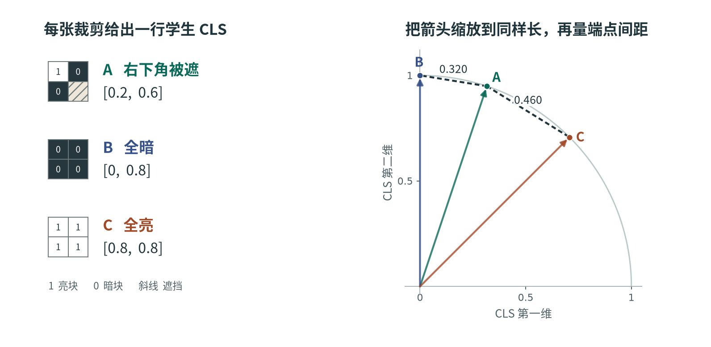
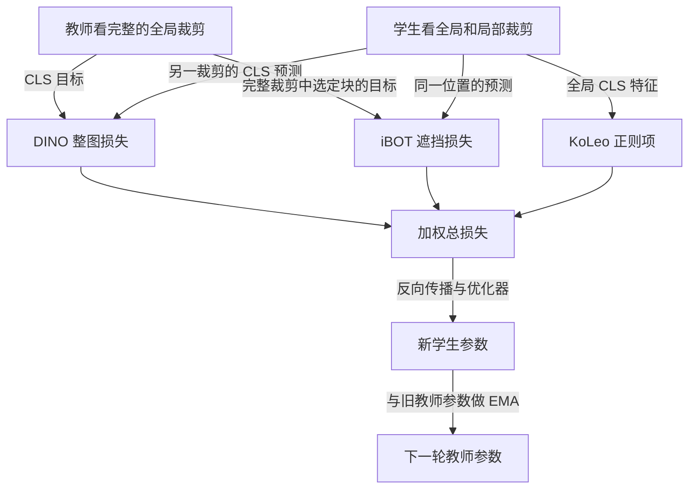

# 用一张小图走完 DINOv2 的一次训练

把一张图裁下来，盖住右下角的一块。学生看不到这块的像素，谁来告诉它预测得好不好？DINOv2 让另一份网络看完整的裁剪，把它对这个位置算出的结果当作本轮的答案。这份提供答案的网络叫**教师**，练习作答的网络叫**学生**。

同一张图还可以出另一道题。给学生看一个裁剪，给教师看另一个裁剪，让两者对整个裁剪的描述也尽量接近。这两道题共用学生提取特征的那部分网络，叫**主干**。所以，看懂某一块和看懂整张图，最终都能影响主干里保存的参数。

前五步用一个可以手算的教学网络完成一次更新。第一次读，跟住裁剪右下角的 `p3` 和主干里的一个参数 `w` 就够了。第二遍可以按需要选读。[逐个核对梯度](#gradients) · [理解温度、Sinkhorn 与 KoLeo](#extensions) · [用 NumPy 复算](#numpy)

## 1. 同一张图，教师和学生各看哪一部分？

用 `1` 表示亮、`0` 表示暗。下面是原图，方括号标出了我们要跟踪的中心像素。

```text
1   0   0
0  [1]  0
0   0   0
```

从原图取出三个**视图**。本例把一个像素当作一个图像块（patch），每份裁剪里的块都从左到右、从上到下重新编号。

| 视图 | 从原图哪里取 | 按行展开的灰度 | 教师看到什么 | 学生看到什么 |
|---|---|---|---|---|
| 甲（全局裁剪） | 左上角 2×2 | `[1, 0, 0, 1]` | 完整的甲 | 甲的右下角被遮住 |
| 乙（全局裁剪） | 右下角 2×2 | `[1, 0, 0, 0]` | 完整的乙 | 完整的乙 |
| 小裁剪（局部裁剪） | 只取正中心 | `[1]` | 教师只处理甲、乙 | 完整的小裁剪 |

在甲里，四块依次叫 `p0、p1、p2、p3`，原图的中心成了甲的 `p3`。同一个像素到了乙，却在左上角，叫乙的 `p0`。后面提到“被遮住的位置”，指的都是**甲的 p3**。

每份裁剪独立经过网络。即使学生在乙里看到了那个亮像素，计算甲的 `p3` 时，它能读取的也只有甲里的信息。

## 2. 遮住 p3 以后，学生怎样给它算出特征？

### 先给每个位置放一行数

网络要把一块图像变成一串能运算的数，这一步叫 **patch embedding**。为方便手算，规定灰度 `x` 变成 `[w × x, 1]`。其中 `w` 是网络保存、训练时可以调整的参数，第二个数固定为 `1`。训练刚开始，教师从学生复制一份参数，两边的 `w` 都是 `1`。于是亮块变成 `[1, 1]`，暗块变成 `[0, 1]`。

在最前面再放一行 **CLS**。它是专门留给整个裁剪的汇总位置，初值设成 `[0, 0]`。学生遮挡 `p3` 的方法，是把那一行的输入替换为占位向量 **MASK**，本例也取 `[0, 0]`。

| 甲的输入行 | 教师 | 学生 |
|---|---|---|
| CLS | `[0, 0]` | `[0, 0]` |
| p0（亮） | `[1, 1]` | `[1, 1]` |
| p1（暗） | `[0, 1]` | `[0, 1]` |
| p2（暗） | `[0, 1]` | `[0, 1]` |
| p3（亮，学生侧遮挡） | `[1, 1]` | `[0, 0]` |

网络把每个位置作为一个 **token** 处理，表里一行就是一个 token。两边都是五行、每行两个数，写成形状就是 `[5, 2]`。学生的遮挡表 `[否, 否, 否, 是]` 依次对应四个图像块，最后一个“是”让学生替换第五行。这样 `p3` 的位置还在，内容换成了 MASK。暗块则保留自己的特征 `[0, 1]`。

### 让每一行读取周围，再看 p3 那一行

这一次让每一行都从五行里各取五分之一，得到一个平均向量。再把平均向量加回本行原有的两个数，这个加法叫**残差连接**。下面只算后面要用的两行。

| 只计算甲 | 教师看完整的甲 | 学生看遮挡的甲 |
|---|---|---|
| 五行相加后除以 5 | `[2, 4] / 5 = [0.4, 0.8]` | `[1, 3] / 5 = [0.2, 0.6]` |
| CLS 输出 = 本行输入 + 平均 | `[0, 0] + [0.4, 0.8] = [0.4, 0.8]` | `[0, 0] + [0.2, 0.6] = [0.2, 0.6]` |
| **p3 输出** = 本行输入 + 平均 | `[1, 1] + [0.4, 0.8] = [1.4, 1.8]` | `[0, 0] + [0.2, 0.6] = [0.2, 0.6]` |

学生 `p3` 的第一个数 `0.2` 从哪来？甲里还露着左上角的亮块 `p0`，它贡献了 `1/5`。第二个数 `0.6` 来自三个可见块，它们各贡献 `1/5`。**盖住的是这个位置自己的像素，它仍能接收同一裁剪里其他位置的信息。** 这两个数合起来，就是学生给 `p3` 算出的**特征**。虽然教师和学生此时都用 `w = 1`，它们看到的内容不同，已经算出了不同的特征。

在这个小网络里，学生的 CLS 和被遮的 `p3` 恰好算出了同一对数，因为两行都从零出发、又加上了同一个平均值。第 3 步取 `p3` 那一行，评价被遮位置的预测。第 4 步取 CLS 那一行，比较整个裁剪的描述。

如果读过 Transformer，可以把这个平均值对应到熟悉的注意力计算。取 `Q = K = 0`、`V = 输入`，输出投影取恒等映射。五个位置的打分相同，经 softmax 后，权重就都是 `1/5`。[《总纲》中的注意力计算](../../course/总纲.md)

## 3. 学生对 p3 的预测有多接近教师？（iBOT）

教师有了 `[1.4, 1.8]`，学生有了 `[0.2, 0.6]`。各自在主干后接一个小模块，把特征变成可以比较的分数，这个模块叫**训练头**。读取图像块特征的是 **iBOT 头**。

本轮开始时，头的三个分数依次取“第一维、第二维、零”。例如学生的 `[0.2, 0.6]` 变成 `[0.2, 0.6, 0]`。这三个原始分数叫 **logits**，每一项对应一个可学习的输出方向，通常叫**原型**。三个原型都没有预先指定的物体名称。

为了比较教师和学生给每个原型分了多少比重，把分数转成总和为 1 的比例。做法是逐项取指数，再除以三个指数之和，这就叫 **softmax**。在这轮手算里，教师和学生都直接使用这个公式，相当于温度取 1。先用学生算一遍。

```text
三个分数          [0.2,    0.6,    0   ]
各自取指数      ≈ [1.2214, 1.8221, 1   ]
各项除以 4.0435 ≈ [0.3021, 0.4506, 0.2473]
```

| 甲的 p3 | 主干给出的特征 | iBOT 头给出的分数 | softmax 后的分布 |
|---|---|---|---|
| 教师目标 | `[1.4, 1.8]` | `[1.4, 1.8, 0]` | `[0.3652, 0.5448, 0.0901]` |
| 学生预测 | `[0.2, 0.6]` | `[0.2, 0.6, 0]` | `[0.3021, 0.4506, 0.2473]` |

光看第三项就能判断方向。教师只分给它约 **9.0%**，学生却分了 **24.7%**。学生需要把一部分比重移到前两项。这道局部预测题用的始终是**同一裁剪、同一位置**的两份分布，教师的答案包含它亲眼看到的 `p3` 以及周围的信息。

怎样给这次作答算一个损失？把教师分布记作 `T`，学生分布记作 `S`。对每一项算 `−ln(学生给的比例)`，再按教师给这一项的比重求加权和。这是**交叉熵**，`ln` 表示自然对数。

$$
H(T,S)=-\sum_{k=1}^{3} T_k \ln S_k
$$

例如第一项用教师的 `0.3652` 给学生的 `−ln(0.3021)` 加权，约得 `0.4372`。三项都这样算再相加，得到 **`H(教师甲 p3, 学生甲 p3) ≈ 0.997216`**。文中小数作了舍入，结果用完整精度计算。固定教师目标时，学生分布与它完全一致，交叉熵达到最小值。像这里有多个非零目标分量时，这个最小值仍大于零。

在本例中，甲只遮一块，乙没有遮挡，乙对这项损失贡献为零。先在每个全局裁剪内平均被遮位置的损失，再对两个全局裁剪取平均，所以 **`L_iBOT = (0.997216 + 0) / 2 ≈ 0.498608`**。[官方 iBOT 位置加权实现](https://github.com/facebookresearch/dinov2/blob/main/dinov2/loss/ibot_patch_loss.py)

## 4. 换一个裁剪，整图描述还接近吗？（DINO）

取出每份裁剪最前面的 **CLS 行**，交给专门比较整图的 **DINO 头**。这里说的“整图”是网络当前收到的整份裁剪。因此，从小裁剪取 CLS，走的也是 DINO 头。上一节走 iBOT 头，是因为取了甲里一个具体图像块的输出。

乙的四块是 `[1, 0, 0, 0]`，两边都看得到。加上 CLS，五行的和为 `[1, 4]`，所以乙的 CLS 输出是 `[0.2, 0.8]`。小裁剪只送给学生，它只有零初值的 CLS 和一个亮块，平均值就是 `([0, 0] + [1, 1]) / 2 = [0.5, 0.5]`。

DINO 头和 iBOT 头各有自己的权重。为了手算，两者起初都把 `[h1, h2]` 变为 `[h1, h2, 0]`。像上一步一样做 softmax，就得到了整图的预测和目标。

| 谁在读哪份裁剪 | CLS 特征 | 用于整图比较的分布 |
|---|---|---|
| 教师读甲 | `[0.4, 0.8]` | `[0.3162, 0.4718, 0.2120]` |
| 学生读遮挡的甲 | `[0.2, 0.6]` | `[0.3021, 0.4506, 0.2473]` |
| 教师读乙、学生读乙 | `[0.2, 0.8]` | `[0.2747, 0.5005, 0.2249]` |
| 学生读小裁剪 | `[0.5, 0.5]` | `[0.3837, 0.3837, 0.2327]` |

**DINO 要求换个裁剪也能给出相近的整图描述。** 学生读甲，就向读乙的教师学习。学生只读小裁剪，就分别向教师的两份全局裁剪学习。沿用上节的交叉熵，四道题的分数如下。[官方跨裁剪配对实现](https://github.com/facebookresearch/dinov2/blob/main/dinov2/train/ssl_meta_arch.py)

| 学生用哪份预测 | 教师用哪份目标 | 交叉熵 `H(教师, 学生)` |
|---|---|---:|
| 甲的 CLS | 乙的 CLS | 1.041905 |
| 乙的 CLS | 甲的 CLS | 1.051548 |
| 小裁剪的 CLS | 甲的 CLS | 1.064011 |
| 小裁剪的 CLS | 乙的 CLS | 1.070457 |

四项整图损失取平均，再把两种任务的损失相加。手算里两种任务的权重都取 1。

```text
整图 DINO 损失 = (1.041905 + 1.051548 + 1.064011 + 1.070457) / 4 ≈ 1.056980
局部 iBOT 损失 = (0.997216 + 0) / 2                             ≈ 0.498608
本轮总损失     = 1.056980 + 0.498608                              ≈ 1.555588
```

到这里完成的是**前向计算**，即从像素一路算到损失。网络已经给这组参数打出了分数，主干参数 `w` 此刻依然是 `1`。

## 5. 损失怎样改到学生，教师又怎样跟上？

### 沿着 p3 的误差，往回找到一个可调的数

把教师算出的目标固定下来，只沿学生这条路径求梯度。本轮的温度为 1，用 softmax 后的分布算交叉熵，学生三个原始分数的梯度就是 `S − T`。汇总时，`p3` 的交叉熵除以了全局裁剪数 2，它传回的梯度也要乘 `1/2`。

```text
总损失对学生 p3 三个分数的梯度
= (学生预测 − 教师目标) / 2
≈ [−0.031555, −0.047074, +0.078629]
```

**梯度表示，把一个数稍微调大，损失会往哪个方向变、变多快。** 第三个梯度为正，单独调高第三个分数会让损失增大。要降低损失，就倾向于调低这个分数。前两个分数的方向相反，和刚才从比例表读出的判断一致。

再顺着第一个分数往回走。起初它直接取学生 `p3` 特征的第一维。甲里唯一可见的亮块贡献 `w`，五行平均后，这一维就是 `w/5`。因此 `w` 每变一点，传到第一个分数的变化只有五分之一。这条路径传回 `w` 的梯度为 `−0.031555 × 1/5 ≈ −0.006311`。把沿途的影响相乘，叫**链式法则**。

四个整图配对也用同一个 `w`，它们传回的梯度合计为 `+0.021341`。把经过同一参数的影响相加，就是**反向传播**在这里做的事。[四项梯度的逐项算式](#gradients)

```text
w 的总梯度 = 整图传回的梯度 + 遮挡位置传回的梯度
           ≈ 0.021341 − 0.006311 = 0.015030
```

### 先更新学生，再用同一张图检查效果

本例用梯度下降更新参数，**学习率**取 `0.5`，也就是每个参数都减去 `0.5 × 自己的梯度`。单看 `p3` 的误差，`w` 倾向于增大。把两个任务合起来，总梯度为正，这次 `w` 会略微减小。

```text
新学生 w = 1 − 0.5 × 0.015030333 ≈ 0.992484834
```

学生的两个头也按各自的梯度同时更新。每个头有三行、每行两个权重，加上主干的 `w`，本轮一共更新 `6 + 6 + 1 = 13` 个数。这一步才真正改动网络保存的参数，执行它的程序叫**优化器**。

把同一份遮挡的甲再给新学生，继续用刚才的教师答案核对。学生 `p3` 的预测变成 `[0.302956, 0.454043, 0.243002]`。原来给第三项的比重是 `0.247309`，现在降到了 `0.243002`，朝教师给的 `0.090051` 靠近了一点。把所有配对也重新算一遍，总损失从 **1.555588** 降到 **1.552512**。

### 学生更新完，教师才移动一步

教师在本轮给出固定目标。等学生更新完，教师把自己原有的参数和学生的新参数逐个加权平均。举例说，让教师保留 99% 的旧值，加入 1% 的新学生值。

```text
新教师 w = 0.99 × 旧教师 w + 0.01 × 新学生 w
         = 0.99 × 1 + 0.01 × 0.992484834
         ≈ 0.999924848
```

这叫**指数移动平均（EMA）**。平均的对象是主干和两个头里对应位置的参数。从读入这批图片，到学生和教师分别完成参数更新，就走完了一次**训练迭代**。下一批图片到来时，教师会用这份更新后的参数给出新的目标。[官方学生更新与教师 EMA 的执行顺序](https://github.com/facebookresearch/dinov2/blob/main/dinov2/train/train.py)

### 合上表格，试着回答三个问题

1. 如果只把甲的 `p3` 从亮改为暗，学生仍遮住同一位置。单看甲这一次前向，教师和学生的 `p3` 特征各会怎样变？
2. 学生小裁剪的 CLS 应该向谁学习？学生甲的 `p3` 又该向谁学习？
3. 更新学生后，想看总损失的变化有多少来自这次学生更新，应当用哪个时刻的教师目标来复算？

<details>
<summary>展开核对答案</summary>

1. 教师会看到新灰度。此时甲只有左上角是亮的，平均值变成 `[0.2, 0.8]`，教师 `p3` 输出 `[0, 1] + [0.2, 0.8] = [0.2, 1.8]`。学生两次看到的输入完全相同，`p3` 都输出 `[0.2, 0.6]`。
2. 小裁剪的 CLS 分别配教师甲和乙的 CLS，共两项 DINO 比较。学生甲的 `p3` 配完整甲的教师 `p3`，形成一项 iBOT 比较。
3. 用学生更新前已经算好的那份教师目标，并沿用同一批裁剪和遮挡。这样两次计算中只有学生参数不同。

</details>

<a id="gradients"></a>

## 选读 A　把梯度算到两个头和主干上

### 一个头里的六个权重怎样得到梯度？

把三个分数的计算规则写成矩阵，每行有两个权重，负责给一个原型打分。下面把特征 `h` 当作列向量，分数就是 `z = W h`。教师、学生各有一个 DINO 头和一个 iBOT 头，四个头分别存储参数，初值恰好相同。

```text
初始 W        作用在 h = [h1, h2] 上
[1, 0]       得到第一个分数 h1
[0, 1]       得到第二个分数 h2
[0, 0]       得到第三个分数 0
```

以学生 iBOT 头为例，把第一行的权重叫作 `a、b`。它们算出 `z1 = a × h1 + b × h2`。第 5 步算出了总损失对 `z1` 的梯度 `−0.031555`。学生 `p3` 的特征是 `[0.2, 0.6]`，于是这一个分数分别给两个权重传回如下梯度。

```text
a 的梯度 ≈ −0.031555 × 0.2 = −0.006311
b 的梯度 ≈ −0.031555 × 0.6 = −0.018933
```

其余两行同理。每行把对应分数的梯度分别乘 `h1` 和 `h2`，再用“旧权重 − 0.5 × 梯度”更新。DINO 头需要把四个配对各自传回的梯度相加。表中各值均保留六位小数。

| 学生训练头 | 对应的分数 | 这一行的两个梯度 | 更新后的两个权重 |
|---|---|---|---|
| iBOT | 第 1 个 | `[−0.006311, −0.018933]` | `[1.003155, 0.009466]` |
| iBOT | 第 2 个 | `[−0.009415, −0.028245]` | `[0.004707, 1.014122]` |
| iBOT | 第 3 个 | `[0.015726, 0.047178]` | `[−0.007863, −0.023589]` |
| DINO | 第 1 个 | `[0.021341, 0.017845]` | `[0.989329, −0.008922]` |
| DINO | 第 2 个 | `[−0.026675, −0.027355]` | `[0.013337, 1.013678]` |
| DINO | 第 3 个 | `[0.005333, 0.009511]` | `[−0.002667, −0.004755]` |

教师的头随后也逐个权重做 EMA。例如学生 DINO 头的第一个权重从 `1` 变为约 `0.989329`，教师对应的权重就变成 `0.99 × 1 + 0.01 × 0.989329 ≈ 0.999893`。

### 整图损失传回 w 的 0.021341 从哪来？

本轮初始权重下，三个分数中只有第一个会随 `w` 改变，所以这条链只用看分布的第一项。学生甲和乙的 CLS 第一维都是 `w/5`，小裁剪的 CLS 第一维是 `w/2`。每项整图损失的系数都是 `1/4`。

| 学生配教师 | 该配对对 `w` 的梯度 = 配对权重 × 第一项预测差 × CLS 第一维对 `w` 的导数 |
|---|---|
| 甲配乙 | `¼ × (0.302064 − 0.274661) × ⅕ ≈ +0.001370` |
| 乙配甲 | `¼ × (0.274661 − 0.316241) × ⅕ ≈ −0.002079` |
| 小裁剪配甲 | `¼ × (0.383652 − 0.316241) × ½ ≈ +0.008426` |
| 小裁剪配乙 | `¼ × (0.383652 − 0.274661) × ½ ≈ +0.013624` |

四项之和约为 `+0.021341`。再加上 iBOT 的 `−0.006311`，即可复算第 5 步的主干更新。所有梯度都在同一组旧参数处求出，之后才一起更新主干和两个头。

用新的 `w` 算，学生 `p3` 的特征为 `[0.992484834 / 5, 0.6] ≈ [0.198497, 0.6]`。用表里的新 iBOT 权重算一遍，就能从参数复算出新预测。

```text
新特征 [0.198497, 0.6]
    → 三个新分数 [0.204803, 0.609408, −0.015714]
    → 新分布     [0.302956, 0.454043, 0.243002]
```

逐项复核时还能看到，“学生乙配教师甲”的交叉熵从 `1.051548` 略升到 `1.052389`。其他配对的改善使加权总损失仍然下降。共享参数的这一步更新同时受所有配对影响。

<a id="extensions"></a>

## 选读 B　温度、Sinkhorn 和 KoLeo 分别在哪一步起作用？

前五步只使用普通 softmax 生成教师目标，温度取 1，总损失只计 DINO 和 iBOT。换成许多原图，还要考虑一件事。如果所有图片都得到同一种描述，师生也可能彼此一致，特征却失去了区分图片的能力，这种退化称为**表示坍塌**。下面都从**更新前**的数据出发，分别观察改变分数、平衡分配和拉开特征距离会发生什么。

### 温度改变一行分数的分配比例

教师甲的 CLS 分数是 `[0.4, 0.8, 0]`。在 softmax 之前把每个分数除以一个正数 `τ`，这个数就叫**温度**。

| 温度 | 实际送入 softmax 的三个数 | 教师甲的分布 |
|---|---|---|
| `τ = 1` | `[0.4, 0.8, 0]` | `[0.3162, 0.4718, 0.2120]` |
| `τ = 0.5` | `[0.8, 1.6, 0]` | `[0.2721, 0.6056, 0.1223]` |

本来就是第二项最大，降低温度后，它分到的比重从 47.18% 升到 60.56%。教师和学生可以分别设置温度。若学生温度为 `τ_s`，单个交叉熵对学生原始分数的梯度就是 `(S − T) / τ_s`。

### Sinkhorn-Knopp 看一整批教师输出怎样使用各个原型

把更新前教师甲、乙的 CLS 分数并排看，两份裁剪都偏向第二个原型。如果一整批图总把大部分比重给少数几个原型，许多输出位置就很少用到。**Sinkhorn-Knopp** 在生成教师目标时，一起调整这批数据的分配。

用同一组分数和温度 1 演算。在下表里，一行代表一个教师视图，一列代表一个原型。先把分数逐项取指数。

| 教师视图 | 原型 1 | 原型 2 | 原型 3 |
|---|---:|---:|---:|
| 甲 | 1.4918 | 2.2255 | 1.0000 |
| 乙 | 1.2214 | 2.2255 | 1.0000 |

最终每一行的和应为 1。两行合计有 2 份比重，平均分到三列，每一列的目标总量就是 `2/3`。交替做两件事即可。

1. **按列缩放。** 各列先除以自己的列和，再乘 `2/3`。例如第一列变成 `[1.4918, 1.2214] / 2.7132 × (2/3) ≈ [0.3666, 0.3001]`。另两列里的两个数原本就相等，缩放后各得 `1/3`。
2. **按行缩放。** 每行再除以自己的行和。甲这一行从约 `[0.3666, 0.3333, 0.3333]` 变为 `[0.3548, 0.3226, 0.3226]`。此时行和为 1，列和会略微偏离 `2/3`，于是回到第一步。

做三轮后，教师甲的目标约为 `[0.355531, 0.322235, 0.322235]`，乙的约为 `[0.311136, 0.344432, 0.344432]`。逐列相加都接近 `0.666667`，同时每个视图仍可以有自己的偏好。沿用原来的学生乙，与新的教师甲配对，交叉熵就从 `1.051548` 变为 `1.163323`。目标已经变了，这轮的损失和梯度都要用新目标重算。[官方 CLS 目标计算](https://github.com/facebookresearch/dinov2/blob/main/dinov2/loss/dino_clstoken_loss.py)

iBOT 会把选中的教师 patch 分数另放在一张表里做同样的整理。本例那张表只有 `p3` 一行，按列平衡就会得到 `[1/3, 1/3, 1/3]`。真实训练会一起处理来自一批图片的许多位置。所有行都均匀也能满足总量平衡，图像能否被区分还取决于数据和其他训练约束。[官方 patch 目标计算](https://github.com/facebookresearch/dinov2/blob/main/dinov2/loss/ibot_patch_loss.py)

### KoLeo 怎样判断两张图的特征挤在了一起？

假设给学生看一张全暗的图，再看一张全亮的图，它两次都输出 `[0, 1]`。只把这两行数交给你，亮图和暗图就分不出来了。前面的 DINO 鼓励同一张图换个裁剪也能给出相近的预测。KoLeo 关心的是不同图片还能区分到什么程度。**每张图都在同组里找出特征最像自己的另一张图。这个邻居离得越近，这张图贡献的损失就越大。**

#### 先把三张图画成三根箭头

A 是第 2 步用过的原图，B 和 C 是另外两张原图。每张都有甲、乙两份全局裁剪。先取 **A 的甲、B 的甲、C 的甲**，让学生分别读图，从主干末尾各取一行 CLS，也就是学生对整份裁剪的描述。三张图的乙放在另一组，按同样的方法算。[官方裁剪分组实现](https://github.com/facebookresearch/dinov2/blob/main/dinov2/train/ssl_meta_arch.py)

沿用 `w = 1` 的小网络。回忆第 2 步，一个可见亮块贡献 `[1, 1]`，一个暗块贡献 `[0, 1]`，遮住的块和 CLS 初值都是 `[0, 0]`。五行平均，所以只要数清“有几块亮着、共有几块可见”，就能算出下面三行。

| 学生看的裁剪 | 可见的亮块数 | 可见的块数 | 学生的 CLS |
|---|---:|---:|---|
| A，右下角被遮 | 1 | 3 | `[1/5, 3/5] = [0.2, 0.6]` |
| B，四块全暗 | 0 | 4 | `[0/5, 4/5] = [0, 0.8]` |
| C，四块全亮 | 4 | 4 | `[4/5, 4/5] = [0.8, 0.8]` |

把 A 的 `[0.2, 0.6]` 画出来，就是从原点向右走 `0.2`、向上走 `0.6` 的一根箭头。B 笔直向上，C 朝右上方。**KoLeo 先把三根箭头都缩放到长度 1，再量箭头尖之间的直线距离。** 这样，即使学生把 A 的两个数同时放大十倍，A 也会落回原来那个方向上的同一个点。要拉开间距，学生得改变它给图片算出的特征方向。

把箭头缩放到单位长度叫 **L2 归一化**。例如 A 的箭头长 `√(0.2² + 0.6²) ≈ 0.632456`。把两个数都除以这个长度，端点变成 `[0.316228, 0.948683]`。同样算，B 落在 `[0, 1]`，C 落在 `[0.707107, 0.707107]`。看右图的虚线，可以先凭眼睛猜一猜 A 离谁更近。



#### 站在每个端点上，找离它最近的另一个点

先站在 A。它到 B 的距离约为 `√((0.316228 − 0)² + (0.948683 − 1)²) ≈ 0.320`，到 C 约为 `0.460`。所以 A 选 B，B 就是 A 的**最近邻**。轮到 B 和 C，也各自从另外两个点里选一次。

| 从哪里出发 | 到另外两个端点的距离 | 选中的邻居 | 用选中的距离 `d` 算损失 `−ln(d)` |
|---|---|---|---:|
| A | 到 B 为 0.320，到 C 为 0.460 | B | 1.1383 |
| B | 到 A 为 0.320，到 C 为 0.765 | A | 1.1383 |
| C | 到 A 为 0.460，到 B 为 0.765 | A | 0.7776 |

`ln` 是自然对数。A 身边有个很近的 B，罚了 `1.1383`。C 离自己的最近邻远一些，只罚 `0.7776`。如果两根箭头尖几乎重合，距离只有 `0.01`，这一项会涨到 `4.6052`。每张图各交一项，**这一组的 KoLeo 损失就是三项的平均**，即 `(1.1383 + 1.1383 + 0.7776) / 3 ≈ 1.0181`。A、B 互选，因此同一段距离在这里贡献了两次。[官方 KoLeo 损失实现](https://github.com/facebookresearch/dinov2/blob/main/dinov2/loss/koleo_loss.py)

#### 这项损失究竟能改动学生的哪个数？

保持这三张图和遮挡完全相同，试着把主干中乘亮块灰度的 `w` 从 `1` 调到 `1.1`。A 有一个可见亮块，CLS 的第一维从 `0.20` 变为 `0.22`。B 全暗，第一维仍为 `0`。C 有四个亮块，第一维从 `0.80` 变为 `0.88`。三根箭头的第二维都和原来一样。

再把箭头缩放到长度 1。A 到 B 的间距从 `0.320` 增至 `0.350`，C 到 A 从 `0.460` 增至 `0.477`。这组的 KoLeo 损失就从 **1.0181 降到 0.9474**。同样三张图，学生对亮块的响应强了一点，三份描述就更容易分开。这就是损失能通过 CLS 把梯度传回主干参数 `w` 的具体例子。

这里手动试调 `w`，是为了看清这一项的作用。训练时，KoLeo 作为**正则项**与 DINO、iBOT 的损失加权相加，一起决定参数怎么更新。例如取权重 `0.1`，在 `w = 1` 时，本例甲组对总损失的贡献为 `0.1 × 1.0181 ≈ 0.1018`。

<details>
<summary>自己算一遍，如果这组只有 A 和 B，KoLeo 损失是多少？</summary>

A 只能选 B，B 也只能选 A。用未舍入的距离计算，两张图各自的损失都是 `−ln(0.320364…) ≈ 1.138296`。两项取平均，结果仍是 `1.138296`。

</details>

## 把小例子对应到真实的 DINOv2

以官方公开的 ViT-g/14 自监督训练配置为例。把甲换成 224×224 的 RGB 裁剪，每个 patch 取 14×14 像素，就有 `16 × 16 = 256` 个图像块。局部裁剪是 98×98，有 `7 × 7 = 49` 个图像块。大小不同的裁剪仍然可以共用主干，每个位置都输出 1536 维特征。[ViT-g/14 训练配置](https://github.com/facebookresearch/dinov2/blob/main/dinov2/configs/train/vitg14.yaml) · [裁剪默认配置](https://github.com/facebookresearch/dinov2/blob/main/dinov2/configs/ssl_default_config.yaml) · [ViT 主干定义](https://github.com/facebookresearch/dinov2/blob/main/dinov2/models/vision_transformer.py)

| 环节 | 手算时怎么做 | 官方 ViT-g/14 配置中怎么做 |
|---|---|---|
| 输入 | 一张原图裁两大一小 | 一批原图各取两份全局和八份局部裁剪，再做缩放与增强 |
| 遮挡和特征提取 | MASK 取零，每行读取相同的平均值，再做一次残差相加 | 在指定位置换上可学习的 MASK 向量，加入位置信息，经过多层带注意力、归一化和前馈网络的 ViT |
| 训练头 | 两个独立的线性头，每个输出三个分数 | 两个独立的头，分别经多层感知机、向量归一化和线性映射，各输出 131072 个原型分数 |
| 训练目标 | 教师用普通 softmax，学生做整图和遮挡位置两道题 | 教师用温度和 Sinkhorn 生成两种目标，学生同时优化 DINO、iBOT 与 KoLeo |
| 参数更新 | 学生做一步梯度下降，教师做 EMA | 学生用 AdamW 更新，教师按调度的动量系数做 EMA |

把数据送进真实训练循环时，可以按下图找到每种误差的来源。教师在当前轮只提供目标，三个损失汇总后的梯度用于更新学生。[训练头定义](https://github.com/facebookresearch/dinov2/blob/main/dinov2/layers/dino_head.py) · [官方训练实现](https://github.com/facebookresearch/dinov2/blob/main/dinov2/train/ssl_meta_arch.py)



这里跟踪的是大模型从头进行自监督训练的一轮。论文还用了另一种训练方式来得到 ViT-S 等较小模型。已经训练好的 ViT-g 担任固定教师，学生用两份全局裁剪计算 iBOT，训练时取消遮挡，最终取学生参数的 EMA。小例子里的损失下降检验了这一次参数更新，真实模型学到的特征质量由下游任务检验。[论文第 5 节的模型蒸馏](https://arxiv.org/html/2304.07193v2#S5)

<a id="numpy"></a>

## 用 NumPy 复算这一次更新

有 Python 和 NumPy 就可以在 CPU 上运行下面的完整示例。代码中的 `G1`、`G2`、`L` 分别对应甲、乙和小裁剪，`P3` 表示甲的右下角。`backbone` 同时算出特征和它对 `w` 的导数，后者用来重现第 5 步的反向传播。这里复算前五步的两项损失。

```python
import copy

import numpy as np


# 从同一张原图取三份视图，教师和学生复用这些像素。
IMAGE = np.array([[1, 0, 0], [0, 1, 0], [0, 0, 0]], dtype=float)
G1 = IMAGE[:2, :2]
G2 = IMAGE[1:, 1:]
LOCAL = IMAGE[1:2, 1:2]
MASK_INDEX = 3


def softmax(scores, temperature=1.0):
    """把一行分数转成比例，减去最大值以避免指数溢出。"""
    scaled = np.asarray(scores, dtype=float) / temperature
    weights = np.exp(scaled - scaled.max())
    return weights / weights.sum()


def backbone(crop, scale, mask_index=None):
    """做一次均匀注意力和残差相加，同时算出各行特征对 w 的导数。"""
    values = np.asarray(crop, dtype=float).reshape(-1)
    # 输入为 [w × x, 1]，两维对 w 的导数分别是 x 和 0。
    tokens = np.column_stack([scale * values, np.ones_like(values)])
    derivatives = np.column_stack([values, np.zeros_like(values)])
    if mask_index is not None:
        tokens[mask_index] = [0.0, 0.0]
        derivatives[mask_index] = [0.0, 0.0]

    # 最前面放 CLS。每行加上所有行的平均值，导数也按同一规则相加。
    tokens = np.vstack([np.zeros(2), tokens])
    derivatives = np.vstack([np.zeros(2), derivatives])
    output = tokens + tokens.mean(axis=0)
    return output, derivatives + derivatives.mean(axis=0)


def student_features(student):
    """取学生三个裁剪的 CLS，以及遮挡位置 p3 的输出与导数。"""
    g1, dg1 = backbone(G1, student["w"], mask_index=MASK_INDEX)
    g2, dg2 = backbone(G2, student["w"])
    local, dlocal = backbone(LOCAL, student["w"])
    # 第 0 行留给 CLS。图像块编号从 0 开始，取 p3 的输出要加 1。
    row = MASK_INDEX + 1
    return {
        "G1": (g1[0], dg1[0]),
        "G2": (g2[0], dg2[0]),
        "L": (local[0], dlocal[0]),
        "P3": (g1[row], dg1[row]),
    }


def make_targets(teacher):
    """教师看完整的甲和乙，用两个训练头算出本轮固定的目标。"""
    g1, _ = backbone(G1, teacher["w"])
    g2, _ = backbone(G2, teacher["w"])
    return {
        "G1": softmax(teacher["dino"] @ g1[0]),
        "G2": softmax(teacher["dino"] @ g2[0]),
        "P3": softmax(teacher["ibot"] @ g1[MASK_INDEX + 1]),
    }


def loss_and_gradients(student, targets):
    """按五组配对汇总损失，逐项累加两个头和主干的解析梯度。"""
    features = student_features(student)
    losses = {"dino": 0.0, "ibot": 0.0}
    gradients = {
        "w": 0.0,
        "dino": np.zeros_like(student["dino"]),
        "ibot": np.zeros_like(student["ibot"]),
    }
    # 依次写出训练头、学生的行、教师的行和本项在总损失里的系数。
    pairs = [
        ("dino", "G1", "G2", 0.25),
        ("dino", "G2", "G1", 0.25),
        ("dino", "L", "G1", 0.25),
        ("dino", "L", "G2", 0.25),
        ("ibot", "P3", "P3", 0.5),
    ]
    comparisons = []
    for head, source, target_name, weight in pairs:
        h, dh_dw = features[source]
        prediction = softmax(student[head] @ h)
        target = targets[target_name]
        ce = -float(target @ np.log(prediction))
        losses[head] += weight * ce
        comparisons.append((head, source, target_name, ce))

        # 每个分数的梯度乘两个输入特征，得到该行两个权重的梯度。
        grad_scores = weight * (prediction - target)
        gradients[head] += np.outer(grad_scores, h)
        # 再经过旧头的权重传回特征，沿特征对 w 的导数传回主干。
        grad_feature = student[head].T @ grad_scores
        gradients["w"] += float(grad_feature @ dh_dw)

    return losses, gradients, comparisons


def main():
    """固定教师目标，更新学生并复算损失，最后对教师参数做 EMA。"""
    initial_head = np.array([[1, 0], [0, 1], [0, 0]], dtype=float)
    student = {"w": 1.0, "dino": initial_head.copy(), "ibot": initial_head.copy()}
    teacher = copy.deepcopy(student)

    targets = make_targets(teacher)
    losses, gradients, comparisons = loss_and_gradients(student, targets)
    for head, source, target_name, ce in comparisons:
        print(f"{head} 学生 {source} 配教师 {target_name} 的交叉熵 = {ce:.9f}")
    print(f'DINO 损失 = {losses["dino"]:.9f}')
    print(f'iBOT 损失 = {losses["ibot"]:.9f}')
    print(f"总损失 = {sum(losses.values()):.9f}")
    print(f'w 的总梯度 = {gradients["w"]:.9f}')

    # 所有参数都用同一组旧梯度更新，复算时继续使用上面的教师目标。
    learning_rate = 0.5
    updated = {
        name: value - learning_rate * gradients[name]
        for name, value in student.items()
    }
    new_losses, _, _ = loss_and_gradients(updated, targets)
    p3, _ = student_features(updated)["P3"]
    prediction = softmax(updated["ibot"] @ p3)
    print(f'新学生 w = {updated["w"]:.9f}')
    print(f"新学生 p3 分布 = {np.round(prediction, 6)}")
    print(f"更新学生后的总损失 = {sum(new_losses.values()):.9f}")

    # 分别对主干与两个训练头的对应参数做指数移动平均。
    teacher = {
        name: 0.99 * value + 0.01 * updated[name]
        for name, value in teacher.items()
    }
    print(f'新教师 w = {teacher["w"]:.9f}')


if __name__ == "__main__":
    main()
```

运行时会先打印五个配对各自的交叉熵，再打印下面的结果。可以分别和第 3 步的遮挡损失、第 4 步的总损失及第 5 步的参数变化核对。

```text
DINO 损失 = 1.056980188
iBOT 损失 = 0.498607993
总损失 = 1.555588181
w 的总梯度 = 0.015030333
新学生 w = 0.992484834
新学生 p3 分布 = [0.302956 0.454043 0.243002]
更新学生后的总损失 = 1.552512377
新教师 w = 0.999924848
```
