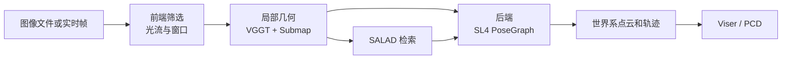

# VGGT-SLAM 教程（一）：为什么需要 Submap、前端和后端

一台相机沿办公室走廊前进。它连续拍下很多图片，但系统最终要交付的不是一串独立图片，而是一张可以定位、回看、校正和导出的三维地图。要理解当前项目，先不要从 `main.py` 的参数开始，而要先问：**一帧图像中的信息，为什么不能直接等于全局地图？**

本篇建立全系统的心智模型。读完后，读者应该知道：关键帧选择解决什么计算问题，Submap 解决什么表示问题，VGGT 解决什么几何问题，PoseGraph 解决什么全局一致性问题，回环为什么是旁路测量而不是“再跑一次建图”。

> **证据范围：** 本篇的运行时行为来自 `main.py`、`main_realtime.py`、`vggt_slam/solver.py`、`submap.py`、`map.py`、`graph.py` 和 `viewer.py`。论文只用于解释名称和方法背景；当前参数和生命周期以代码为准。

## 1. 机器人真正要维护的不是一张图，而是三种互相引用的状态

### 1.1 画面状态：我刚刚看到了什么

相机当前帧提供颜色和纹理，但一帧图像只在自己的像素坐标系中表达世界。像素 $(u,v)$ 没有自己的三维位置，必须结合预测深度和内参反投影。相机移动后，下一张图片又拥有新的像素坐标。因此，图像是**原始观测**，不是持久地图实体。

代码中的 `image_names`、`images` 和 `Submap.frames` 都属于这一层：它们保存的是“哪一帧被读取、以什么尺寸进入网络、以后是否还需要在 Viser 或语义查询中显示”。它们不负责证明两帧在世界中位于哪里。[代码确认]

### 1.2 局部几何状态：这一小段场景怎样自洽

VGGT 可以同时读取一个小窗口的帧，利用跨帧视觉关系预测相机编码和密集深度。窗口内部的几何是一个短期自洽的局部解释，但不同窗口不一定共享完全一致的原点、尺度或漂移。

`Submap` 是这个局部状态的容器。它保存帧、文件名、每帧的局部点、颜色、置信度、内参扩展矩阵和检索向量。它不是“地图里的一块已经固定的砖”，而是一个可以被后端 homography 重新放置的中间表示。

### 1.3 全局图状态：不同局部解释怎样互相约束

相邻 Submap 通常有一个重叠帧。这个共同观测可以建立跨块关系；Submap 内部连续帧也可以建立内部关系。所有节点和关系被放入 GTSAM 的 `NonlinearFactorGraph`，通过优化得到更一致的 `Values`。

因此同一个物理点会经历三次“被认识”：

```text
像素观测
  -> 局部相机坐标点
  -> 图节点 homography 下的世界点
  -> 回环优化后重新计算的世界点
```

最后一次不是生成新点，而是用更新后的状态重新解释同一批局部点。[代码确认：`Submap.get_points_in_world_frame()` 每次读取当前 graph homography]

## 2. 为什么不把全部图片一次送进 VGGT

### 2.1 全序列输入的三个代价

若把 $N$ 张图片一次送进模型，输入张量的基本形状是 $B\times N\times3\times H\times W$。VGGT aggregator 还要在帧内 token 和跨帧 token 之间反复做注意力。全局 token 数随 $N$ 增加，注意力中间结果和 DPT 头的激活都会增加。

三个后果分别是：

1. **显存压力**：一次 forward 的激活必须同时存在；
2. **更新延迟**：必须等整个序列结束才得到地图；
3. **错误传播范围大**：一段坏帧会影响整批全局解释。

这不是说大窗口一定更差；大窗口可能给模型更多跨帧约束，但本项目要在普通显卡和增量建图之间取平衡。[工程推断]

### 2.2 Submap 是一个计算边界，不是最终语义层

将关键帧按小窗口处理后，系统可以在一个窗口内集中做三件事：

- 让 VGGT 看到足够的视差和跨帧上下文；
- 用窗口内重叠帧把局部块连接起来；
- 在处理完以后释放或复用 forward 的临时激活，而长期只保留必要的子地图字段。

`submap_size` 表示一个子地图中新增的帧数，`overlapping_window_size` 表示下一块继续携带的旧帧数。窗口目标是两者之和，而不是单独的 `submap_size`。[代码确认]

一个具体序列如下：

```text
关键帧流：f0, f1, f2, f3, f4, f5, ...
submap_size=2, overlap=1
窗口 0：[f0, f1, f2]  -> 处理新增 f0,f1，保留 f2
窗口 1：[f2, f3, f4]  -> 处理新增 f3,f4，保留 f4
窗口 2：[f4, f5, f6]  -> ...
```

如果把重叠帧理解为“重复点云”，就会错过它的核心作用：它是连接相邻局部坐标解释的共同证据。

## 3. 四个模块边界



### 3.1 前端：决定哪些观测进入局部模型

前端没有估计完整世界地图。它只维护一个上一关键帧和角点追踪结果，使用平均像素位移判断当前帧是否足够有信息。它的输出是路径列表 `image_names_subset`，不是三维点。

### 3.2 模型桥：把窗口变成几何测量

`Solver.run_predictions()` 创建一个新的 `Submap`，保存窗口图像和 SALAD 描述子，然后调用 `model(images)`。模型返回的是测量和中间特征：相机编码、深度、置信度以及回环相似度统计量。它没有直接把所有窗口拼成永久世界地图。

### 3.3 后端：让局部测量共享一个全局解释

`Solver.add_points()` 把局部预测装入当前 `Submap`，再调用 `add_edge()` 创建节点和因子。`PoseGraph.optimize()` 只更新图中的 SL4 节点；点云并不会被逐点优化，而是下次读取 homography 时被重新变换。

### 3.4 输出层：消费当前状态，不拥有地图真相

Viser 读取世界系点和相机位姿，把它们发给浏览器；PCD 导出读取同一个图状态并写磁盘。浏览器 WebGL 失败时，地图状态可能仍然完整；可视化故障不能反推建图失败。

## 4. 节点、候选和临时对象的区分

Hydra 文档强调不能把“candidate、cluster、persistent node”混成一个对象。在当前 VGGT-SLAM 中，对应关系可以这样读：

| 对象 | 分类 | 创建 | 接受/拒绝 | 更新与结束 |
|---|---|---|---|---|
| 角点追踪 | 原始/临时候选 | `goodFeaturesToTrack` | KLT 状态为 1 且数量至少 10 | 参考关键帧更新时整体替换 |
| `image_names_subset` | 窗口候选 | 关键帧通过位移门槛 | 达到窗口大小才进入 VGGT | 子地图处理后重置为重叠帧 |
| 普通 `Submap` | 持久中间实体 | 窗口推理完成 | 总是加入 `GraphMap` | 当前代码没有合并、删除或归档 |
| `LoopMatch` | 回环候选 | SALAD 最近邻 | L2 距离和队列容量筛选；双帧 ratio 再筛 | 未通过则丢弃 |
| 回环 `Submap` | 约束辅助实体 | 双帧验证通过 | `is_lc_submap=True` | 保留在 map 和图中；轨迹导出跳过，但 PCD 遍历当前所有子地图 |
| SL4 节点 | 优化变量/全局身份 | `add_homography` | 键必须未初始化 | LM 后替换 `Values` 中的估计 |

这里最容易误解的是“回环子地图是临时的”。它是**为一次回环测量创建的辅助观测块**，但当前实现没有将其从 `GraphMap.submaps` 删除。它的“临时”只说明来源和用途，不说明物理内存生命周期。[代码确认]

## 5. 全局一致性为什么必须晚于局部几何

如果一开始就试图优化每个像素、每个深度和每个相机状态，问题会非常大；当前代码选择先让 VGGT 在窗口内给出局部解释，再把窗口摘要为有限的图节点和相对关系。这是两层压缩：

```text
像素密集观测 -> 每帧点图/置信度 -> 每帧一个图节点 + 少量因子
```

局部点保留下来，便于颜色、语义查询和稠密输出；后端只优化节点状态，避免把数千万个点直接作为优化变量。后端更新后，节点状态会间接改变所有点的世界位置。

这就产生下一篇的核心问题：**VGGT 内部如何把多帧图像变成相机和深度？** 如果只知道“调用一个模型”，就无法解释输入形状、token 数量、显存差异和 `image_match_ratio` 的真实含义。

## 6. 本篇源码入口

| 目的 | 文件/符号 |
|---|---|
| 离线窗口和主循环 | `main.py::main` |
| 实时采集与后台线程 | `main_realtime.py::main`、`threaded_process_submap` |
| 子地图创建、模型调用、回环桥接 | `vggt_slam/solver.py::run_predictions` |
| 子地图入图、尺度和因子 | `vggt_slam/solver.py::add_points`、`add_edge` |
| 状态容器 | `vggt_slam/submap.py::Submap` |
| 图状态 | `vggt_slam/graph.py::PoseGraph` |
| 世界点读取 | `vggt_slam/submap.py::get_points_in_world_frame` |

