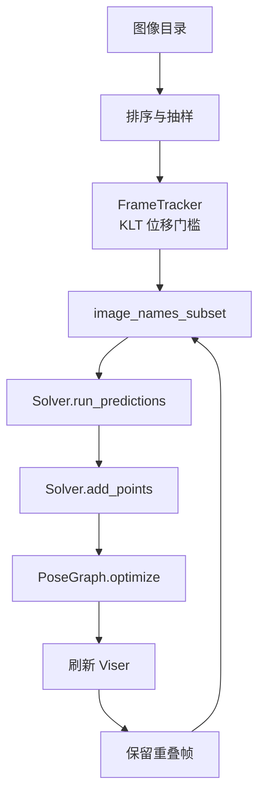
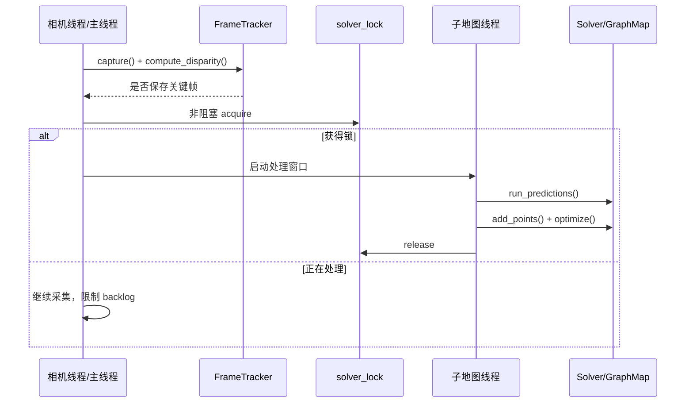

# VGGT-SLAM 教程（架构导读）：运行时管线、状态所有权与线程边界

上一篇建立了“原始图像 → Submap → 图后端 → 世界地图”的整体心智模型。本篇把这条链放回程序运行时，回答三个工程问题：一帧数据具体在哪些阶段改变表示，哪个对象拥有可变状态，以及为什么离线和实时入口虽然共享 `Solver`，却有不同的并发和失败边界。

本篇不重复完整的相机数学，而是先建立后续章节共用的运行时坐标系。读完后，读者拿到任意一个日志字段或内存对象，都应该能指出生产者、消费者、生命周期和发生错误时最早的检查位置。

## 1. 入口不是一个函数，而是两个运行时协议

### 1.1 离线协议：文件列表驱动的增量批处理

`main.py` 的输入是一个图像目录。它把所有符合条件的路径读入 `image_names`，使用 `sort_images_by_number()` 按文件名数字排序，然后逐个送入 `FrameTracker`。光流只决定路径是否进入 `image_names_subset`；它不会读取 VGGT，也不会改变 `GraphMap`。

当窗口长度达到 `submap_size + overlapping_window_size`，或者已经处理到目录最后一张图片时，主循环执行一次完整的子地图批处理：



一个重要的时间顺序是：`Solver` 构造时就会创建 `Viewer`、`ImageRetrieval`、`GraphMap` 和 `PoseGraph`；模型加载发生在主循环之前；只有 `add_points()` 完成后，当前 `Submap` 才加入 `GraphMap`。因此“服务器已启动”不等于“地图已有点”，“SALAD 初始化成功”也不等于“回环已发生”。[代码确认]

### 1.2 实时协议：采集线程和子地图线程分离

`main_realtime.py` 用相机后端持续捕获 BGR 帧。主线程负责：

1. 读取相机帧；
2. 调用同一个 `FrameTracker` 判断是否保存关键帧；
3. 达到窗口大小时，非阻塞获取 `solver_lock`；
4. 启动一个 daemon 线程处理子地图；
5. 继续采集并显示当前帧。

后台线程依次执行 `run_predictions()`、`add_points()`、`graph.optimize()` 和可视化更新。`data_lock` 保护 Solver 的共享地图状态，`solver_lock` 保证同时只有一个子地图进入模型和后端。相机断开时，主线程尝试 `stop()`、`start()`，成功后继续采集；程序退出前等待正在运行的子地图结束。[代码确认]



实时模式中“主线程继续采集”意味着图像到达速度可能高于 VGGT 处理速度。代码在积压超过 `target_size * 2` 时只保留最近窗口，这是**有损的实时背压策略**：被截掉的关键帧不会在以后补回。[工程解释，代码确认阈值]

## 2. 一帧数据如何跨越表示边界

下面把离线和实时都使用的 `Solver` 数据链展开。每个箭头都标出信息保留和信息丢失。

```text
路径/BGR 帧
  --排序、文件排除、光流门槛-->
关键帧路径列表
  --load_and_preprocess_images，缩放/裁剪/补白-->
S×3×H×W Tensor（RGB，0～1）
  --SALAD batch descriptor-->
每帧检索向量 + Submap.frames
  --VGGT aggregator + camera/depth heads-->
pose_enc、depth、depth_conf、image_match_ratio
  --pose 编码恢复、深度反投影-->
外参/内参 + 相机坐标点 + 颜色
  --conf 百分位读取门槛-->
高置信度局部点视图
  --PoseGraph homography-->
世界系点、相机位姿、回环图约束
  --Viser/Open3D-->
浏览器对象或 binary PCD
```

注意三个边界：

- **图像预处理会丢失原始像素几何**：默认 `load_and_preprocess_images()` 把宽度调整到 518，按 `crop` 模式中心裁剪过高图像；本项目不保存原图到 VGGT 输入中的映射信息。
- **置信度不是物理删除**：`Submap.add_all_points()` 保留完整 `pointclouds` 和 `conf`，`get_points_in_world_frame()` 读取时才应用阈值。
- **显示降采样不改图状态**：`--vis_voxel_size` 只在 `set_point_cloud()` 发送给 Viser 前调用 Open3D；写 PCD 时重新读取未体素化的高置信度点。[代码确认]

## 3. 状态所有权：谁能修改什么

| 状态 | 所有者 | 初始化 | 修改时机 | 其他模块如何读 | 当前失效/删除行为 |
|---|---|---|---|---|---|
| 上一关键帧角点 | `FrameTracker` | 第一帧或追踪点少于 10 | 平均位移超过阈值或追踪失败时整体替换 | 只有下一次 `compute_disparity()` | 没有历史恢复 |
| 当前路径窗口 | `main.py` 或实时主线程 | 空列表 | 通过关键帧添加；批处理后保留 overlap | `run_predictions()` 只读快照 | 实时 backlog 过大时截去旧关键帧 |
| 当前工作子地图 | `Solver.current_working_submap` | `run_predictions()` 创建 | `add_points()` 填入局部几何并加入 map | `add_points()`、回环断言 | 下一窗口覆盖引用，子地图仍在 map |
| 子地图集合 | `GraphMap.submaps` | 空字典 | `add_submap()` 插入 | 检索、优化后可视化、导出 | 当前没有删除/归档 |
| 图值与因子 | `PoseGraph.values/graph` | 空；第一节点先验 | `add_homography`、`add_between_factor`、`optimize` | `get_homography()`、轨迹/点云 | 优化后用 result 替换 values |
| Viser 场景句柄 | `Viewer` | 服务启动 | 每次更新子地图/相机/OBB | 浏览器客户端 | 服务停止时销毁；场景对象没有统一清理接口 |
| GPU 模型 | `main` 局部变量 | `load_vggt_model()` | forward 只读参数 | `Solver.run_predictions()` | 进程退出释放；`--keep_alive` 会继续占用 |

这里需要区分“引用被覆盖”和“实体被删除”：`current_working_submap` 指针换成下一块，不代表上一块从 `GraphMap` 删除；`PoseGraph.values=result` 换的是优化结果容器，不是重建整个图；Viser 更新旧子地图时也可能新增同名场景对象，而不是自动删除旧句柄。[代码确认]

## 4. `Solver.run_predictions()` 的真实输入输出

### 4.1 输入不是只有图像

方法接收：

```text
image_names: list[str]
model: CompatibleVGGT
max_loops: int
clip_model / clip_preprocess: 可选开放集模型
```

它先将路径转成 `images`，形状通常是 `S×3×H×W`；随后创建 `Submap` 并写入：

- `frames = images`；
- `img_names = image_names`；
- `frame_ids = set_frame_ids(image_names)`，从文件名提取数字；
- `retrieval_vectors = ImageRetrieval.get_all_submap_embeddings()`；
- 可选 `semantic_vectors`。

模型调用位于 `torch.no_grad()` 内，返回的所有 Tensor（除了 `target_tokens`）随后转为 FP32、CPU NumPy，并去掉 batch 维。于是 `add_points()` 消费的 `pred_dict` 已经不在 GPU 上；模型激活的峰值主要发生在 forward 期间，而点云和图优化主要使用 CPU NumPy。[代码确认]

### 4.2 输出字段不是同一坐标系

`pred_dict` 中重要字段的实际语义：

| 字段 | 形状（去 batch 后） | 实际含义 | 消费者 |
|---|---|---|---|
| `images` | `S×3×H×W` | FP32 RGB 图像，给颜色使用 | `add_points`、Viser |
| `pose_enc` | `S×9` | 平移、四元数、垂直/水平 FOV 编码 | `pose_encoding_to_extri_intri` |
| `extrinsic` | `S×3×4` | world-to-camera 的 `[R|t]` | 外参逆、图节点关系 |
| `intrinsic` | `S×3×3` | 像素内参，主点默认图像中心 | 反投影、K 扩展 |
| `depth` | `S×H×W×1` | 正值深度预测 | 上游 geometry 函数 |
| `depth_conf` | `S×H×W` | `1+exp(raw_conf)` 形式的置信度 | 百分位阈值、尺度掩码 |
| `image_match_ratio` | 标量或 `None` | aggregator 在目标 global layer 的注意力统计 | 回环验证 |
| `detected_loops` | `list[LoopMatch]` | SALAD 候选队列结果 | `add_points` |

`world_points` 这个变量名在 `add_points()` 中不能作为坐标系证据；下一篇会从上游 `unproject_depth_map_to_point_map()` 的返回顺序证明它实际是相机坐标点。

## 5. 运行时计时和日志该怎样读

`Solver` 使用三个 `Accumulator`：`vggt_timer`、`loop_closure_timer`、`clip_timer`；主程序另外统计光流和后端时间。日志中的“Average FPS”由 `1 / (total_time / image_count)` 得到，前面的变量名 `average_fps` 实际保存的是每帧秒数再取倒数，阅读时不要把中间量直接当 FPS。[代码确认]

建议一次实验保留以下记录：

```text
启动参数
GPU 型号、显存和同时存在的进程
关键帧数 image_count
Submap 数和 loop closure 数
每次窗口的 S、输入图像 H/W
VGGT、loop closure、backend 的累计时间
conf_threshold 的实际数值
PCD 文件大小与点数
```

只看总时间无法判断慢在哪里：关键帧变少会降低模型调用次数，但也会改变窗口间隔；`--vis_imgs` 可能让浏览器发送和显示变慢，却不一定出现在 `vggt_timer` 中。

## 6. 从这里进入下一篇

架构导读解决了“数据在哪里、谁拥有状态”的问题，下一篇开始解决“VGGT 内部如何计算”。重点包括：

1. 图像怎样变成 patch token、camera/register token；
2. frame attention 和 global attention 怎样交替；
3. camera head 为什么输出 9 维编码并迭代修正；
4. DPT 深度头如何从多层 token 恢复高分辨率深度和置信度；
5. 为什么同一个模型 forward 既能返回几何，又能产生回环相似度。

