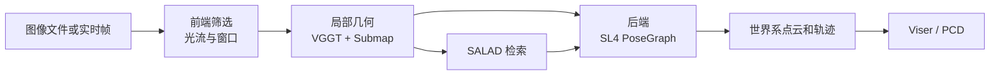
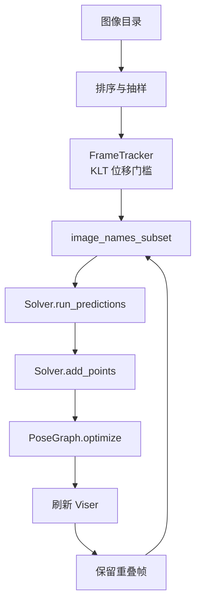
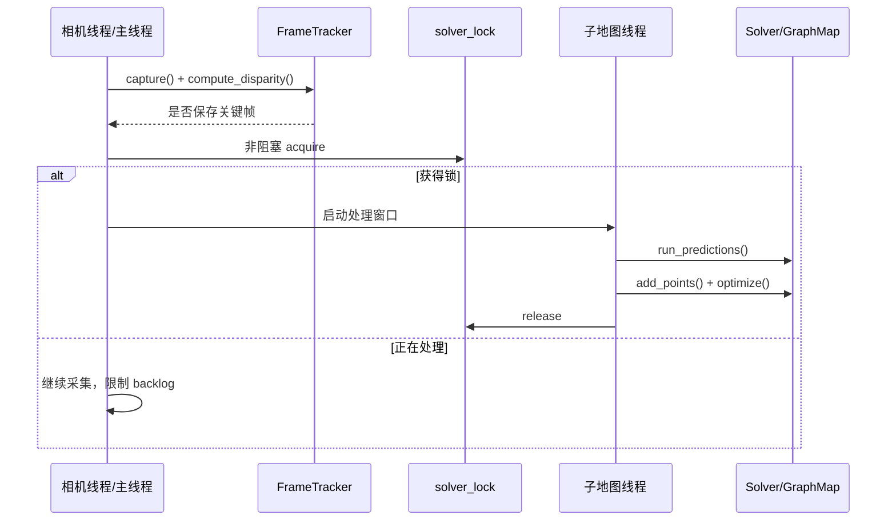

# VGGT-SLAM 代码讲解：从启动、模型到世界点云

全文按下面六个问题追踪每个变量：

1. 它由谁产生？
2. 进入当前函数时是什么形状？
3. 它属于哪个坐标系或计算层？
4. 当前函数对它做了什么？
5. 为什么要做这一步？
6. 哪个下游函数继续消费它？

只给抽象形状通常不足以形成直觉。因此全文固定使用以下数字：

    B = 1                         一个推理 batch
    S = 5                         小窗口教学实例中的帧数
    S = 17                        submap_size=16、overlap=1 时的窗口帧数
    原图 = 1920×1080              office_loop 的典型输入尺寸
    网络图像 = 294×518            宽度变成 518，高度取 14 的倍数
    patch_size = 14
    patch 网格 = 21×37 = 777
    camera token = 1
    register token = 4
    每帧 token = 1+4+777 = 782
    token 通道 = 1024
    SALAD 描述子 = 64×128+256 = 8448 维

其中 S=5 用来追踪张量下标，S=17 用来解释默认滑动窗口；二者都是具体教学实例。

## 1. 先建立三个不能混用的数字

项目中有三个看起来都像“相似度”的数字，但它们来自不同层。

| 数字 | 来源 | 代码中的判断 |
|---|---|---|
| SALAD best_score | 全局描述子的 L2 距离 | 越小越相似，必须小于 lc_thres |
| image_match_ratio | VGGT global attention 派生统计 | 当前实现要求至少 0.95 |
| GTSAM factor error | Prior/Between 因子的残差代价 | 优化器尝试降低 |

SALAD 只负责外观候选，image_match_ratio 负责双帧 VGGT 验证，factor error 负责后端图优化。不能用其中一个数字解释另一个层的行为。

## 2. 项目启动和 launch.json

当前 .vscode/launch.json 主要有两个调试入口：

    VGGT-SLAM：运行 office_loop
    VGGT-SLAM：运行当前 Python 文件

运行项目入口的关键字段是：

    type = debugpy
    request = launch
    python = 项目/.venv/bin/python
    program = 项目/main.py
    cwd = 项目根目录
    console = integratedTerminal
    justMyCode = false
    subProcess = true

每个字段解决不同问题：

- python 固定虚拟环境，避免 VS Code 使用系统 Python。
- program 固定主入口，不会因为当前打开的是 solver.py 就启动错误文件。
- cwd 保证 office_loop、logs 和模型缓存的相对路径从项目根目录解析。
- justMyCode=false 允许进入 third_party/vggt 和 third_party/salad 调试。
- subProcess=true 允许调试器跟踪子进程。
- TORCH_HOME、HF_HOME、MPLCONFIGDIR 将权重和缓存固定在项目目录。
- MPLBACKEND=Agg 避免无图形环境下 Matplotlib 阻塞。
- OMP_NUM_THREADS=4 防止多个 CPU 后端同时抢占全部线程。

当前 office_loop 调试参数还包含：

    --image_folder office_loop
    --submap_size 2
    --max_loops 1
    --vis_map
    --vis_voxel_size 0.01
    --keep_alive
    --log_results

调试配置使用 submap_size=2，便于快速观察。README 中的默认解释使用 submap_size=16。真正的窗口长度等于新帧数加重叠帧数。

## 3. 显存和 WebGL 问题的根源

### 3.1 为什么别人的测试显存够，自己的运行却不够

一次 VGGT forward 的显存至少包括：

    模型参数
    + 当前窗口 token 和注意力激活
    + DPT 和 camera head 中间特征
    + 回环双帧的第二次 forward
    + Submap 中长期保存的 frames
    + Submap 中长期保存的 SALAD retrieval_vectors
    + CUDA allocator cache

固定一个窗口：B=1、S=17、H=294、W=518。

每帧 patch 数是 21×37=777，加 5 个特殊 token 后 P=782。单个 frame attention 的主体可看成：

    B*S × P × C = 17 × 782 × 1024

global attention 的主体可看成：

    B × (S*P) × C = 1 × 13294 × 1024

这还没有计算 q、k、v、multi-head 临时张量、SDPA 缓冲和 DPT 多层特征。窗口从 S=3 增到 S=17 时，global token 数从 2346 增到 13294，峰值会明显增加。

当前项目还会把 new_submap.frames 和 SALAD 描述子保存到 Submap。predictions 转成 CPU NumPy 以后，历史 Submap 仍可能持有 GPU Tensor。因此比较两次运行时要固定：

    同一个 Python 进程是否残留
    同一个 submap_size 和关键帧数量
    是否打开回环
    是否打开 --vis_imgs
    是否存在其他 CUDA 进程

### 3.2 为什么 Viser 已连接但浏览器空白

曾经出现过：

    THREE.WebGLRenderer: A WebGL context could not be created.
    GL_VENDOR = Disabled
    GL_RENDERER = Disabled
    Sandboxed = yes
    Error creating WebGL context.

这表示 HTTP 和 WebSocket 可能已经正常，但 Chrome 的 Three.js 无法创建 WebGL context。viser 的 Connection opened 只证明浏览器收到场景消息，不证明浏览器可以渲染三维场景。

open_viewer.sh 使用独立 Chrome 配置和 SwiftShader：

    --user-data-dir=.cache/viser-chrome
    --use-gl=angle
    --use-angle=swiftshader
    --enable-unsafe-swiftshader
    --no-proxy-server

服务仍然运行时，可以在另一个终端执行：

    ./open_viewer.sh 8080

如果只想验证点云文件，不要重新加载 VGGT：

    .venv/bin/python view_pcd.py logs/office_loop_poses_points.pcd \
        --voxel_size 0.05 --port 8081
    ./open_viewer.sh 8081

view_pcd.py 的数据流是：

    Open3D 读取 PCD
    → 删除 NaN 和 Inf
    → 可选 voxel_down_sample(0.05)
    → Viser add_point_cloud

voxel_size 只影响发送给浏览器的点数，不影响模型 forward 显存，也不改原始 PCD。

## 4. 主循环和滑动窗口

main.py 用 image_names_subset 保存当前尚未送入 VGGT 的图片路径。默认：

    submap_size = 16
    overlapping_window_size = 1

固定例子：

    第一批：[0,1,2,...,15,16]
    处理后保留：[16]
    第二批：[16,17,18,...,31,32]
    处理后保留：[32]

图像 16 同时属于两个 VGGT 窗口。两个窗口对同一张图的局部深度尺度可能不同，add_edge() 使用它来估计窗口之间的关系。

当：

    len(image_names_subset) == submap_size + overlapping_window_size

或当前到达最后一张图片时，main.py 执行：

    predictions = solver.run_predictions(...)
    solver.add_points(predictions)
    solver.graph.optimize()
    更新可视化
    保留最后一个重叠帧

Python 中 list[-0:] 等于 list[0:]，因此 overlapping_window_size=0 不会清空列表。当前代码主要支持默认的 1。

## 5. run_predictions：普通序列输入

### 5.1 图像尺寸

load_and_preprocess_images() 默认使用 crop 模式。office_loop 的原图是 1920×1080，宽度缩放到 518：

    H' = 14 * round((1080*518)/(1920*14)) = 294
    W' = 518

因此 S=17 的窗口进入模型前是：

    images.shape = [17, 3, 294, 518]

模型内部发现输入是 4 维，会增加 batch 维：

    [17,3,294,518] → [1,17,3,294,518]

### 5.2 当前 Submap 的字段

run_predictions() 先创建 new_submap，然后保存：

    frames
    frame_ids
    last_non_loop_frame_index
    retrieval_vectors
    img_names

此时 new_submap 还没有通过 map.add_submap() 放入 GraphMap。它先用于当前窗口的模型推理和回环检索。

### 5.3 普通 VGGT 输出

CompatibleVGGT 只启用 camera head 和 depth head，关闭未使用的 point head、track head。主要输出可按下面理解：

    pose_enc       [1,S,9]
    depth          [1,S,1,H,W]
    depth_conf     [1,S,1,H,W]
    images         [1,S,3,H,W]
    target_tokens  模型特征
    image_match_ratio 普通 forward 通常为 None

pose_enc 的 9 个数是：

    tx, ty, tz, qx, qy, qz, qw, fov_h, fov_w

## 6. Aggregator：从像素到跨帧 token

### 6.1 patch 和特殊 token

对于 H=294、W=518、patch_size=14：

    patch_h = 294/14 = 21
    patch_w = 518/14 = 37
    patch 数 = 21×37 = 777

每帧还会加入：

    1 个 camera token
    4 个 register token
    777 个 patch token

所以每帧：

    P = 1+4+777 = 782

每个 token 是 C=1024 维特征，不是三维坐标。

### 6.2 frame attention

frame attention 将 token 整理为：

    [B*S, P, C]

固定 S=5 时：

    [5, 782, 1024]

每个帧作为独立的 batch 项，只在本帧内部交互。墙面纹理、地面和本帧上下文会影响本帧的 camera token 和 patch token。

### 6.3 global attention

global attention 将 token 整理为：

    [B, S*P, C]

固定 S=5 时：

    [1, 3910, 1024]

此时第 0 帧的墙面 patch 可以读取第 4 帧的信息。多个 block 交替执行 frame/global attention，最终保留多个中间层供 camera head 和 DPT head 使用。

### 6.4 一个具体注意力计算

假设一个 query 和两个 key 的缩放点积为：

    [0, log(3)]

softmax 后是：

    [0.25, 0.75]

如果两个 value 分别为 2 和 6，输出是：

    0.25×2 + 0.75×6 = 5

这是特征聚合，不是像素对应，也不直接产生一个三维点。

### 6.5 compute_similarity=True

回环双帧使用：

    model(lc_frames, compute_similarity=True)

Aggregator 到达 target_layer 时取 global block 的 q/k，并调用 get_similarity()。这个 image_match_ratio 只用于双帧验证，不是点云内点率，也不是后端 factor error。

## 7. Camera head：从 camera token 到内外参

CameraHead.forward() 取最后一个 Aggregator 层：

    tokens = aggregated_tokens_list[-1]

固定实例可看成：

    [B,S,P,2048] = [1,5,782,2048]

取每帧第 0 个 camera token：

    pose_tokens = tokens[:, :, 0]
    [1,5,782,2048] → [1,5,2048]

经过 token_norm 和迭代 trunk 后，返回多个位姿编码。run_predictions() 只取最后一次。

pose_encoding_to_extri_intri() 把编码拆开：

    T = pose_encoding[..., :3]
    quat = pose_encoding[..., 3:7]
    fov_h = pose_encoding[..., 7]
    fov_w = pose_encoding[..., 8]

四元数转换为 R，拼成：

    extrinsic = [R | T]

输出形状：

    [1,S,3,4]

它表示世界坐标到相机坐标：

    p_C = [R|t] p_W

对 H=294、W=518：

    cx = W/2 = 259
    cy = H/2 = 147
    fx = (W/2) / tan(fov_w/2)
    fy = (H/2) / tan(fov_h/2)

若 fov_w=90°，则 fx=259。视场角要以弧度传入 tan。

## 8. DPT head：从 patch token 到深度

DPT 只取 patch token：

    x = aggregated_tokens_list[layer_idx][:, :, patch_start_idx:]

patch_start_idx=5 时：

    782 - 5 = 777 个 patch token

每层特征的形状变化是：

    [B,S,777,2048]
    → [B*S,777,2048]
    → LayerNorm
    → [B*S,2048,777]
    → [B*S,2048,21,37]
    → project
    → resize

四个中间层分别使用 projects[dpt_idx] 和 resize_layers[dpt_idx]。dpt_idx 是“第几个选中的中间层”，不是帧编号。

四层特征经过 scratch_forward() 融合、插值回图像大小和 output_conv2 后，DPT 原始输出是：

    preds = [B,S,1,H,W]
    conf  = [B,S,1,H,W]

当前 solver.py 的注释和 geometry.py 的使用习惯有时写成 [S,H,W,1]。统一转 NumPy 时只 squeeze(0) 会得到 [S,1,H,W]，若现场出现反投影维度错误，应打印实际形状并在边界显式转置。

## 9. SALAD：外观回环候选

ImageRetrieval.get_batch_descriptors() 对每帧执行：

    Tensor [3,H,W]
    → PIL
    → Resize 224×224
    → ToTensor
    → ImageNet 标准化
    → DINOv2 backbone
    → SALAD aggregator
    → [8448] 全局描述子

当前 SALAD 参数是：

    num_clusters = 64
    cluster_dim = 128
    token_dim = 256

因此：

    64×128 + 256 = 8448

find_loop_closures() 对当前子地图中的每个 query_vector 调用 map.retrieve_best_score_frame()。历史搜索跳过当前子地图、最新普通子地图和回环辅助块。

描述子距离是：

    score = norm(embedding - query_vector)

固定例子：

    当前帧 0 → 历史 3/5，距离 0.31
    当前帧 1 → 历史 7/2，距离 0.88
    当前帧 2 → 历史 4/6，距离 1.12

阈值为 0.95 时，前两帧成为候选，第三帧被丢弃。max_loop_closures=1 时，队列只返回距离最小的第 0 帧。

LoopMatch 保存：

    similarity_score
    query_submap_id
    query_submap_frame
    detected_submap_id
    detected_submap_frame

它描述的是一对“当前局部帧—历史局部帧”，不是全局点云约束。

## 10. 深度反投影：一个像素的具体计算

针孔模型是：

    z = depth[v,u]
    x = (u-cx) * z / fx
    y = (v-cy) * z / fy

固定：

    u=300
    v=120
    z=2.0
    fx=500
    fy=500
    cx=259
    cy=147

则：

    x=(300-259)*2/500=0.164
    y=(120-147)*2/500=-0.108
    z=2.0

得到相机坐标点：

    p_C=(0.164,-0.108,2.0)

geometry.py 中虽然函数名和局部变量叫 world_points，但 unproject_depth_map_to_point_map() 最后保存并返回的是 cam_coords_points。因此 add_points() 中的 world_points 实际仍是相机坐标点。

## 11. add_points：把模型结果放进 Submap

普通路径读取：

    images
    extrinsic
    intrinsic
    depth
    depth_conf

然后：

    world_points = unproject_depth_map_to_point_map(...)
    colors = images.transpose(0,2,3,1) * 255
    cam_to_world = closed_form_inverse_se3(extrinsics_cam)
    world_to_cam = inv(cam_to_world)

Submap 保存：

    pointclouds
    colors
    conf
    conf_threshold
    proj_mats
    poses
    conf_masks

置信度阈值是：

    percentile(conf, init_conf_threshold) + 1e-6

它先保存完整数组，读取世界点时才按阈值筛选。低置信度点没有在 add_points() 入口处立刻从所有数组中删除。

## 12. add_edge：把局部子地图接到全局图

节点编号：

    node_id = submap_id + frame_id

固定例子：

    子地图 0：[A,B,C] → 节点 0,1,2
    子地图 3：[C,D,E] → 节点 3,4,5

两个 C 是同一张图，但来自不同 VGGT 窗口，因此仍然是两个局部节点。

### 12.1 good_mask

连接两侧重叠帧时，读取两侧置信度：

    current_conf = current_submap.get_conf_masks_frame(frame_id_curr)
    prior_conf = prior_submap.get_conf_masks_frame(frame_id_prev)

初始 mask 要求两侧同时超过 prior 的阈值，再 reshape 成 [H*W]。少于 100 个点时，代码放宽为只看 prior 阈值，再放宽为 prior>0。

当前实现两侧都使用 prior_submap.get_conf_threshold()，没有分别使用当前子地图阈值。

### 12.2 scale_factor

跨块内参修正：

    P_temp = inv(K_prior) @ K_current

筛选后的当前点：

    t1 = (P_temp[:3,:3] @ current_points.T).T

参考点：

    t2 = prior_points

scale_solver.py 对每个点计算：

    ratio_i = norm(t2[i]) / norm(t1[i])
    scale = median(ratio_i)

固定例子：

    t1 距离：[1.0,2.0,3.0]
    t2 距离：[2.0,4.1,5.9]
    ratio：  [2.0,2.05,1.9667]
    median： 2.0

构造：

    H_scale = diag(2.0,2.0,2.0,1.0)

### 12.3 H_overlap 和节点初值

跨块相对关系：

    H_overlap = inv(K_prior) @ K_current @ H_scale

当前第一节点的全局初值：

    H_w_current = H_w_prior @ H_overlap

坐标流是：

    当前相机点
    → H_overlap
    → 参考侧坐标
    → H_w_prior
    → 全局地图

普通子地图内部：

    H_inner = world_to_cam[index-1] @ inv(pose)
    current_node = previous_node @ H_inner

如果 E_i 表示局部系到第 i 个相机系：

    p_Ci = E_i p_L
    p_C(i-1) = E_(i-1) inv(E_i) p_Ci

所以 H_inner 是当前相机坐标到前一相机坐标的变换。

### 12.4 第一个节点和回环分支

没有 prior 子地图时，只允许：

    submap_id_curr=0
    frame_id_curr=0

创建单位初值并添加 PriorFactorSL4，固定全局参考。

is_loop_closure=True 时，当前历史节点已经存在，代码不重新插入节点，只添加 BetweenFactor，然后提前返回，避免重复添加辅助块内部边。

## 13. run_predictions 的回环双帧路径

候选列表非空时：

    retrieved_frames = map.get_frames_from_loops(detected_loops)

然后只取第一个候选：

    current_query = new_submap.get_frame_at_index(
        detected_loops[0].query_submap_frame
    )
    historical = retrieved_frames[0]
    lc_frames = stack([current_query,historical], axis=0)

形状：

    [3,H,W] + [3,H,W] → [2,3,H,W]

调用：

    predictions_lc = model(lc_frames, compute_similarity=True)

模型内部加 batch 后是 [1,2,3,H,W]。如果 image_match_ratio<0.95：

    predictions_lc = None
    predictions["detected_loops"] = []

普通子地图仍然继续建图，但不创建回环辅助子地图。

如果通过：

    self.graph.increment_loop_closure()
    extrinsic_lc, intrinsic_lc = pose_encoding_to_extri_intri(...)
    predictions["extrinsic_lc"] = extrinsic_lc
    predictions["intrinsic_lc"] = intrinsic_lc
    predictions["depth_lc"] = predictions_lc["depth"]
    predictions["depth_conf_lc"] = predictions_lc["depth_conf"]

increment_loop_closure() 只是计数，不是添加 GTSAM 因子。真正的因子在后面的 add_points() 和 add_edge() 中加入。

普通和回环字段统一转换时：

    float()
    → cpu()
    → numpy()
    → squeeze(0)

所以外参从 [1,S,3,4] 变为 [S,3,4]。frames_lc 是在这个循环之后才放入 predictions，因此仍然是 PyTorch Tensor，add_points() 会显式调用 cpu().numpy()。

回环文件名保持：

    frames_lc_names[0] = 当前查询图像
    frames_lc_names[1] = 历史匹配图像

### 多候选的实际边界

当前代码只对 detected_loops[0] 构造 lc_frames 和运行一次双帧 VGGT。若 detected_loops 有多个元素，后续 add_points() 循环可能复用第一组 frames_lc、depth_lc 和 pose，同时使用不同的 LoopMatch ID。命令行帮助也明确当前主要支持 max_loops=1。

## 14. 回环辅助子地图的图结构

设：

    Q  = 已有地图中的当前查询节点
    A0 = 辅助子地图第 0 帧，查询图像
    A1 = 辅助子地图第 1 帧，历史图像
    H  = 已有地图中的历史节点

add_points() 调用：

    add_edge(lc_submap_num,0,
             query_submap_id,query_submap_frame,
             is_loop_closure=False)

先连接 Q 和 A0，然后因为 is_loop_closure=False，继续添加辅助块内部 A0-A1。

第二次：

    add_edge(detected_submap_id,detected_submap_frame,
             lc_submap_num,1,
             is_loop_closure=True)

只连接 A1 和 H，不重新创建 H，也不重新添加 A0-A1。

最终：

    Q —— A0 —— A1 —— H

辅助块让同一次双帧 VGGT 产生的局部坐标系同时连接到当前地图和历史地图。

## 15. optimize、可视化和窗口重置

main.py 的顺序是：

    solver.add_points(predictions)
    with backend_time:
        solver.graph.optimize()
    loop_closure_detected = len(predictions["detected_loops"]) > 0
    if args.vis_map:
        if loop_closure_detected:
            solver.update_all_submap_vis()
        else:
            solver.update_latest_submap_vis()
    image_names_subset = image_names_subset[-overlap:]

add_points() 负责建立节点和因子，optimize() 才使用全部图状态求新的 Values。PoseGraph.optimize() 采用 GTSAM Levenberg-Marquardt，最后执行：

    self.values = result

没有回环时只更新最新子地图，减少 Viser 传输。有回环时历史节点也可能移动，所以刷新全部子地图。

## 16. 从优化后的 H 到世界点

Submap.pointclouds 中的点仍是相机坐标。读取世界点时：

    p_camera_h = [x,y,z,1]
    p_world_h = H_i @ p_camera_h
    p_world = p_world_h[:3] / p_world_h[3]

LM 优化不会逐点改写 pointclouds，只更新 H_i。Viser 和 PCD 都在读取时使用优化后的 H_i。

Viser 路径：

    get_points_in_world_frame(graph)
    → 可选 voxel_down_sample
    → scene.add_point_cloud
    → WebSocket
    → Three.js/WebGL

PCD 路径：

    遍历 Submap
    → 拼接高置信度世界点和颜色
    → Open3D write_point_cloud
    → binary PCD

office_loop 的本地 PCD 约有 53,657,975 个点、约 858 MB。它很大并不代表浏览器一定能显示，因为浏览器还必须成功创建 WebGL context。

## 17. 排障时的固定检查顺序

### 启动

    1. 确认 VS Code 使用 .venv/bin/python
    2. 确认 cwd 是项目根目录
    3. 确认缓存目录可写
    4. 先关闭 --run_os，确认普通建图

### CUDA OOM

    1. nvidia-smi 检查残留进程
    2. 打印 B、S、H、W
    3. 确认是否有第二次回环 forward
    4. 检查 Submap.frames 和 retrieval_vectors 的 device
    5. 降低 submap_size，暂时关闭回环和 --vis_imgs

### Viser 白屏

    1. 确认 HTTP 页面可打开
    2. 查看 Console 是否有 WebGL context 错误
    3. 使用 ./open_viewer.sh 的 SwiftShader
    4. 使用 view_pcd.py 验证 PCD
    5. 独立查看也失败时再查 PCD、Open3D 和服务端数据

### 回环不入图

    print("SALAD loops:", detected_loops)
    print("image_match_ratio:", predictions_lc["image_match_ratio"])
    print("final loops:", predictions["detected_loops"])
    print("graph loops:", self.graph.get_num_loops())

这四个量依次回答：

    有没有外观候选？
    双帧 VGGT 是否接受？
    是否把候选交给 add_points？
    是否计入已接受回环？

## 18. 源码阅读地图

| 文件或函数 | 需要回答的问题 |
|---|---|
| main.py | 窗口何时触发，优化何时发生，为什么保留 overlap |
| solver.py::run_predictions | 普通和回环预测如何进入 predictions |
| solver.py::add_points | 深度、点云、置信度怎样登记 |
| solver.py::add_edge | 尺度、节点初值、内部边和回环边 |
| submap.py | 局部点、颜色、置信度和世界点读取 |
| map.py | 子地图容器、检索、轨迹和 PCD |
| graph.py | SL4 Values、PriorFactor、BetweenFactor 和 LM |
| loop_closure.py | SALAD 描述子、LoopMatch 和候选队列 |
| third_party/vggt/.../aggregator.py | frame/global attention 和 image_match_ratio |
| third_party/vggt/.../camera_head.py | camera token 到 pose encoding |
| third_party/vggt/.../dpt_head.py | patch token 到 depth/confidence |
| third_party/vggt/.../geometry.py | depth、内参到相机点 |
| view_pcd.py / open_viewer.sh | 独立点云查看和软件 WebGL |

更长的数学推导和 office_loop 运行产物见：

    docs/vggt_slam_tutorial/01_why_vggt_slam_needs_submaps.md
    docs/vggt_slam_tutorial/01a_runtime_pipeline_and_state_ownership.md
    docs/vggt_slam_tutorial/02_from_images_to_vggt_geometry.md
    docs/vggt_slam_tutorial/03_from_local_geometry_to_sl4_graph.md
    docs/vggt_slam_tutorial/04_loop_closure_and_map_lifecycle.md
    docs/vggt_slam_tutorial/05_from_graph_to_world_map.md
    docs/vggt_slam_tutorial/06_complete_office_loop_case.md
    docs/vggt_slam_tutorial/appendix_b_parameters_memory_and_debugging.md

---

# 逐函数补充：把聊天中逐行讨论的函数完整展开

前面的章节按系统生命周期解释了代码。下面按聊天中实际打开过的函数，再做一次“输入—中间变量—输出”的局部追踪。这里的目标不是重复函数名，而是说明每一个变量在这一行之后代表什么。

## A. Aggregator.forward 的四个返回值

VGGT 的 Aggregator 接收：

    images: [B,S,3,H,W]
    compute_similarity: bool

固定一个回环双帧例子：

    B=1
    S=2
    H=294
    W=518

输入就是：

    images.shape = [1,2,3,294,518]

Aggregator 首先把每帧图像变成 patch token。294×518、patch=14 时：

    patch_h = 21
    patch_w = 37
    patch_num = 777

若每帧有 1 个 camera token 和 4 个 register token：

    P = 1+4+777 = 782

在 frame attention 前，token 可以理解为：

    [B*S,P,C] = [2,782,1024]

在 global attention 前，token 可以理解为：

    [B,S*P,C] = [1,1564,1024]

Aggregator 的核心循环会交替处理 frame blocks 和 global blocks。每个命中的中间层都可能把拼接后的 token 保存到 output_list。DPT 需要多个中间层，而 camera head 主要消费最后一层的 camera token。

### A.1 patch_start_idx

patch_start_idx 是 patch token 在一帧 token 序列中的起始位置。当前特殊 token 是 camera token 和 register token，共 5 个，因此：

    patch_start_idx = 5

切片：

    tokens[:, :, patch_start_idx:]

会删除前 5 个特殊 token，只保留 777 个 patch token。DPT 使用它恢复空间网格；如果把 0 误认为起始位置，camera/register token 会被错误地当成图像 patch，reshape 成 21×37 时就会错位。

### A.2 output_list

output_list 是一个 Python list。它的每个元素对应 Aggregator 某个中间层的拼接特征，而不是单独一帧图像。典型形式可以理解为：

    output_list[layer].shape = [B,S,P,2*C]
    output_list[layer].shape = [1,2,782,2048]

这里的 2048 来自 frame/global 两条路径各 1024 维的拼接。列表保留多个层，是因为 DPT 的四个尺度需要来自不同 Transformer 深度的特征。

### A.3 target_tokens

target_tokens 是在 target_layer 处保存的一份 token 快照。它不是 SALAD 的 8448 维检索描述子，也不是点云。它主要用于：

    保存目标层的视觉特征
    在需要时供相似度或调试路径使用

它通常仍然保留 batch 和 frame 维度，具体通道和 token 数取决于 aggregator 的目标层实现。CompatibleVGGT 返回它，但 solver 的统一 CPU 转换循环特意跳过 target_tokens。

### A.4 image_match_ratio

当 compute_similarity=False 时，image_match_ratio 通常为 None。普通窗口只需要相机和深度预测，不需要额外保存双帧相似度。

当 compute_similarity=True 且执行到 target_layer 的 global block 时，Aggregator 取出该层 q/k，调用 get_similarity()，返回一个标量。这个标量被 run_predictions() 与 0.95 比较：

    image_match_ratio < 0.95  → 丢弃回环
    image_match_ratio >= 0.95 → 保存回环几何字段

所以 Aggregator 的返回值是：

    return output_list, patch_start_idx, target_tokens, image_match_ratio

四者分别被后续使用：

| 返回值 | 后续消费者 | 作用 |
|---|---|---|
| output_list | camera_head、depth_head | 相机和深度预测的多层特征 |
| patch_start_idx | DPTHead | 从 token 序列分离 patch token |
| target_tokens | VGGT 输出字典 | 保留目标层视觉特征 |
| image_match_ratio | Solver.run_predictions | 双帧回环验证 |

## B. CameraHead.forward 的数据流

函数输入：

    aggregated_tokens_list: list[Tensor]
    num_iterations: int = 4

固定 S=5 的实例中，列表最后一个元素可以理解为：

    tokens = aggregated_tokens_list[-1]
    tokens.shape = [1,5,782,2048]

### B.1 取最后一个中间层

    tokens = aggregated_tokens_list[-1]

列表中早期层更偏局部视觉特征，最后一层包含更充分的跨帧几何信息。相机头只取最后层，是为了让一个 camera token 代表每帧经过完整 Transformer 处理后的全局状态。

### B.2 取 camera token

    pose_tokens = tokens[:, :, 0]

最后一维索引 0 不是取通道，而是取每帧 token 序列中的第一个 token。由于第 0 个 token 是 camera token：

    [1,5,782,2048] → [1,5,2048]

此时第 i 帧的 2048 维向量包含该帧相机姿态和视场相关信息。

### B.3 归一化和迭代 trunk

    pose_tokens = self.token_norm(pose_tokens)
    pred_pose_enc_list = self.trunk_fn(pose_tokens, num_iterations)

token_norm 只改变数值尺度，不改变帧数。trunk_fn 进行 4 次迭代式预测修正，每轮输出一个 [1,5,9] 编码。9 个数对应：

    [tx,ty,tz,qx,qy,qz,qw,fov_h,fov_w]

最后：

    return pred_pose_enc_list

返回的是一个 list，而不是单个 Tensor。VGGT 上层取：

    pose_enc = pose_enc_list[-1]

也就是最后一轮 refinement 的结果。早期轮次仍可用于分析收敛，但当前 Solver 不保存它们作为最终位姿。

## C. DPTHead.forward 和 dpt_idx

DPTHead.forward 的输入：

    aggregated_tokens_list
    images: [B,S,3,H,W]
    patch_start_idx
    frames_chunk_size=8

对于 S=17、H=294、W=518：

    images.shape = [1,17,3,294,518]

### C.1 是否分块处理帧

如果 frames_chunk_size=None 或大于等于 S，直接一次处理所有帧。

如果 frames_chunk_size=8：

    第一个 chunk：帧 0 到 7，共 8 帧
    第二个 chunk：帧 8 到 15，共 8 帧
    第三个 chunk：帧 16，共 1 帧

每个 chunk 调用 _forward_impl()，最后沿 dim=1 拼回：

    torch.cat(all_preds, dim=1)

分块只改变 DPT 头一次处理的帧数量，不改变输出的帧顺序。

### C.2 从 token 切出 patch

_forward_impl 中：

    x = aggregated_tokens_list[layer_idx][:, :, patch_start_idx:]

如果输入 token 是 [1,17,782,2048]，patch_start_idx=5：

    x.shape = [1,17,777,2048]

然后只处理当前 chunk 的帧，再 reshape：

    [B,chunk,777,2048]
    → [B*chunk,777,2048]
    → [B*chunk,2048,777]
    → [B*chunk,2048,21,37]

最后一个 reshape 把线性 patch 序列恢复为二维空间网格。

### C.3 dpt_idx 的实际作用

代码中：

    dpt_idx = 0
    for layer_idx in self.intermediate_layer_idx:
        ...
        x = self.projects[dpt_idx](x)
        if self.pos_embed:
            x = self._apply_pos_embed(x, W, H)
        x = self.resize_layers[dpt_idx](x)
        out.append(x)
        dpt_idx += 1

dpt_idx 是 DPT 的“第几个输入尺度”计数器。它不是：

    当前帧编号
    Transformer 的真实层号
    patch 的空间坐标

如果 intermediate_layer_idx=[4,11,17,23]，那么：

    layer_idx=4  → dpt_idx=0 → projects[0], resize_layers[0]
    layer_idx=11 → dpt_idx=1 → projects[1], resize_layers[1]
    layer_idx=17 → dpt_idx=2 → projects[2], resize_layers[2]
    layer_idx=23 → dpt_idx=3 → projects[3], resize_layers[3]

不同中间层的分辨率和统计分布不同，所以每个 dpt_idx 都要使用与该层匹配的投影和 resize 模块。若误把 dpt_idx 当作 layer_idx，会选择错误的参数组。

### C.4 四层融合和输出

四个 out 元素经过 scratch_forward() 融合：

    out = [layer_0, layer_1, layer_2, layer_3]
    out = scratch_forward(out)

然后插值到目标图像尺寸，通过 output_conv2 得到两个通道：

    第 0 个通道 → 深度预测
    第 1 个通道 → 置信度预测

activate_head() 应用：

    activation = exp
    conf_activation = expp1

最后 reshape：

    preds = [B,S,1,H,W]
    conf  = [B,S,1,H,W]

当前工程的下游注释有时使用 [S,H,W,1]，所以读取深度时必须以实际打印出来的 shape 为准。

## D. SALAD 聚合器 forward 的数据流

SALAD 聚合器的输入是一个二元组：

    x = (f, t)

固定一个 batch：

    f.shape = [B,C,H/14,W/14]
    t.shape = [B,C]

例如 DINOv2 输出：

    f = [2,768,16,16]
    t = [2,768]

这对应 224×224 输入，因为 224/14=16。

### D.1 cluster_features

    f = self.cluster_features(x).flatten(2)

cluster_features 把每个空间位置的 768 维 backbone 特征映射到 cluster_dim=128：

    [2,768,16,16]
    → [2,128,16,16]
    → flatten(2)
    → [2,128,256]

这里 256=16×16，是空间位置数。

### D.2 score

    p = self.score(x).flatten(2)

score 为每个空间位置产生到各个 cluster 的匹配分数。若 num_clusters=64：

    p.shape = [2,64,256]

每个 batch、每个 cluster、每个 patch 都有一个分数。

### D.3 token_features

    t = self.token_features(t)

token_features 把全局 token 从 768 维投影到 token_dim=256：

    [2,768] → [2,256]

这一支是 global token 描述子，不经过空间聚类。

### D.4 Sinkhorn matching

    p = get_matching_probs(p, self.dust_bin, 3)
    p = torch.exp(p)
    p = p[:, :-1, :]

Sinkhorn 算法把局部 patch 和 cluster 的匹配分数变成近似质量守恒的匹配概率。dust_bin 是一个“未匹配”容器，用于吸收不适合任何 cluster 的 patch。

在 exp 之前，p 是对数概率；exp 后变成正的匹配质量。p[:, :-1, :] 删除最后一个 dust-bin，只保留真实 cluster：

    [2,65,256] → [2,64,256]

### D.5 加权聚合

    p = p.unsqueeze(1).repeat(1, self.cluster_dim, 1, 1)
    f = f.unsqueeze(2).repeat(1, 1, self.num_clusters, 1)

形状：

    p: [2,64,256]
       → [2,1,64,256]
       → [2,128,64,256]

    f: [2,128,256]
       → [2,128,1,256]
       → [2,128,64,256]

这样每个 cluster 都能对全部空间特征做加权和：

    (f*p).sum(dim=-1)
    [2,128,64,256] → [2,128,64]

对 cluster 维做归一化并 flatten：

    [2,128,64] → [2,8192]

再把 token 分支拼接：

    token 分支：[2,256]
    cluster 分支：[2,8192]
    concat：    [2,8448]

最后：

    return normalize(f, p=2, dim=-1)

所以 SALAD 返回每张图一个 8448 维、L2 归一化的全局描述子。

## E. geometry.unproject 的坐标返回顺序

unproject_depth_map_to_point_map() 接收：

    depth_map: [S,H,W,1] 或 [S,H,W]
    extrinsics_cam: [S,3,4]
    intrinsics_cam: [S,3,3]

如果输入是 Tensor，先搬到 CPU 并转 NumPy。每帧调用：

    cur_world_points, cam_coords_points, valid_mask =
        depth_to_world_coords_points(...)

depth_to_world_coords_points() 内部确实计算了：

    cam_coords_points
    cam_to_world_extrinsic
    world_coords_points

但 unproject_depth_map_to_point_map() 最后执行：

    world_points_list.append(cam_coords_points)

因此最终返回：

    world_points_array.shape = [S,H,W,3]

但其数值属于每帧相机坐标系。变量名 world_points 是历史命名，不能替代实际返回语句作为坐标系证据。

## F. find_loop_closures 的逐行数据流

函数输入：

    map
    submap
    max_similarity_thres=0.80
    max_loop_closures=0

第一行：

    matches_queue = LoopMatchQueue(max_size=max_loop_closures)

创建容量受限的候选队列。主程序通常传 max_loops=1，而不是函数默认的 0。

第二行：

    query_id = 0

query_id 是当前子地图的局部帧下标。

循环：

    for query_vector in submap.get_all_retrieval_vectors():

如果当前块有 S=5 帧，就执行 5 次，每次 query_vector 是一个 [8448] 描述子。

检索：

    best_score, best_submap_id, best_frame_id =
        map.retrieve_best_score_frame(
            query_vector,
            submap.get_id(),
            ignore_last_submap=True,
        )

返回：

    best_score       历史全局最小 L2 距离
    best_submap_id   最相似帧所在的历史子地图
    best_frame_id    该帧在历史子地图中的局部下标

阈值：

    if best_score < max_similarity_thres:

注意 score 是距离，所以越小越相似。

构造：

    LoopMatch(
        best_score,
        submap.get_id(),
        query_id,
        best_submap_id,
        best_frame_id,
    )

最后：

    query_id += 1
    return matches_queue.get_matches()

返回列表已经由队列按距离从小到大排列，并且长度不超过 max_loop_closures。

## G. main.py 三行为什么必须按这个顺序

主循环中：

    solver.add_points(predictions)
    with backend_time:
        solver.graph.optimize()
    可视化
    image_names_subset = image_names_subset[-overlap:]

第一步把预测结果注册到 Submap 和 PoseGraph。第二步才有节点和因子可优化。第三步读取优化后的 H_i 变换点云。第四步保留当前窗口末尾的共享帧，供下一窗口和旧块连接。

如果先可视化再 optimize，浏览器看到的是节点初始位置，不是全局优化后位置。如果先清空 image_names_subset，下一块将没有重叠帧，add_edge() 就失去正常尺度估计所依赖的共享观测。

## H. 一次完整的固定数字链

使用：

    原图：1920×1080
    网络图像：294×518
    窗口：S=5
    patch：14
    深度：每像素一个 z

从像素 (300,120) 和 z=2.0 开始：

    K = [[500,0,259],
         [0,500,147],
         [0,0,1]]

反投影：

    p_C=(0.164,-0.108,2.0)

假设该帧属于子地图 3 的局部帧 2：

    node_id = 3+2 = 5

假设图优化给出的 homography 是：

    H_5 = identity with translation x=1.0

则齐次点：

    [0.164,-0.108,2.0,1]

变到世界系：

    [1.164,-0.108,2.0,1]

若两窗口对同一重叠帧估计出的尺度是 2.0，则当前窗口的点先乘：

    H_scale = diag(2,2,2,1)

再通过 H_overlap 和旧节点 H_prior 进入全局图。图优化不会修改最初的相机点数组，而是在下一次读取 H_5 时改变最终世界坐标。


---

# 完整章节收录说明

上一部分按照聊天中的提问顺序建立了主线。下面完整收录仓库中已经整理好的详细教程章节，不用链接跳转即可继续阅读。每个章节前保留原文件路径，便于回到源码和原始章节维护。


---

# 完整收录：docs/VGGT-SLAM-项目讲解.md


# VGGT-SLAM 项目讲解

本次聊天按“启动问题 → 模型内部 → 几何与图优化 → 回环 → 主循环”的顺序整理在 [docs/代码讲解/VGGT-SLAM-代码讲解.md](VGGT-SLAM-代码讲解.md)；它固定使用 1920×1080 → 294×518、patch=14、P=782 等具体数字追踪张量和坐标变换。

这份入口文档已经按 Hydra 教程的生成流程拆分：先建立表示链，再沿着数据生命周期阅读每一层，最后用 `office_loop` 的真实输出复盘。详细内容位于 [`docs/vggt_slam_tutorial/`](../vggt_slam_tutorial/README.md)。

## 推荐阅读顺序

```text
系统问题与架构
  -> 运行时管线和状态所有权
  -> 图像怎样经过 VGGT 变成几何
  -> 局部几何怎样进入 SL(4) 图
  -> SALAD 怎样提出回环约束
  -> 图状态怎样变成世界地图和 PCD
  -> office_loop 完整案例
  -> 依赖边界、参数排障、源码阅读地图
```

| 章节 | 主要问题 |
|---|---|
| [教程索引](../vggt_slam_tutorial/README.md) | 全部章节、表示链和读者验收问题 |
| [01：为什么需要 Submap](../vggt_slam_tutorial/01_why_vggt_slam_needs_submaps.md) | 前端、局部几何、全局图和输出层怎样分工 |
| [01a：运行时管线与状态所有权](../vggt_slam_tutorial/01a_runtime_pipeline_and_state_ownership.md) | 离线/实时路径、队列、GPU/CPU 边界和生命周期 |
| [02：从图像到相机坐标几何](../vggt_slam_tutorial/02_from_images_to_vggt_geometry.md) | token、相机头、DPT 深度、置信度和反投影 |
| [03：从局部几何到 SL(4) 图](../vggt_slam_tutorial/03_from_local_geometry_to_sl4_graph.md) | 尺度、节点、因子、残差、雅可比和 LM 更新 |
| [04：从 SALAD 到回环约束](../vggt_slam_tutorial/04_loop_closure_and_map_lifecycle.md) | 描述子候选、双帧验证和回环辅助 Submap |
| [05：从图状态到世界地图](../vggt_slam_tutorial/05_from_graph_to_world_map.md) | homography 如何改变点云、Viser 与 PCD 的分叉 |
| [06：office_loop 完整案例](../vggt_slam_tutorial/06_complete_office_loop_case.md) | 用本地 473 个文件、311 行轨迹和稠密 PCD 串起全流程 |
| [附录 A：实现边界与依赖](../vggt_slam_tutorial/appendix_a_implementation_boundaries_and_dependencies.md) | 项目代码、VGGT/SALAD、GTSAM 和论文的证据边界 |
| [附录 B：参数、显存与排障](../vggt_slam_tutorial/appendix_b_parameters_memory_and_debugging.md) | OOM、回环、PCD 和 WebGL 空白页的检查顺序 |
| [附录 C：源码阅读地图](../vggt_slam_tutorial/appendix_c_source_reading_map.md) | 按数据流定位函数和复核修改影响 |

## 统一阅读方法

每一层都按下面六个问题阅读：

1. 上游传入什么形状和坐标系的数据？
2. 内存中由哪个对象持有？
3. 哪些候选会被门槛或 mask 筛掉？
4. 优化、回环或显示更新时谁会改变它？
5. 它什么时候结束、被跳过或继续保留？
6. 哪个下游函数消费它？

文档中的证据标签含义如下：

- **[代码确认]**：可以直接定位到当前仓库的实现。
- **[依赖库确认]**：来自当前 checkout 实际调用的 VGGT、SALAD、GTSAM、Open3D 或 Viser。
- **[运行产物确认]**：来自本机日志、轨迹或 PCD 文件的测量。
- **[通用理论]**：相机模型、齐次坐标、李群和最小二乘的标准知识。
- **[工程推断]**：由调用关系、输入规模或资源表现推断出的解释，会单独标记。

## 当前案例的快速入口

```bash
# 直接读取已保存的稠密点云，不加载 VGGT
.venv/bin/python view_pcd.py --voxel_size 0.05 --port 8081
./open_viewer.sh 8081
```

本机 `logs/office_loop_poses_points.pcd` 的头部记录了 53,657,975 个点，文件约 858 MB；Viser 使用的 `--vis_voxel_size` 只影响浏览器发送数据，不会缩小这个 PCD，也不会降低 VGGT 一次 forward 的显存峰值。网页空白时，先看浏览器 Console 是否出现 `Could not create a WebGL context`，再决定查浏览器渲染还是查点云数据。

详细教程的研究审计底稿保存在 [`RESEARCH_LEDGER.md`](../vggt_slam_tutorial/RESEARCH_LEDGER.md)，用于记录源码证据、依赖边界和易混淆结论。


---

# 完整收录：docs/vggt_slam_tutorial/README.md


# VGGT-SLAM 详细教程

这套教程按照 Hydra 教程的生成流程重整 VGGT-SLAM 的阅读路径。它不把源码目录直接翻译成章节，而是沿着一条可复述的数据生命周期展开：

```text
磁盘图像 / RealSense 帧
  -> 预处理与关键帧候选
  -> 关键帧窗口与 Submap
  -> VGGT 共享视觉特征
  -> 相机、深度、置信度
  -> 相机坐标点云
  -> SL(4) 节点和 Between/Prior 因子
  -> SALAD 回环候选与双帧验证
  -> 优化后的世界系点云和相机轨迹
  -> Viser、poses.txt、binary PCD
```

每一层都回答六个问题：上游传入什么、内存中怎样表示、哪些候选被保留、数据如何更新、什么时候失效或结束、下游谁消费它。源码只作为行为证据，论文方法、固定依赖、通用数学和工程推断分别标记。

## 推荐阅读顺序

```text
01 系统问题与架构
  -> 01a 运行时管线与状态所有权
  -> 02 图像怎样经过 VGGT 变成几何
  -> 03 局部几何怎样进入 SL(4) 图
  -> 04 回环怎样生成附加约束
  -> 05 世界地图、Viser 和文件输出
  -> 06 office_loop 完整案例
  -> 附录 A 实现边界和版本
  -> 附录 B 参数、显存与故障排查
  -> 附录 C 源码阅读地图
```

| 篇目 | 主问题 | 阅读结果 |
|---|---|---|
| [01：为什么需要 VGGT-SLAM 与 Submap](../vggt_slam_tutorial/01_why_vggt_slam_needs_submaps.md) | 单张图像、整段视频和全局地图之间缺少什么表示 | 能说清前端、模型、后端和可视化的职责边界 |
| [01a：运行时管线、队列和状态所有权](../vggt_slam_tutorial/01a_runtime_pipeline_and_state_ownership.md) | 一帧图像在哪些阶段改变表示，谁持有可变状态 | 能定位显存、并发、窗口和生命周期问题 |
| [02：从图像到相机坐标几何](../vggt_slam_tutorial/02_from_images_to_vggt_geometry.md) | VGGT 的 token、注意力、相机头、DPT 深度头如何产生三维点 | 能从像素、深度和内参手算一个点 |
| [03：从局部点到 SL(4) 位姿图](../vggt_slam_tutorial/03_from_local_geometry_to_sl4_graph.md) | 子地图如何连接，尺度如何估计，GTSAM 因子如何更新节点 | 能追踪残差、雅可比、增量和点云写回 |
| [04：从外观检索到回环约束](../vggt_slam_tutorial/04_loop_closure_and_map_lifecycle.md) | SALAD 候选、VGGT 注意力相似度和回环子地图的真实作用 | 不会把检索分数误认为几何配准 |
| [05：从图状态到世界地图和浏览器](../vggt_slam_tutorial/05_from_graph_to_world_map.md) | 优化后的节点如何改变点云、轨迹、Viser 和 PCD | 能区分显示降采样和磁盘稠密输出 |
| [06：完整 office_loop 案例](../vggt_slam_tutorial/06_complete_office_loop_case.md) | 用一条实际运行把所有表示串起来 | 能从日志反查某个结果来自哪一层 |
| [附录 A：实现边界与依赖](../vggt_slam_tutorial/appendix_a_implementation_boundaries_and_dependencies.md) | 当前代码、VGGT/SALAD、GTSAM 和论文各自负责什么 | 不把外部依赖行为写成项目自有实现 |
| [附录 B：参数、显存和排障](../vggt_slam_tutorial/appendix_b_parameters_memory_and_debugging.md) | 参数怎样沿数据链改变结果，如何排查空白页面和 OOM | 有可执行的检查顺序和中间量 |
| [附录 C：源码阅读地图](../vggt_slam_tutorial/appendix_c_source_reading_map.md) | 读哪些文件、按什么顺序、每个符号验证什么 | 可以独立继续研究和改造项目 |
| [研究审计底稿](../vggt_slam_tutorial/RESEARCH_LEDGER.md) | 记录表示来源、证据差异和复核结果 | 用于审查教程结论是否仍与当前代码一致 |

## 贯穿案例和读者契约

贯穿案例是一台相机沿办公室走廊移动，最后回到曾经经过的位置。它会反复出现：

- 相邻帧变化太小时，光流选择器拒绝新关键帧；
- 视差足够大时，若干帧组成一个 `Submap`；
- VGGT 为窗口共享 token，并输出每帧的 `pose_enc`、深度和置信度；
- 局部点先保留在相机/子地图坐标，图优化后才变成世界坐标；
- SALAD 只提出外观候选，双帧 VGGT 相似度再决定是否创建回环约束；
- 回环优化后，旧子地图通过新的 homography 重新投影，浏览器和 PCD 读取同一份更新后的图状态。

读者只需要会读 Python、理解矩阵乘法和基本三维坐标。不会默认读者已经了解 SLAM、VGGT、SALAD、SL(4)、GTSAM 或 WebGL；每个术语第一次出现时会说明它解决的具体问题。

## 统一证据标签

- **[代码确认]**：当前仓库中可以直接定位到的行为。
- **[依赖库确认]**：当前 checkout 实际调用的 `third_party/vggt`、`third_party/salad`、GTSAM、Open3D 或 Viser 行为。
- **[通用理论]**：相机模型、齐次坐标、李群和最小二乘的标准知识。
- **[论文描述]**：README 引用的 VGGT-SLAM 研究方法；不能自动替代运行时代码。
- **[工程推断]**：由输入规模、内存和调用关系推断出的原因或建议。

固定源码版本记录在附录 A。GTSAM 的 Python wheel 能确认 API 和版本，但不携带完整源码 commit；涉及 SL(4) 的精确实现时，附录 A 会同时给出构建时间附近的官方 GTSAM 源码快照，并把它标为依赖证据。

## 先建立总表示链

| 层 | 输入 | 存储 | 选择/过滤 | 更新或生命周期 | 消费者 |
|---|---|---|---|---|---|
| 原始图像 | 路径或相机 BGR 帧 | 文件、临时 `numpy` 数组 | 排除深度、txt、db；按文件名数字排序 | 离线直到读取；实时帧可丢弃 | 光流和预处理 |
| 关键帧 | 当前帧与上一关键帧角点 | `FrameTracker` 状态 | KLT 成功点至少 10 个；平均位移大于阈值 | 通过则替换参考关键帧 | `image_names_subset` |
| 子地图 | 窗口内关键帧 | `Submap` 的 frames、文件名、检索向量 | 窗口大小等于新帧数加重叠帧 | 加入 `GraphMap` 后保留；回环块有独立标记 | VGGT、图、检索、可视化 |
| VGGT 表示 | `S×3×H×W` 图像 | aggregator tokens 与 DPT 特征 | 使用相机/深度头；关闭 point/track 头 | 一次 forward 的临时激活 | 外参、内参、深度、置信度 |
| 局部几何 | 深度、内参、外参 | `Submap.pointclouds`、colors、conf | 读取时用子地图置信度百分位阈值 | 原始数组保留；高置信度视图按需生成 | 尺度、homography、PCD |
| 图后端 | 节点初值与相对 homography | GTSAM `Values` 和 factor graph | 节点必须先初始化；边连接已存在节点 | 每个子地图后 LM 优化；值被替换 | 世界点和相机轨迹 |
| 回环 | SALAD 描述子与双帧注意力 | `LoopMatch`、回环 `Submap`、附加边 | 最近邻 L2 距离门槛、最大候选数、match ratio | 候选拒绝即丢弃；通过则块保留并参与图/导出 | `PoseGraph.optimize()` |
| 输出 | 世界点、姿态 | Viser 对象、txt、binary PCD | Viser 可 voxel 降采样；PCD 不使用该参数 | 服务会话或磁盘文件 | 浏览器、Open3D、评测 |

## 阅读后的验收目标

读完主线后，应该可以回答：

1. 一个 `image_names_subset` 是怎样从原始目录产生的？
2. `world_points` 为什么在 `Solver.add_points()` 中实际还是相机坐标点？
3. `Submap.proj_mats`、`PoseGraph` homography 和 `Submap.get_all_poses_world()` 分别表示什么？
4. SALAD 距离、`image_match_ratio` 和 GTSAM factor error 哪一个是外观候选、哪一个是注意力相似度、哪一个是后端代价？
5. LM 求解的 15 维增量如何通过 SL(4) retraction 改变 `Values`，再改变一个点的世界位置？
6. 为什么 `--vis_voxel_size` 能降低浏览器压力，却不能降低一次 VGGT forward 的显存？
7. 如果网页空白但 WebSocket 曾经连接，应该先查数据还是先查 WebGL？

如果其中任一问题答不出来，应回到对应章节的“来源—表示—筛选—更新—消费者”表，而不是只看术语表。


---

# 完整收录：docs/vggt_slam_tutorial/01_why_vggt_slam_needs_submaps.md


# VGGT-SLAM 教程（一）：为什么需要 Submap、前端和后端

一台相机沿办公室走廊前进。它连续拍下很多图片，但系统最终要交付的不是一串独立图片，而是一张可以定位、回看、校正和导出的三维地图。要理解当前项目，先不要从 `main.py` 的参数开始，而要先问：**一帧图像中的信息，为什么不能直接等于全局地图？**

本篇建立全系统的心智模型。读完后，读者应该知道：关键帧选择解决什么计算问题，Submap 解决什么表示问题，VGGT 解决什么几何问题，PoseGraph 解决什么全局一致性问题，回环为什么是旁路测量而不是“再跑一次建图”。

> **证据范围：** 本篇的运行时行为来自 `main.py`、`main_realtime.py`、`vggt_slam/solver.py`、`submap.py`、`map.py`、`graph.py` 和 `viewer.py`。论文只用于解释名称和方法背景；当前参数和生命周期以代码为准。

## 1. 机器人真正要维护的不是一张图，而是三种互相引用的状态

### 1.1 画面状态：我刚刚看到了什么

相机当前帧提供颜色和纹理，但一帧图像只在自己的像素坐标系中表达世界。像素 $(u,v)$ 没有自己的三维位置，必须结合预测深度和内参反投影。相机移动后，下一张图片又拥有新的像素坐标。因此，图像是**原始观测**，不是持久地图实体。

代码中的 `image_names`、`images` 和 `Submap.frames` 都属于这一层：它们保存的是“哪一帧被读取、以什么尺寸进入网络、以后是否还需要在 Viser 或语义查询中显示”。它们不负责证明两帧在世界中位于哪里。[代码确认]

### 1.2 局部几何状态：这一小段场景怎样自洽

VGGT 可以同时读取一个小窗口的帧，利用跨帧视觉关系预测相机编码和密集深度。窗口内部的几何是一个短期自洽的局部解释，但不同窗口不一定共享完全一致的原点、尺度或漂移。

`Submap` 是这个局部状态的容器。它保存帧、文件名、每帧的局部点、颜色、置信度、内参扩展矩阵和检索向量。它不是“地图里的一块已经固定的砖”，而是一个可以被后端 homography 重新放置的中间表示。

### 1.3 全局图状态：不同局部解释怎样互相约束

相邻 Submap 通常有一个重叠帧。这个共同观测可以建立跨块关系；Submap 内部连续帧也可以建立内部关系。所有节点和关系被放入 GTSAM 的 `NonlinearFactorGraph`，通过优化得到更一致的 `Values`。

因此同一个物理点会经历三次“被认识”：

```text
像素观测
  -> 局部相机坐标点
  -> 图节点 homography 下的世界点
  -> 回环优化后重新计算的世界点
```

最后一次不是生成新点，而是用更新后的状态重新解释同一批局部点。[代码确认：`Submap.get_points_in_world_frame()` 每次读取当前 graph homography]

## 2. 为什么不把全部图片一次送进 VGGT

### 2.1 全序列输入的三个代价

若把 $N$ 张图片一次送进模型，输入张量的基本形状是 $B\times N\times3\times H\times W$。VGGT aggregator 还要在帧内 token 和跨帧 token 之间反复做注意力。全局 token 数随 $N$ 增加，注意力中间结果和 DPT 头的激活都会增加。

三个后果分别是：

1. **显存压力**：一次 forward 的激活必须同时存在；
2. **更新延迟**：必须等整个序列结束才得到地图；
3. **错误传播范围大**：一段坏帧会影响整批全局解释。

这不是说大窗口一定更差；大窗口可能给模型更多跨帧约束，但本项目要在普通显卡和增量建图之间取平衡。[工程推断]

### 2.2 Submap 是一个计算边界，不是最终语义层

将关键帧按小窗口处理后，系统可以在一个窗口内集中做三件事：

- 让 VGGT 看到足够的视差和跨帧上下文；
- 用窗口内重叠帧把局部块连接起来；
- 在处理完以后释放或复用 forward 的临时激活，而长期只保留必要的子地图字段。

`submap_size` 表示一个子地图中新增的帧数，`overlapping_window_size` 表示下一块继续携带的旧帧数。窗口目标是两者之和，而不是单独的 `submap_size`。[代码确认]

一个具体序列如下：

```text
关键帧流：f0, f1, f2, f3, f4, f5, ...
submap_size=2, overlap=1
窗口 0：[f0, f1, f2]  -> 处理新增 f0,f1，保留 f2
窗口 1：[f2, f3, f4]  -> 处理新增 f3,f4，保留 f4
窗口 2：[f4, f5, f6]  -> ...
```

如果把重叠帧理解为“重复点云”，就会错过它的核心作用：它是连接相邻局部坐标解释的共同证据。

## 3. 四个模块边界



### 3.1 前端：决定哪些观测进入局部模型

前端没有估计完整世界地图。它只维护一个上一关键帧和角点追踪结果，使用平均像素位移判断当前帧是否足够有信息。它的输出是路径列表 `image_names_subset`，不是三维点。

### 3.2 模型桥：把窗口变成几何测量

`Solver.run_predictions()` 创建一个新的 `Submap`，保存窗口图像和 SALAD 描述子，然后调用 `model(images)`。模型返回的是测量和中间特征：相机编码、深度、置信度以及回环相似度统计量。它没有直接把所有窗口拼成永久世界地图。

### 3.3 后端：让局部测量共享一个全局解释

`Solver.add_points()` 把局部预测装入当前 `Submap`，再调用 `add_edge()` 创建节点和因子。`PoseGraph.optimize()` 只更新图中的 SL4 节点；点云并不会被逐点优化，而是下次读取 homography 时被重新变换。

### 3.4 输出层：消费当前状态，不拥有地图真相

Viser 读取世界系点和相机位姿，把它们发给浏览器；PCD 导出读取同一个图状态并写磁盘。浏览器 WebGL 失败时，地图状态可能仍然完整；可视化故障不能反推建图失败。

## 4. 节点、候选和临时对象的区分

Hydra 文档强调不能把“candidate、cluster、persistent node”混成一个对象。在当前 VGGT-SLAM 中，对应关系可以这样读：

| 对象 | 分类 | 创建 | 接受/拒绝 | 更新与结束 |
|---|---|---|---|---|
| 角点追踪 | 原始/临时候选 | `goodFeaturesToTrack` | KLT 状态为 1 且数量至少 10 | 参考关键帧更新时整体替换 |
| `image_names_subset` | 窗口候选 | 关键帧通过位移门槛 | 达到窗口大小才进入 VGGT | 子地图处理后重置为重叠帧 |
| 普通 `Submap` | 持久中间实体 | 窗口推理完成 | 总是加入 `GraphMap` | 当前代码没有合并、删除或归档 |
| `LoopMatch` | 回环候选 | SALAD 最近邻 | L2 距离和队列容量筛选；双帧 ratio 再筛 | 未通过则丢弃 |
| 回环 `Submap` | 约束辅助实体 | 双帧验证通过 | `is_lc_submap=True` | 保留在 map 和图中；轨迹导出跳过，但 PCD 遍历当前所有子地图 |
| SL4 节点 | 优化变量/全局身份 | `add_homography` | 键必须未初始化 | LM 后替换 `Values` 中的估计 |

这里最容易误解的是“回环子地图是临时的”。它是**为一次回环测量创建的辅助观测块**，但当前实现没有将其从 `GraphMap.submaps` 删除。它的“临时”只说明来源和用途，不说明物理内存生命周期。[代码确认]

## 5. 全局一致性为什么必须晚于局部几何

如果一开始就试图优化每个像素、每个深度和每个相机状态，问题会非常大；当前代码选择先让 VGGT 在窗口内给出局部解释，再把窗口摘要为有限的图节点和相对关系。这是两层压缩：

```text
像素密集观测 -> 每帧点图/置信度 -> 每帧一个图节点 + 少量因子
```

局部点保留下来，便于颜色、语义查询和稠密输出；后端只优化节点状态，避免把数千万个点直接作为优化变量。后端更新后，节点状态会间接改变所有点的世界位置。

这就产生下一篇的核心问题：**VGGT 内部如何把多帧图像变成相机和深度？** 如果只知道“调用一个模型”，就无法解释输入形状、token 数量、显存差异和 `image_match_ratio` 的真实含义。

## 6. 本篇源码入口

| 目的 | 文件/符号 |
|---|---|
| 离线窗口和主循环 | `main.py::main` |
| 实时采集与后台线程 | `main_realtime.py::main`、`threaded_process_submap` |
| 子地图创建、模型调用、回环桥接 | `vggt_slam/solver.py::run_predictions` |
| 子地图入图、尺度和因子 | `vggt_slam/solver.py::add_points`、`add_edge` |
| 状态容器 | `vggt_slam/submap.py::Submap` |
| 图状态 | `vggt_slam/graph.py::PoseGraph` |
| 世界点读取 | `vggt_slam/submap.py::get_points_in_world_frame` |


---

# 完整收录：docs/vggt_slam_tutorial/01a_runtime_pipeline_and_state_ownership.md


# VGGT-SLAM 教程（架构导读）：运行时管线、状态所有权与线程边界

上一篇建立了“原始图像 → Submap → 图后端 → 世界地图”的整体心智模型。本篇把这条链放回程序运行时，回答三个工程问题：一帧数据具体在哪些阶段改变表示，哪个对象拥有可变状态，以及为什么离线和实时入口虽然共享 `Solver`，却有不同的并发和失败边界。

本篇不重复完整的相机数学，而是先建立后续章节共用的运行时坐标系。读完后，读者拿到任意一个日志字段或内存对象，都应该能指出生产者、消费者、生命周期和发生错误时最早的检查位置。

## 1. 入口不是一个函数，而是两个运行时协议

### 1.1 离线协议：文件列表驱动的增量批处理

`main.py` 的输入是一个图像目录。它把所有符合条件的路径读入 `image_names`，使用 `sort_images_by_number()` 按文件名数字排序，然后逐个送入 `FrameTracker`。光流只决定路径是否进入 `image_names_subset`；它不会读取 VGGT，也不会改变 `GraphMap`。

当窗口长度达到 `submap_size + overlapping_window_size`，或者已经处理到目录最后一张图片时，主循环执行一次完整的子地图批处理：



一个重要的时间顺序是：`Solver` 构造时就会创建 `Viewer`、`ImageRetrieval`、`GraphMap` 和 `PoseGraph`；模型加载发生在主循环之前；只有 `add_points()` 完成后，当前 `Submap` 才加入 `GraphMap`。因此“服务器已启动”不等于“地图已有点”，“SALAD 初始化成功”也不等于“回环已发生”。[代码确认]

### 1.2 实时协议：采集线程和子地图线程分离

`main_realtime.py` 用相机后端持续捕获 BGR 帧。主线程负责：

1. 读取相机帧；
2. 调用同一个 `FrameTracker` 判断是否保存关键帧；
3. 达到窗口大小时，非阻塞获取 `solver_lock`；
4. 启动一个 daemon 线程处理子地图；
5. 继续采集并显示当前帧。

后台线程依次执行 `run_predictions()`、`add_points()`、`graph.optimize()` 和可视化更新。`data_lock` 保护 Solver 的共享地图状态，`solver_lock` 保证同时只有一个子地图进入模型和后端。相机断开时，主线程尝试 `stop()`、`start()`，成功后继续采集；程序退出前等待正在运行的子地图结束。[代码确认]



实时模式中“主线程继续采集”意味着图像到达速度可能高于 VGGT 处理速度。代码在积压超过 `target_size * 2` 时只保留最近窗口，这是**有损的实时背压策略**：被截掉的关键帧不会在以后补回。[工程解释，代码确认阈值]

## 2. 一帧数据如何跨越表示边界

下面把离线和实时都使用的 `Solver` 数据链展开。每个箭头都标出信息保留和信息丢失。

```text
路径/BGR 帧
  --排序、文件排除、光流门槛-->
关键帧路径列表
  --load_and_preprocess_images，缩放/裁剪/补白-->
S×3×H×W Tensor（RGB，0～1）
  --SALAD batch descriptor-->
每帧检索向量 + Submap.frames
  --VGGT aggregator + camera/depth heads-->
pose_enc、depth、depth_conf、image_match_ratio
  --pose 编码恢复、深度反投影-->
外参/内参 + 相机坐标点 + 颜色
  --conf 百分位读取门槛-->
高置信度局部点视图
  --PoseGraph homography-->
世界系点、相机位姿、回环图约束
  --Viser/Open3D-->
浏览器对象或 binary PCD
```

注意三个边界：

- **图像预处理会丢失原始像素几何**：默认 `load_and_preprocess_images()` 把宽度调整到 518，按 `crop` 模式中心裁剪过高图像；本项目不保存原图到 VGGT 输入中的映射信息。
- **置信度不是物理删除**：`Submap.add_all_points()` 保留完整 `pointclouds` 和 `conf`，`get_points_in_world_frame()` 读取时才应用阈值。
- **显示降采样不改图状态**：`--vis_voxel_size` 只在 `set_point_cloud()` 发送给 Viser 前调用 Open3D；写 PCD 时重新读取未体素化的高置信度点。[代码确认]

## 3. 状态所有权：谁能修改什么

| 状态 | 所有者 | 初始化 | 修改时机 | 其他模块如何读 | 当前失效/删除行为 |
|---|---|---|---|---|---|
| 上一关键帧角点 | `FrameTracker` | 第一帧或追踪点少于 10 | 平均位移超过阈值或追踪失败时整体替换 | 只有下一次 `compute_disparity()` | 没有历史恢复 |
| 当前路径窗口 | `main.py` 或实时主线程 | 空列表 | 通过关键帧添加；批处理后保留 overlap | `run_predictions()` 只读快照 | 实时 backlog 过大时截去旧关键帧 |
| 当前工作子地图 | `Solver.current_working_submap` | `run_predictions()` 创建 | `add_points()` 填入局部几何并加入 map | `add_points()`、回环断言 | 下一窗口覆盖引用，子地图仍在 map |
| 子地图集合 | `GraphMap.submaps` | 空字典 | `add_submap()` 插入 | 检索、优化后可视化、导出 | 当前没有删除/归档 |
| 图值与因子 | `PoseGraph.values/graph` | 空；第一节点先验 | `add_homography`、`add_between_factor`、`optimize` | `get_homography()`、轨迹/点云 | 优化后用 result 替换 values |
| Viser 场景句柄 | `Viewer` | 服务启动 | 每次更新子地图/相机/OBB | 浏览器客户端 | 服务停止时销毁；场景对象没有统一清理接口 |
| GPU 模型 | `main` 局部变量 | `load_vggt_model()` | forward 只读参数 | `Solver.run_predictions()` | 进程退出释放；`--keep_alive` 会继续占用 |

这里需要区分“引用被覆盖”和“实体被删除”：`current_working_submap` 指针换成下一块，不代表上一块从 `GraphMap` 删除；`PoseGraph.values=result` 换的是优化结果容器，不是重建整个图；Viser 更新旧子地图时也可能新增同名场景对象，而不是自动删除旧句柄。[代码确认]

## 4. `Solver.run_predictions()` 的真实输入输出

### 4.1 输入不是只有图像

方法接收：

```text
image_names: list[str]
model: CompatibleVGGT
max_loops: int
clip_model / clip_preprocess: 可选开放集模型
```

它先将路径转成 `images`，形状通常是 `S×3×H×W`；随后创建 `Submap` 并写入：

- `frames = images`；
- `img_names = image_names`；
- `frame_ids = set_frame_ids(image_names)`，从文件名提取数字；
- `retrieval_vectors = ImageRetrieval.get_all_submap_embeddings()`；
- 可选 `semantic_vectors`。

模型调用位于 `torch.no_grad()` 内，返回的所有 Tensor（除了 `target_tokens`）随后转为 FP32、CPU NumPy，并去掉 batch 维。于是 `add_points()` 消费的 `pred_dict` 已经不在 GPU 上；模型激活的峰值主要发生在 forward 期间，而点云和图优化主要使用 CPU NumPy。[代码确认]

### 4.2 输出字段不是同一坐标系

`pred_dict` 中重要字段的实际语义：

| 字段 | 形状（去 batch 后） | 实际含义 | 消费者 |
|---|---|---|---|
| `images` | `S×3×H×W` | FP32 RGB 图像，给颜色使用 | `add_points`、Viser |
| `pose_enc` | `S×9` | 平移、四元数、垂直/水平 FOV 编码 | `pose_encoding_to_extri_intri` |
| `extrinsic` | `S×3×4` | world-to-camera 的 `[R|t]` | 外参逆、图节点关系 |
| `intrinsic` | `S×3×3` | 像素内参，主点默认图像中心 | 反投影、K 扩展 |
| `depth` | `S×H×W×1` | 正值深度预测 | 上游 geometry 函数 |
| `depth_conf` | `S×H×W` | `1+exp(raw_conf)` 形式的置信度 | 百分位阈值、尺度掩码 |
| `image_match_ratio` | 标量或 `None` | aggregator 在目标 global layer 的注意力统计 | 回环验证 |
| `detected_loops` | `list[LoopMatch]` | SALAD 候选队列结果 | `add_points` |

`world_points` 这个变量名在 `add_points()` 中不能作为坐标系证据；下一篇会从上游 `unproject_depth_map_to_point_map()` 的返回顺序证明它实际是相机坐标点。

## 5. 运行时计时和日志该怎样读

`Solver` 使用三个 `Accumulator`：`vggt_timer`、`loop_closure_timer`、`clip_timer`；主程序另外统计光流和后端时间。日志中的“Average FPS”由 `1 / (total_time / image_count)` 得到，前面的变量名 `average_fps` 实际保存的是每帧秒数再取倒数，阅读时不要把中间量直接当 FPS。[代码确认]

建议一次实验保留以下记录：

```text
启动参数
GPU 型号、显存和同时存在的进程
关键帧数 image_count
Submap 数和 loop closure 数
每次窗口的 S、输入图像 H/W
VGGT、loop closure、backend 的累计时间
conf_threshold 的实际数值
PCD 文件大小与点数
```

只看总时间无法判断慢在哪里：关键帧变少会降低模型调用次数，但也会改变窗口间隔；`--vis_imgs` 可能让浏览器发送和显示变慢，却不一定出现在 `vggt_timer` 中。

## 6. 从这里进入下一篇

架构导读解决了“数据在哪里、谁拥有状态”的问题，下一篇开始解决“VGGT 内部如何计算”。重点包括：

1. 图像怎样变成 patch token、camera/register token；
2. frame attention 和 global attention 怎样交替；
3. camera head 为什么输出 9 维编码并迭代修正；
4. DPT 深度头如何从多层 token 恢复高分辨率深度和置信度；
5. 为什么同一个模型 forward 既能返回几何，又能产生回环相似度。


---

# 完整收录：docs/vggt_slam_tutorial/02_from_images_to_vggt_geometry.md


# VGGT-SLAM 教程（二）：从 RGB 图像到相机坐标几何

办公室中的墙在照片里只有颜色，模型却需要给出“这个像素距离相机多远”和“拍摄这些照片的相机如何移动”。本篇沿着图像到三维点的因果链，解释 VGGT 内部计算，而不把它留在“调用大模型”这一句话里。

依赖基准为 `third_party/vggt` 的 `6e6e16107b88e8e76c751826af10d4295d87ecd2`。这是本项目安装的 VGGT_SPARK 分支，其中加入了注意力相似度接口；本地 `CompatibleVGGT` 又选择了硬件精度、关闭了未使用预测头。本文区分这两层改动。

## 1. 图像中未知的是什么

设相机看到办公室墙上的一个像素，像素位置为 $(u,v)$，单位为像素。光线方向可以由相机内参算出，但沿这条光线的距离尚未知。多个三维点可能投影到同一个像素，单个 RGB 像素无法独立决定深度。

VGGT，即 Visual Geometry Grounded Transformer，是一个已训练的视觉几何预测网络。它结合图像纹理、训练中学到的几何先验及当前窗口跨帧关系，输出相机和深度。本仓库只做推理，不从本次视频重新训练网络，也没有 IMU 或 RealSense 实测深度参与这个主流程。[代码/依赖确认]

先约定三个空间：

- **像素空间**：$(u,v)$，横向向右、纵向向下；
- **相机系 $C_i$**：第 $i$ 帧相机的 x 向右、y 向下、z 向前；
- **局部参考系 $L$**：这一批 VGGT 预测共同使用的参考。它与最终图世界系 $W$ 要分别对待。

图像序号 $i$ 和坐标系 $C_i$ 是一一对应的，但局部预测并不直接说明该相机在最终全局图中的位置。下一步先让图像变成网络可以共同处理的表示。

## 2. 预处理改变了哪些信息

### 2.1 文件颜色、尺寸和 Tensor

光流通过 OpenCV 使用 BGR，网络通过 PIL 重新读取路径并转 RGB；二者不是共享一个被就地改色的数组。默认 `load_and_preprocess_images(mode='crop')` 的过程是：

```text
PIL 读取 -> RGBA 与白背景融合（如果有透明通道）
-> RGB -> 宽度 518
-> 高度按比例缩放并四舍五入为 14 的倍数
-> 高度超过 518 时中心裁剪
-> 范围 [0,1] 的 C×H×W Tensor -> stack 成 S×3×H×W
```

若各帧形状不同，补白至批内最大高宽。默认 crop 与可选 pad 的语义不同：前者可能丢掉上下部分，后者保留图像并补到方形。Solver 没有给这次调用传 mode，所以实际使用 crop。[依赖确认]

office_loop 的原图为 1080×1920。高度计算为：

$$
H'=14\operatorname{round}\left(\frac{1080\cdot518}{1920\cdot14}\right)=294,
\qquad W'=518.
$$

因此一个三帧窗口变成 `3×3×294×518`。每张网络输入有 152292 个像素。当前 FOV 转内参使用的是这个输入尺寸，不能把原图 1920×1080 的像素坐标直接代入后面的反投影。

### 2.2 网络内部的标准化

aggregator 接收 `[0,1]` 图像，按通道做：

$$
I'_c=\frac{I_c-\mu_c}{\sigma_c},
\quad \boldsymbol\mu=(0.485,0.456,0.406),
\quad \boldsymbol\sigma=(0.229,0.224,0.225).
$$

这个操作是改变数值表示，不是改成灰度，也不代表光照校准。原始 `[0,1]` images 仍用于颜色和输出。标准化后的图像被送入 patch embedding，开始建立区域级特征。

## 3. 像素怎样变成 token

### 3.1 为什么不在每个像素上直接做全局注意力

三帧共有约 45 万像素。若直接比较每个像素与其他所有像素，配对数量会极大。模型先把图像分成 14×14 的 patch，再用视觉骨干编码每个小区域。

**token** 是一个区域或特定角色的特征向量，保存网络学到的视觉描述。它不是三维点，也不是一个物体 ID；一个 patch 覆盖了多个像素，特征维度不能当作空间坐标维度。

对于 294×518 输入，patch 网格为 21×37，共 777 个 patch token。aggregator 又在每帧前面添加：

- 1 个 camera token，给相机预测头读取整帧信息；
- 4 个 register token，作为可训练的额外信息槽位；
- 777 个 patch token，给密集几何恢复使用。

于是每帧 token 数 $P=782$，通道维数 $C=1024$。第一帧和后续帧使用两组不同的 camera/register 参数，帧数扩大时后续组被展开复用。[依赖确认]

### 3.2 token 的形状和所有权

| 表示 | office_loop 三帧实例 | 来源/更新 | 生命周期/消费者 |
|---|---|---|---|
| 图像 | `B=1,S=3,3,294,518` | PIL + 转 batch | Submap.frames 长期保存输入 |
| patch 特征 | `B*S,777,1024` | 内部 DINOv2 风格骨干 | forward 中间值 |
| 加特殊 token | `B*S,782,1024` | camera + register + patch 拼接 | frame/global blocks |
| frame/global 拼接特征 | `B,S,782,2048` | 对应两类注意力结果拼接 | camera/DPT heads |
| `target_tokens` | 目标层的归一化特征 | clone 与按通道范数归一化 | 推理输出；不是 SALAD 检索向量 |

整个 aggregator 共 24 组交替层，输出列表保留各层拼接特征。DPT 需要多个深度的特征，因而即使 `torch.no_grad()` 不保存反向传播图，也仍需保留这些前向结果直到预测头用完。

## 4. 交替注意力怎样让不同照片互相解释

### 4.1 注意力不是直接的像素匹配

对 token 矩阵 $X\in\mathbb R^{N\times C}$，三个可训练投影产生查询 $Q$、键 $K$ 和值 $V$。某个查询 token 在问“其他 token 中哪些信息对我有用”；键决定相关程度，值提供被汇总的信息。

单头简化形式为：

$$
Q=XW_Q,\quad K=XW_K,\quad V=XW_V,
$$

$$
A_{ab}=\frac{\exp(q_a^\mathsf T k_b/\sqrt{d})}{\sum_j\exp(q_a^\mathsf T k_j/\sqrt{d})},
\qquad Y_a=\sum_b A_{ab}v_b.
$$

$d$ 是每个头的通道数，$A$ 是注意力权重，不是三维配准的内点掩码。依赖实际还使用 q/k normalization、二维旋转位置编码和输出投影；上式是解释共同机制的 [教学简化]，不是省略后可以替代该网络的实现。

例如两个 key 的缩放得分为 $(0,\log3)$，softmax 得到 $(0.25,0.75)$。若对应 value 为 $(2,6)$，输出是 $0.25\cdot2+0.75\cdot6=5$。token 被其他区域的信息改变，但这并不能说明第二个区域就是同一个物理点。

### 4.2 frame attention 先解释一张图

`_process_frame_attention()` 将张量整理为 `(B*S,P,C)`。每个帧是独立批项，注意力在自己的一帧内工作：墙纹理、地面和视野上下文都能影响本帧相机 token，但尚不能直接向其他帧取信息。

这一步解决局部图像结构问题。仅靠它，三张图仍然是三份独立解释，因此需要 global attention。

### 4.3 global attention 再连接多帧

`_process_global_attention()` 将张量整理为 `(B,S*P,C)`，一个批项里包含整个窗口的 token。此时图 0 的墙 patch 可以读图 1 和图 2 的信息，camera token 也能综合跨帧上下文。

两者交替 24 次，最后每层把帧内和全局的特征拼接为 2048 通道。模型不是先完整做所有帧内层、再完整做所有全局层，而是交替更新。[依赖确认]

概念上的注意力比较规模为 $S P^2$ 与 $(SP)^2$。这说明增大窗口尤其会增加跨帧处理规模；实际 PyTorch SDPA 的峰值显存还取决于选中的算子，不应直接把理论注意力矩阵大小当作实测 CUDA 分配。

### 4.4 `Aggregator` 的函数分工

| 函数 | 输入布局 | 核心职责 | 输出/下游 |
|---|---|---|---|
| `__init__()` | 模型配置 | 创建 patch encoder、RoPE、24 个 frame blocks、24 个 global blocks 和特殊 token | 持久模型参数 |
| `__build_patch_embed__()` | 编码器名称与图像/patch 尺寸 | 选择卷积编码器或 DINOv2 ViT，并关闭未使用 mask token 的梯度 | `self.patch_embed` |
| `forward()` | `B×S×3×H×W` | 标准化、生成 token、交替执行两种 attention、拼接中间特征 | camera/DPT heads、目标层 token、回环 ratio |
| `_process_frame_attention()` | `B*S×P×C` | 让每一帧的 P 个 token 独立交互 | `B×S×P×C` 中间特征 |
| `_process_global_attention()` | `B×S*P×C` | 让一个窗口的所有帧共享 attention；按需返回 q/k | 跨帧中间特征和回环 q/k |
| `slice_expand_and_flatten()` | `1×2×X×C` 特殊 token | 第一组只给首帧，第二组复用到后续帧，再展平 B、S | `B*S×X×C` |
| `get_similarity()` | 双帧 global q/k | 用第一帧 patch key 衡量第二帧 query 的相对高响应 | `image_match_ratio` 标量 |

当前源码有一个需要按执行顺序理解的索引细节：相似度分支在执行 global block **之前**检查 `global_idx == target_layer`，所以 q/k 来自零基索引 `target_layer` 的 block；保存 `target_tokens` 的检查发生在 block 将 `global_idx` 加 1 **之后**，所以保存的是索引 `target_layer-1` 的输出。上层 `VGGT` 当前默认传入 `target_layer=21`。[依赖确认]

## 5. 相机头：从整帧特征到 9 个参数

### 5.1 camera token 的消费者

相机头读取最后一层拼接结果中的 token 0，获得 `(B,S,2048)`。它采用四轮网络预测修正：第一轮使用 learned empty pose，后续把上一轮预测嵌入到特征中，生成新的 9 维增量。

$$
p^{(0)}=\Delta p^{(0)},
\qquad p^{(k+1)}=p^{(k)}+\Delta p^{(k+1)}.
$$

$p$ 是相机编码向量，不是 4×4 李群状态。这里的修正是神经网络迭代，不是 GTSAM 的 LM 优化，也没有使用后端因子。推理取 `pose_enc_list[-1]`。[依赖/代码确认]

9 维的实际顺序如下：

| 索引 | 语义 | 单位/约定 |
|---|---|---|
| `0:3` | world-to-camera 的平移 $t$ | 模型局部长度单位；不自动等于相机中心 |
| `3:7` | 四元数 $(q_x,q_y,q_z,q_w)$ | 实部最后；转换时按范数处理 |
| `7` | 垂直视场角 FOV_h | 弧度 |
| `8` | 水平视场角 FOV_w | 弧度 |

依赖的 FOV 激活用 ReLU；这只保证非负，不是证明焦距永远合理。四元数转换要求非零范数。

### 5.2 外参的方向必须写出来

令 $L$ 为本批局部参考，$C_i$ 为相机系。模型外参满足：

$$
p_{C_i}=R_{C_iL}p_L+t_{C_iL}.
$$

相机中心在 $L$ 中的位置来自 $p_{C_i}=0$，解得：

$$
c_L=-R_{C_iL}^{\mathsf T}t_{C_iL}.
$$

因此外参平移 $t$ 不等于相机在地图中的坐标。例如 $R=I$、相机中心 $(1,0,0)$，world-to-camera 的 $t$ 应为 $(-1,0,0)$。本项目用 `closed_form_inverse_se3()` 得到 camera-to-local 的 4×4 矩阵，又保存其逆作为 `Submap.poses`。

### 5.3 从 FOV 恢复焦距

在中心对称针孔模型中，半张图宽对应半个视场角：

$$
\tan(\theta_w/2)=\frac{W/2}{f_x},
\qquad f_x=\frac{W/2}{\tan(\theta_w/2)}.
$$

同理 $f_y=(H/2)/\tan(\theta_h/2)$，主点设为 $(W/2,H/2)$。若 `W=518`、水平 FOV 为 90°，则 $f_x=259$ 像素。若把角度 90 当成弧度传入公式，结果会完全错误。

内参 $K$ 的单位是像素，它将相机空间坐标的比值变成像素位置；它不承担相机位置或世界尺度估计。

## 6. DPT：从区域特征恢复每个像素的深度

### 6.1 为什么只用最后一个 token 还不够

camera token 汇总整帧适合输出少量相机参数，但每个像素需要一个深度。因此深度头要重新利用 patch 网格的空间排列。

DPT（Dense Prediction Transformer，密集预测头）读取 aggregator 输出的层索引 `[4,11,17,23]`，去掉 camera/register token，将 patch token 转为二维特征图。各层通过 1×1 卷积投影、不同倍率缩放，再由逐层融合块恢复高分辨率输出。[依赖确认]

```text
四个深度层的 patch tokens
 -> B*S×2048×21×37 特征网格
 -> 各层通道投影和缩放
 -> 多尺度融合
 -> 插值到 H×W
 -> 2 通道 raw 输出
 -> 深度 + 置信度
```

多层融合保留浅层空间细节和深层跨帧信息。这是对网络设计的机制解释，不意味着每个层索引只负责某一个可直接命名的物体。

### 6.2 深度和置信度不是同一个数

本地 VGGT 深度头配置是 `output_dim=2, activation='exp', conf_activation='expp1'`。若 raw 的两个通道为 $a,b$，则：

$$
z=\exp(a),\qquad c=1+\exp(b).
$$

例如 $a=\log2$、$b=\log3$，输出深度 2，置信度 4。置信度可以大于 1，不能按百分之四百成功率解释。`conf_threshold=25` 也不是要求概率超过 25%，而是从子地图完整置信度数组计算第 25 百分位。

DPT 默认按最多 8 帧一块处理密集头，减轻头部激活压力；aggregator 仍处理整个输入窗口，因此这不是把整个模型切成了 8 帧独立推理。

## 7. 从深度到相机坐标点：完整推导

### 7.1 前向投影先说明深度的含义

相机点 $p_C=(x,y,z)$ 的针孔投影为：

$$
u=f_x\frac{x}{z}+c_x,\qquad v=f_y\frac{y}{z}+c_y.
$$

这里 $z$ 是光轴坐标，不是射线距离 $\sqrt{x^2+y^2+z^2}$。已知像素 $(u,v)$ 和深度 $z$，把公式分别对 $x,y$ 求解：

$$
x=\frac{(u-c_x)z}{f_x},\qquad y=\frac{(v-c_y)z}{f_y}.
$$

于是：

$$
p_C=z K^{-1}[u,v,1]^{\mathsf T},
\qquad K=\begin{bmatrix}f_x&0&c_x\\0&f_y&c_y\\0&0&1\end{bmatrix}.
$$

这是一个 3 维向量，没有齐次第四分量；之后再附加 1，才能乘图节点的 4×4 homography。

### 7.2 手算墙上的一个点

用便于计算的教学相机：$f_x=f_y=500$ 像素，主点 $(320,240)$，墙像素 $(420,290)$，深度 2。反投影为：

$$
p_C=(0.4,0.2,2),
\qquad \|p_C\|=\sqrt{0.16+0.04+4}=\sqrt{4.2}\approx2.049.
$$

深度 2 与射线长 2.049 不同。若相机到世界变换是无旋转、平移 $(1,0,0)$，世界点变成 $(1.4,0.2,2)$。第 3 篇将说明这个变换在图里如何得到和更新。

### 7.3 当前依赖中函数名与返回值不一致

`depth_to_world_coords_points()` 返回三项：世界/局部参考坐标、相机坐标、有效深度掩码。但当前 fork 的 `unproject_depth_map_to_point_map()` 追加到结果列表的是第二项 `cam_coords_points`，并丢掉掩码。

`Solver.add_points()` 把这个返回值命名为 `world_points`，并保存到 `Submap.pointclouds`。**它的实际坐标系仍是逐帧相机系。** 不能依据变量名说代码已经做了外参逆变换。原掩码虽然检查 `depth>eps`，却没在这里成为筛选条件；实际点云读取主要使用置信度掩码。[固定依赖确认]

若深度出现 NaN、Inf 或极端值，单纯“正深度激活”不能代替数值有效性过滤。独立 `view_pcd.py` 在文件读取阶段会删除 NaN/Inf，但这不是建图阶段已经做了相同处理。

## 8. 置信度门槛如何改变可读取点

设一个极小子地图的置信度排序为 `(2,4,6,8)`，`np.percentile(...,25)` 在线性插值下为 3.5，实际阈值为 `3.5+1e-6`；点的读取条件是 $c>\tau$，因此保留 4、6、8 三个点。

$$
\tau=\operatorname{percentile}(\{c_{iuv}\},p)+10^{-6},
\qquad m_{iuv}=(c_{iuv}>\tau).
$$

这里阈值是在**整个子地图所有帧**上计算，不是每帧分别保证保留 75%。若置信度全部相同，`+1e-6` 与严格大于会使所有点被拒绝；所以“25 百分位一定保留 75%”只对没有大量并列值的通常分布近似成立。

完整局部点和颜色仍保留在内存；读取时才生成高置信度视图。因此调高门槛可能降低输出点数，却不按同样比例降低持久数组内存。

## 9. 精度路径与生命周期

`CompatibleVGGT` 关闭 point/track 头，aggregator 选择 FP16 或 BF16，geometry tokens 转为 FP32 再进入 camera/DPT heads。模型输出接口不变，但精度选择来自本地适配层。

```text
半精度模型权重/特征提取
 -> 多层 tokens
 -> FP32 geometry_tokens
 -> camera/depth 头
 -> CPU NumPy 几何数组
```

`torch.no_grad()` 禁用梯度记录，`model.eval()` 改变训练/推理行为；两者都不会把模型参数自动移回 CPU。`Submap.frames` 和 SALAD vectors 仍可能长期驻留 CUDA。因此 GPU 内存要拆成权重、瞬时激活、持久图像/描述子、缓存四部分，而不是只看窗口帧数。

## 10. 本篇证据与下一步

| 结论 | 源码入口 |
|---|---|
| crop/pad、518 与 14 | `vggt/utils/load_fn.py::load_and_preprocess_images` |
| 特殊 token、24组、交替注意力 | `vggt/models/aggregator.py::Aggregator` |
| SDPA、q/k 处理 | `vggt/layers/attention.py::Attention.forward` |
| 四次相机修正 | `vggt/heads/camera_head.py::trunk_fn` |
| 多尺度深度、exp/expp1 | `vggt/heads/dpt_head.py`、`head_act.py` |
| 编码順序与外参 | `vggt/utils/pose_enc.py`、`rotation.py` |
| 实际相机坐标返回 | `vggt/utils/geometry.py::unproject_depth_map_to_point_map` |
| 本地精度适配 | `vggt_slam/model_utils.py` |

现在我们有了每帧相机系点，仍然缺少不同窗口共享的世界参考。下一篇将把局部外参和重叠帧转成 SL(4) 节点、尺度测量和因子，并追踪后端如何真正修改地图。


---

# 完整收录：docs/vggt_slam_tutorial/03_from_local_geometry_to_sl4_graph.md


# VGGT-SLAM 教程（三）：从局部几何到 SL(4) 位姿图

上一篇得到的是每帧的 `extrinsic`、`intrinsic` 和相机坐标点。它们仍然属于各自的局部解释：第一个 Submap 可能以自己的相机为原点，第二个 Submap 又以另一个窗口的局部原点表达。若直接拼接点，就会产生重影。

本篇解决的核心问题是：**共享帧和局部相对几何怎样变成一个可优化的全局图？** 文中会先解释 `add_edge()` 的工程路径，再追踪本机 GTSAM SL(4) 依赖中真实的 `BetweenFactor` 残差、15 维局部坐标、雅可比和重牵引。不要把普通 SE(3) 位姿图公式直接替换过来：当前项目保存的是 `SL4`。

## 1. 从两个局部窗口开始

假设第一块包含相机帧 $C_0,C_1,C_2$，第二块包含重叠帧 $C_2,C_3,C_4$。第一块的局部点记为 $p^{(0)}$，第二块的局部点记为 $p^{(1)}$。即使两个 `C_2` 来自同一张图片，VGGT 的窗口坐标解释也可能带有尺度或投影差异。

目标不是逐点把两块平均，而是找到每个帧节点的 4×4 变换 $H_i$，使得：

```text
局部点 p_i 经过 H_i 后进入同一个世界坐标
相邻窗口的重叠帧关系尽量一致
每个 Submap 内部的帧间关系尽量一致
回环提供的远距离关系也能一起满足
```

$H_i$ 是 projective homography（齐次投影变换），不是被代码限制为纯旋转平移的 `Pose3`。它作为 `gtsam.SL4` 写入 `PoseGraph.values`。

## 2. 先把代码里的矩阵方向固定下来

### 2.1 `pose` 是 world-to-camera 外参

`pose_encoding_to_extri_intri()` 得到 $E_i=[R_{C_iL}\mid t_{C_iL}]$，满足：

$$
p_{C_i}=R_{C_iL}p_L+t_{C_iL}.
$$

`Solver.add_points()` 保存：

```python
cam_to_world = closed_form_inverse_se3(extrinsics_cam)
world_to_cam = np.linalg.inv(cam_to_world)
current_submap.add_all_poses(world_to_cam)
```

所以 `Submap.poses` 仍是 `world_to_cam` 外参，名字 `poses` 不表示 camera-to-world。`cam_to_world` 只作为中间量，也没有直接写入 Submap。[代码确认]

### 2.2 `proj_mats` 不是相机外参

`K_4x4` 由每帧内参 $K_i$ 放入 4×4 单位矩阵左上角得到：

$$
K_i^{(4)}=\begin{bmatrix}f_x&0&c_x&0\\0&f_y&c_y&0\\0&0&1&0\\0&0&0&1\end{bmatrix}.
$$

`Submap.add_all_points()` 把它保存为 `proj_mats`。该字段名容易让人以为它是 VGGT 的投影矩阵；当前代码里它实际是扩展的 intrinsics。`get_all_poses_world()` 后来用 `proj_mats[index] @ inv(homography_world)` 构造 4×4 projective camera matrix，再通过 RQ 分解提取旋转和平移。[代码确认]

## 3. 相邻子地图怎样估计尺度

### 3.1 为什么只看重叠帧

两个窗口若没有共同观测，无法把当前局部点和上一块的点直接比较。代码选择上一普通子地图最后一个非回环帧与当前子地图第一帧：

```text
prior_submap.last_non_loop_frame
current_submap.frame_0
```

先从两个置信度图生成 `good_mask`。正常路径要求 prior 和 current 都高于各自阈值；点数小于 100 时降级为 prior 高置信度；再不足则使用正掩码。这个选择不是几何算法的普遍定理，而是当前工程代码的可观察门控。

### 3.2 `estimate_scale_pairwise()` 的确切公式

代码接收同形状的两组点 $X,Y\in\mathbb R^{N\times3}$，按每个点到各自局部原点的欧氏范数计算比值：

$$
\rho_i^X=\lVert X_i\rVert_2,\qquad
\rho_i^Y=\lVert Y_i\rVert_2,
$$

$$
 s_i=\frac{\rho_i^Y}{\rho_i^X},\qquad
\hat{s}=\operatorname{median}_{i=1}^{N}s_i.
$$

代码没有显式除零保护；如果 $\rho_i^X=0$，NumPy 会产生无穷或 NaN，最终中位数可能污染后续图。正确阅读方式是：尺度函数假定传入点和 mask 已经足够良好，而不是它自己保证鲁棒。[代码确认]

例如 $X_1=(1,0,0)$、$Y_1=(2,0,0)$，比值是 2；另外三个点比值为 1.9、2.1、8。中位数为 2，单个错误点不会像均值那样把尺度拉到约 3。这个抗离群例子是 [通用统计解释]，不是对任意错误对应都安全的保证。

### 3.3 当前代码如何组成重叠变换

代码先计算：

```python
P_temp = inv(prior_submap.proj_mats[-1]) @ current_submap.proj_mats[0]
t1 = P_temp[0:3, 0:3] @ current_points[good_mask]
t2 = prior_points[good_mask]
scale_factor = estimate_scale_pairwise(t1, t2)[0]
H_scale = diag(scale_factor, scale_factor, scale_factor, 1)
H_overlap = inv(prior_K4) @ current_K4 @ H_scale
```

这里 `P_temp` 使用的是两个扩展内参矩阵；它不是从完整 SE(3) 外参直接求出的对齐矩阵。代码再把 `H_overlap` 与 prior 节点的 graph homography 相乘，得到当前 Submap 第一个节点的初值：

$$
H_{w,submap}=H_{w,prior\_overlap}\,H_{overlap,prior\_current}.
$$

矩阵的物理解释需结合当前 fork 的投影参数约定；不要把变量名自动改写成标准 `world_T_camera`。本段直接描述实现，不给它添加源码没有声明的纯刚体性质。

## 4. Submap 内部关系和节点生命周期

### 4.1 第一个节点

第一块没有 previous submap。代码要求它必须是 `submap_id=0, frame_id=0`，插入单位矩阵：

$$
H_0=I_4.
$$

然后加入 `PriorFactorSL4(X(0), SL4(I_4), anchor_noise)`。它固定全局参考，否则只有相对因子的图可以整体乘上同一个群元素而保持相对关系不变。[代码确认 + 通用 gauge freedom]

### 4.2 后续窗口的第一个节点

当存在 prior overlap 时，当前首节点先作为新的 `SL4` value 加入，然后增加上一重叠节点到当前首节点的 `BetweenFactorSL4`。这条边的噪声是 `intra_submap_noise`，其 15 个 diagonal sigma 当前均为 0.05。

### 4.3 当前 Submap 内部节点

对 `world_to_cam` 中的第 `index` 帧，代码构造：

$$
H_{inner,index}=E_{index-1}E_{index}^{-1}.
$$

并把当前节点初值设成：

$$
H_{current}=H_{previous}H_{inner,index}.
$$

同时增加前一节点到当前节点的 `BetweenFactorSL4`，噪声使用 `inner_submap_noise`。这不是让点云每个像素都成为节点，而是用每个相机帧一个节点把整块几何挂到图上。

节点的 key 用 `X(submap_id + index)`；`X()` 是 GTSAM 的符号键编码，实际保存的是 long key，不应与 Python 的 submap ID 直接当作同一类型。若 `add_homography()` 发现 key 已初始化，只打印后返回；若 `add_between_factor()` 两端没有先加入节点，则抛出 `ValueError`。[代码确认]

## 5. SL(4) 到底表示什么

### 5.1 15 维从哪里来

一个任意 4×4 矩阵有 16 个元素。SL(4) 要求行列式为 1，局部自由度减少 1，因而 GTSAM `SL4::dimension=15`。当前官方源码把李代数分成：

```text
6 个 4D 反对称旋转分量
6 个对称非对角剪切分量
3 个迹为零的对角缩放分量
```

三者合计 15。它不是“3 平移 + 3 旋转 + 1 尺度”的七维参数；SL(4) 允许更一般的投影形变。当前 `PoseGraph` 仍称 homography，且不调用本地 `normalize_to_sl4()`，因为构造 `SL4(global_h)` 时 GTSAM constructor 会重新处理矩阵。[代码/依赖确认]

### 5.2 构造时发生了什么

官方 GTSAM 快照中的 `SL4(Matrix44)`：

1. 对输入矩阵做 SVD，$M=U\Sigma V^T$；
2. 如果 $UV^T$ 是反射，翻转 $U$ 的最后一列；
3. 用修正后的 $U\Sigma V^T$ 重建矩阵；
4. 检查奇异值乘积非零且有限；
5. 除以 $\det(M)^{1/4}$，使内部矩阵行列式为 1。

因此传入的 `global_h` 可能不是 determinant 1 的矩阵，但它不会原样存入 `Values`。本机验证 `diag(2,2,2,1)` 经过构造后变为 determinant 约 1 的矩阵；这解释了为什么“打印出的 homography”和 Python 初始矩阵可能有统一尺度差异。[依赖确认：本机 wheel + 2026-10-02 官方源码快照]

## 6. BetweenFactor 的真实残差：不是直接矩阵减法

### 6.1 物理关系

边 $i\to j$ 携带一个测量 $Z_{ij}\in SL(4)$。若当前节点是 $H_i,H_j$，由节点预测的相对变换为：

$$
\hat Z_{ij}=H_i^{-1}H_j.
$$

GTSAM `BetweenFactor` 的源码先调用 `traits<T>::Between(p1,p2)` 得到上式，再把测量和预测送入 `Local(measured, hx)`。对 SL4，当前 `ChartAtOrigin::Local` 使用 `Vee(T-I)`，不是默认把矩阵送入矩阵对数。因而精确的当前依赖表达为：

$$
 r_{ij}=\operatorname{Local}\left(Z_{ij},H_i^{-1}H_j\right),
$$

$$
 r_{ij}=\operatorname{Vee}\left(Z_{ij}^{-1}H_i^{-1}H_j-I_4\right)
\quad\text{（当前 SL4 chart 的展开）}.
$$

`Vee` 按固定的 15 维正交基抽取反对称、对称非对角和无迹对角分量。这里 residual 的维度为 15，不是 16，因为 determinant 约束去掉一个方向。

### 6.2 零残差意味着什么

当

$$
Z_{ij}^{-1}H_i^{-1}H_j=I_4
$$

且位于当前 chart 的有效范围时，残差为零，表示节点预测的相对关系与测量一致。它不表示每个节点的绝对世界坐标正确；整体 gauge 仍需 prior，且局部错误可能互相抵消。

对 $Z_{ij}=I$、$H_i=I$、$H_j=I$，残差显然为 0。对 $H_j=\operatorname{diag}(1.3,1/1.3,1,1)$，残差非零；本机 GTSAM 探针得到 15 维向量只有无迹对角分量非零，数值约为 `(0.3753, 0.0283, 0.0200)`，它不是“沿 x 方向 0.3 米”的直接编码。[依赖确认]

### 6.3 为什么教学中常见的 Log 公式仍会出现

一般李群教程常写：

$$
\log\left(Z_{ij}^{-1}H_i^{-1}H_j\right).
$$

这表示在群上取一个局部误差的通用思路，但当前 GTSAM SL4 `Local` 的具体 chart 是 `Vee(T-I)`；官方 `SL4::Logmap` 是另一个静态接口。两者在误差足够小时都表达“离单位元有多远”，数值却不一定相同。

因此本文严格区分：

- **[依赖精确形式]** `BetweenFactor`：`Local(measured, between)`，SL4 chart 展开为 `Vee(relative-I)`；
- **[教学简化]** `Log(Z^{-1}H_i^{-1}H_j)`，用于解释李群误差概念，不用于声称逐行等价。

## 7. 从残差到节点更新

### 7.1 右侧重牵引和 15 维增量

GTSAM 的 LieGroup 默认用：

$$
H_i' = H_i\operatorname{Retract}(\delta\xi_i),
\qquad \delta\xi_i\in\mathbb R^{15}.
$$

当前 SL4 chart 的 retraction 首先尝试：

$$
\operatorname{Retract}(\delta\xi)=\operatorname{SL4}\left(I_4+\operatorname{Hat}(\delta\xi)\right),
$$

若候选行列式非正或非有限，才退回矩阵指数 `Expmap`。`Hat` 把 15 个数放进 4×4 无迹李代数矩阵。每次 LM 更新不是直接把 15 个数加到矩阵 16 个元素上。

### 7.2 Jacobian 的两个非零块

在当前图值附近，残差只依赖 $H_i$ 与 $H_j$：

$$
 r_{ij}(\xi+\delta\xi)
 \approx r_{ij}+J_i\delta\xi_i+J_j\delta\xi_j.
$$

`BetweenFactor` 源码把 `H1/H2` 传给 `traits<T>::Between` 和 `Local`。对于当前 SL4 chart，本机对编译后的 factor 做 `linearize()` 探针，得到 $15\times15$ 的两块：

$$
J_i=-\operatorname{Ad}_{h(x)^{-1}},
\qquad J_j=I_{15},
\qquad h(x)=H_i^{-1}H_j
$$

这里的 `h(x)` 是 factor 在**当前图值**处的预测相对变换；只有在残差接近零、$h(x)\approx Z_{ij}$ 时，才可以把它近似写成 $-\operatorname{Ad}_{Z_{ij}^{-1}}$。本机对简单状态 `H_i=I`、`H_j=D` 做 `linearize()` 探针，确实得到第一块为 $-\operatorname{Ad}_{D^{-1}}$、第二块为单位阵。边不连接的其他节点 Jacobian 块为零。于是一个回环边可以通过共享节点把远处轨迹耦合进同一个正规方程。

### 7.3 加权最小二乘和 LM 阻尼

所有因子堆叠为：

$$
\min_{\delta\xi}\sum_k\|r_k+J_k\delta\xi\|_{\Omega_k}^2,
\qquad
\|r\|_{\Omega}^2=r^T\Omega r.
$$

若把所有变量按节点拼接，线性化后得到：

$$
(J^T\Omega J+\lambda D)\delta\xi=-J^T\Omega r.
$$

这里 $D$ 是 LM 使用的阻尼对角结构，$\lambda$ 随尝试步长调整。GTSAM `LevenbergMarquardtOptimizer` 先 linearize 图，再建立带阻尼系统，尝试增量；若真实代价下降不符合预测，就调大 lambda 重试。`PoseGraph.optimize()` 不设置自定义 lambda，也不读取最终迭代统计，只把 `optimizer.optimize()` 返回的 `Values` 存回 `self.values`。[依赖/代码确认]

对于代码中的噪声：`inner_noise` 和 `intra_noise` 都是 15 个 `0.05` 的 diagonal sigma，anchor 是 15 个 `1e-6`。若按高斯噪声解释，信息权重约为 $1/0.05^2=400$；anchor 的权重约为 $10^{12}$，所以首节点几乎固定。[工程解释；数值来自代码]

### 7.4 间接更新点云

优化变量不是每个点，而是节点 $H_i$。真正的传播路径为：

```text
Between/Prior residual
  -> 两个节点的非零 Jacobian 块
  -> 共享节点的 Hessian/正规方程耦合
  -> 15维 delta xi
  -> SL4 retract 写回 Values
  -> get_homography() 读出新矩阵
  -> Submap 点齐次变换改变
  -> Viser/PCD 看到校正后的位置
```

因此浏览器刷新发生在优化之后，但点的局部三维值没有被网络重新预测。这个区分对解释回环后的旧地图移动非常重要。

## 8. 两节点数值例子

构造一个只含无迹对角缩放的教学状态：

```text
H_i = I
H_j = diag(1.3, 1/1.3, 1, 1)
Z_ij = I
```

预测相对关系就是 $H_j$，所以残差为：

$$
 r=\operatorname{Vee}(H_j-I).
$$

它不等于把 `1.3-1` 直接当作一个平移误差，因为 SL4 的基包含对角缩放方向，且矩阵需要保持 determinant 1。优化器会寻找一个 15 维增量，让相对关系靠近 $I$；若首节点有强 prior，主要修正第二节点；若两节点都有软约束，误差可以按权重分摊。

物理画面是：两张局部地图的相对尺度/投影关系不一致，后端移动的是节点解释，而不是把墙上的每个点独立拉到平均位置。若一条边的端点未先 `add_homography`，代码会直接报错，这比产生一个无约束假结果更容易排查。

## 9. 本篇源码入口和边界

| 问题 | 入口 |
|---|---|
| 读取局部预测并挂图 | `vggt_slam/solver.py::add_points` |
| 尺度和重叠矩阵 | `vggt_slam/solver.py::add_edge`、`scale_solver.py` |
| 节点、prior、between | `vggt_slam/graph.py::PoseGraph` |
| 局部点变世界点 | `vggt_slam/submap.py::get_points_in_world_frame` |
| SL4 维度、constructor、retract、Local | GTSAM `SL4.h/SL4.cpp`，参考快照记录在附录 A |
| between 残差 | GTSAM `BetweenFactor.h::evaluateError` |
| LM 阻尼 | GTSAM `LevenbergMarquardtOptimizer.cpp` |

下一篇处理尚未解决的长程问题：即使相邻边都成立，回到旧地点时仍可能因累计漂移产生第二份办公室。需要把外观检索候选、注意力相似度和回环子地图接入这张图。


---

# 完整收录：docs/vggt_slam_tutorial/04_loop_closure_and_map_lifecycle.md


# VGGT-SLAM 教程（四）：从 SALAD 检索到回环约束

相机沿走廊前进时，邻近 Submap 的 `BetweenFactor` 可以维持局部连续性；但走完整个办公室后，许多小误差已经累积，回到起点时，当前局部坐标可能和起点相距很远。单靠“最近时间帧”无法发现这次重访，因此系统增加一条外观旁路：先检索历史相似画面，再让 VGGT 验证两帧的跨图像关系，最后把验证结果转成 PoseGraph 的额外 factor。

本篇特别区分三个相似但不同的量：

```text
SALAD L2 距离       -> 外观检索候选，越小越像
image_match_ratio   -> VGGT global attention 派生统计，越大越像
GTSAM factor error   -> 图约束与当前节点状态的不一致代价
```

只有前两个用于决定候选是否进入图；第三个由后端优化阶段计算，不能拿来替代图像检索。

## 1. 回环问题的三层门控

### 1.1 第一层：历史搜索

当前窗口有若干查询帧。系统要在历史普通 Submap 中找“可能看过的同一地点”，但不能把最新普通块和当前块拿来当回环：它们本来就相邻，会把正常里程计关系误报成回环。

### 1.2 第二层：跨图像关系验证

外观相似并不等于同一位置。白墙、相似桌面和重复走廊会产生相近描述子，因此候选要经过双帧 VGGT 的 `compute_similarity=True`，用 aggregator global attention 统计跨帧 token 关系。

### 1.3 第三层：图约束应用

只有验证通过的候选才创建一个回环 Submap 并新增 between factors。回环不是在 `ImageRetrieval` 内直接移动历史节点；它只产生观测和约束，真正修改节点值仍由 `PoseGraph.optimize()` 完成。

## 2. SALAD 描述子是怎样产生的

### 2.1 输入预处理

`ImageRetrieval` 初始化时固定 `input_size=224`。每张 Submap frame 经过：

```text
Tensor -> PIL -> resize(224,224) -> ToTensor -> ImageNet mean/std normalize
```

这与 VGGT 的 518 宽 crop 不是同一输入。SALAD 不使用 VGGT 的 `target_tokens`，而是独立加载 DINOv2 backbone。

### 2.2 DINOv2 输出

固定 SALAD 配置为 `dinov2_vitb14`，通道数 768。224×224 除以 patch size 14 后是 16×16 的局部网格；DINOv2 同时给出：

- `f`：`B×768×16×16` 的局部 feature map；
- `t`：`B×768` 的全局 token。

模型 forward 中，前面的 DINOv2 blocks 在 `no_grad` 中运行，最后 4 个 blocks（SALAD `num_trainable_blocks=4`）保留可训练路径；推理时都在 eval/no_grad 语境中使用。[依赖确认]

### 2.3 Sinkhorn 局部聚合

SALAD 名称来自 *Sinkhorn Algorithm for Locally Aggregated Descriptors*。它建立两个局部量：

- `cluster_features` 把每个空间位置映射到 128 维 cluster 特征；
- `score` 为 64 个 cluster 产生每位置的分数。

再加一个 dustbin 行，使用 3 次 Sinkhorn 迭代得到近似质量分配 $P$。局部聚合的教学形式可以写成：

$$
 g_k=\sum_{u}P_{ku}f_u,
\qquad
\hat g_k=\frac{g_k}{\lVert g_k\rVert_2},
$$

其中 $u$ 是 16×16 局部位置，$k$ 是 64 个 cluster，$f_u\in\mathbb R^{128}$。同时将全局 token 经 MLP 变成 256 维并归一化。最终描述子拼接为：

$$
 d=[t_{256},\hat g_1,\ldots,\hat g_{64}]\in\mathbb R^{256+64\times128}=\mathbb R^{8448},
$$

最后整体 L2 归一化。代码默认模型输出的确是 8448 维；实际向量保存在 GPU 上，随 `Submap.retrieval_vectors` 长期保存。[依赖/代码确认]

一个理解 Sinkhorn 的小例子：两个空间位置和两个 cluster 的分配矩阵若为

$$
P=\begin{bmatrix}0.8&0.2\\0.2&0.8\end{bmatrix},
$$

第一个 cluster 的特征是 $0.8f_1+0.2f_2$，而不是只复制最强位置。这使描述子对局部纹理的一点遮挡不那么敏感，但不保证在重复结构中唯一。

## 3. 候选检索的精确代码路径

### 3.1 每帧描述子进入历史集合

`run_predictions()` 创建 `new_submap` 后立即调用：

```text
ImageRetrieval.get_all_submap_embeddings(new_submap)
  -> get_batch_descriptors(frames)
  -> SALAD model
  -> S×8448 CUDA tensor
  -> new_submap.retrieval_vectors
```

候选搜索发生在 `GraphMap` 已有的 `submaps` 中；当前 `new_submap` 尚未通过 `add_points()` 加入 map，所以不会与自身比较。

### 3.2 距离和筛选

对查询描述子 $q$ 与历史向量 $d_j$，代码使用：

$$
\delta_j=\lVert d_j-q\rVert_2,
\qquad
j^*=\arg\min_j\delta_j.
$$

由于向量被 L2 归一化，$
0\le \delta_j\le2$；代码的 `lc_thres=0.95` 是距离上限而不是相似度下限。接受条件为：

```text
submap_id != current_submap_id
submap 不是 latest non-loop 普通块
submap 不是回环辅助块
best_score < lc_thres
```

每个查询帧只保留自己的最佳历史帧。`LoopMatchQueue(max_size=max_loops)` 再用容量堆限制整个新子地图最多保留 `max_loops` 个候选。`max_loops=0` 的实际结果是空队列，因此可以关闭回环。[代码确认]

### 3.3 一个手算距离例子

假设两个已归一化的二维描述子：

$$
q=(0.8,0.6),\qquad d_1=(0.8,0.6),\qquad d_2=(0.6,0.8).
$$

则：

$$
\delta_1=0,\qquad
\delta_2=\sqrt{(0.6-0.8)^2+(0.8-0.6)^2}=0.283.
$$

若阈值 0.2，只接受 $d_1$；若阈值 0.95，两者都有可能成为候选，但每个查询只取最小的 $d_1$。这个门控只说明“值得几何验证”，不能说明相机位姿已经相等。

## 4. `image_match_ratio` 不是匹配点内点率

### 4.1 什么时候计算

如果 SALAD 返回一个或多个候选，`run_predictions()` 取当前查询帧和历史匹配帧，构造两帧 batch，并调用：

```python
predictions_lc = model(lc_frames, compute_similarity=True)
```

`CompatibleVGGT.forward()` 将 `compute_similarity` 传给 aggregator。aggregator 在 `target_layer` 的 global attention 中请求 q/k，调用 `get_similarity(k,q)`。

### 4.2 实际统计步骤

按当前 `third_party/vggt` 实现，过程可以展开为：

1. q、k 经过 attention head 维度处理；
2. 计算 `q @ k.transpose(-2,-1)`；
3. 转置并在最后一维 softmax；
4. 对 head 求均值；
5. 按 `tokens_per_img` 切出第一、第二帧区域；
6. 用第一帧每个查询 token 的最大注意力做归一化；
7. 对第二帧方向取 token 维最大值；
8. 取这些值的 top quarter 平均。

可以用符号写成一个教学近似：

$$
A=\operatorname{mean}_{h}\left[\operatorname{softmax}\left((q_hK_h^T)^T\right)\right],
$$

$$
 r=\operatorname{mean}\left(\operatorname{TopQuarter}\left(\max_{u\in\text{second}}\frac{A_{u}}{\max_{v\in\text{first}}A_v+10^{-8}}\right)\right).
$$

这不是几何点对应数量、RANSAC 内点比例或深度误差。它是 attention 派生的标量。当前 `Solver.run_predictions()` 使用 `image_match_ratio < 0.95` 拒绝候选，等价于保留 ratio 至少 0.95 的候选。[代码/依赖确认]

### 4.3 为什么这个数字可能超出直觉

该统计做了归一化和 top-quarter 平均，没有显式 clamp；attention 的实现、token 切片和 q/k shape 都影响数值。不要把 `0.95` 解读成“95% 像素正确”。它只是当前项目选定的二次门槛。

如果候选被拒绝，`predictions_lc=None`，`predictions["detected_loops"]` 设为空，当前窗口仍可作为普通 Submap 继续进入图；回环失败不会阻止正常建图。[代码确认]

## 5. 回环 Submap 怎样进入 PoseGraph

### 5.1 普通窗口先完成自己的路径

`add_points()` 先处理当前普通 Submap：

1. 把 VGGT 外参反投影结果写入 current working Submap；
2. 将普通块加入 `GraphMap`；
3. 用时间/窗口重叠调用 `add_edge(..., is_loop_closure=False)`；
4. 为块首节点、内部节点和内部因子建图。

这样当前查询帧首先有普通图节点，回环测量才有一个已存在的 query endpoint。

### 5.2 通过验证后创建辅助块

每个 `LoopMatch` 会创建一个新的 `lc_submap`：

- `set_lc_status(True)`；
- 保存两帧 `frames_lc` 和对应路径；
- `last_non_loop_frame_index=1`；
- 写入两帧的外参、内参扩展矩阵、局部点和置信度。

它的两帧分别来自当前查询和历史检索帧；两帧必须用一次双帧 VGGT 产生共同的相对解释。

### 5.3 两次 `add_edge()` 产生连接

代码对回环辅助块调用：

```text
add_edge(lc_id, 0, query_submap_id, query_frame, is_loop_closure=False)
add_edge(detected_submap_id, detected_frame, lc_id, 1, is_loop_closure=True)
```

第一次把回环块首节点放在查询帧附近，并为辅助块两帧加入内部关系；第二次以历史帧为 current、辅助块第二帧为 prior，加入历史节点与辅助节点之间的 between factor。`is_loop_closure=True` 分支只建立跨图约束，不再为 current 节点添加新初值，也不继续添加 current 子图内部边。[代码确认]

概念上它形成：

```text
query graph node  -- first relation --  lc frame 0
lc frame 0        -- internal edge  --  lc frame 1
history node      -- loop relation --  lc frame 1
```

图优化会通过这条链把 query 和 history 耦合。回环子地图不是把历史节点直接重命名，也不是把两份点云先验平均。

## 6. 回环实体的生命周期和下游影响

| 阶段 | 对象 | 状态 | 后续消费者 |
|---|---|---|---|
| 外观检索 | 描述子距离 | 候选计算 | `LoopMatchQueue` |
| 队列门控 | `LoopMatch` | 临时候选 | 双帧 VGGT |
| ratio 拒绝 | 候选 | 丢弃 | 无；普通窗口继续 |
| ratio 通过 | `lc_submap` | 持久保存在 `GraphMap`，标记 LC | PoseGraph、点云、Viser |
| LM 优化 | 回环 between factor | 图中的长期约束 | 新 `Values` |
| 导出轨迹 | LC 子地图 | `get_all_cam_matricies` 跳过 | `poses.txt` |
| 导出点云 | 当前 `write_points_to_file` 遍历所有子地图 | LC 点仍进入 PCD | binary PCD |

这解释了一个容易冲突的结论：回环子地图是“辅助约束块”，但不是“运行后一定被删除的临时变量”。普通轨迹统计跳过它，点云写出当前代码却没有跳过它。[代码确认]

## 7. 回环失败的边界和可观测量

### 7.1 漏检

真实回到旧位置却没有候选，可能是：

- `lc_thres` 太小；
- SALAD 权重没有加载到同一缓存或输入颜色/尺度异常；
- 历史块被跳过（例如只有一个普通 Submap）；
- 关键帧选择没有保存包含重访证据的画面；
- 图像外观变化超出描述子鲁棒性。

此时 `detected_loops=[]` 是正常数据路径，不等于 graph 或 depth 失败。

### 7.2 误检

外观候选错误但 ratio 恰好很高，可能产生错误 factor。后端目前使用固定 diagonal noise，没有在 `PoseGraph` 这里实现 robust kernel 或 switchable constraint；错误回环可能牵动多个节点。因此调大 `lc_thres` 会同时增加召回和误检风险，必须查看 factor error、轨迹跳变和候选帧图像。[代码确认 + 工程风险]

### 7.3 诊断顺序

```text
SALAD checkpoint 是否存在
 -> 当前 query/historical submap 是否被跳过
 -> best_score 和 lc_thres
 -> retrieved frame 文件名
 -> image_match_ratio
 -> detected_loops 长度
 -> graph.num_loop_closures
 -> optimize 前后 total error
 -> Viser/PCD 是否读取更新后的 H
```

不要只看最后的 `Total number of loop closures`；它在 ratio 通过时递增，可能早于 `add_points()` 以及最终 LM 成功完成。

## 8. 本篇证据入口

| 主题 | 文件/符号 |
|---|---|
| 描述子模型 | `third_party/salad/salad/eval.py::load_model` |
| DINO 特征和 token | `third_party/salad/salad/models_salad/backbones/dinov2.py` |
| Sinkhorn 与 SALAD 聚合 | `third_party/salad/salad/models_salad/aggregators/salad.py` |
| L2 历史搜索 | `vggt_slam/map.py::retrieve_best_score_frame` |
| 候选队列 | `vggt_slam/loop_closure.py::LoopMatchQueue` |
| 双帧验证 | `vggt_slam/solver.py::run_predictions` |
| 注意力 ratio | `third_party/vggt/vggt/models/aggregator.py::get_similarity` |
| 辅助块和 factor | `vggt_slam/solver.py::add_points/add_edge` |

下一篇把优化后的 `Values` 接到输出：一个 graph homography 怎样作用于数千万个局部点，为什么 Viser 的 voxel 参数与 PCD 文件大小无关，以及如何用独立点云查看器绕开浏览器 WebGL 问题。


---

# 完整收录：docs/vggt_slam_tutorial/05_from_graph_to_world_map.md


# VGGT-SLAM 教程（五）：从图状态到世界地图、Viser 和文件输出

前几篇把局部深度变成了图节点和因子，但图优化本身并不会自动改写 `Submap.pointclouds`。当前项目采用“局部数据长期保留、读取时按最新 homography 变换”的方式：同一份相机坐标点，在 `Values` 更新后重新投影到世界系，Viser 和 PCD 都从这条读取路径获得结果。

这一点解释了三个常见现象：

```text
优化后不用重新运行 VGGT，点云仍然会改变位置；
Viser 的 voxel 降采样只影响浏览器发送的数据；
写出的 binary PCD 很大，因为它不会沿用 Viser 的显示体素参数。
```

## 1. 三个坐标层次

### 1.1 `Submap.pointclouds`：局部相机坐标

`Solver.add_points()` 调用 `unproject_depth_map_to_point_map(depth, extrinsic, intrinsic)`。上游函数返回的是相机坐标点，虽然返回值变量和预测字段沿用了 `world_points` 这个名字。数组形状为 `S×H×W×3`，每一帧都有一张局部深度几何图。

同一阶段还保存：

| 字段 | 形状/类型 | 作用 |
|---|---|---|
| `colors` | `S×H×W×3`、`uint8` | 从输入图像转成 RGB 颜色 |
| `conf` | `S×H×W` | VGGT 深度置信度原值 |
| `conf_masks` | `S×H×W` | 当前代码再次保存的置信度数组 |
| `conf_threshold` | 标量 | `np.percentile(conf, 25)+1e-6`（默认过滤最低 25%） |
| `proj_mats` | `S×4×4` | 左上角嵌入 `intrinsic` 的扩展内参矩阵 |
| `poses` | `S×4×4` | `world_to_cam` 外参，而不是最终世界姿态 |

点云和颜色会保留在 `Submap` 中。它们不是每轮优化都复制一份的新世界点云。

### 1.2 图中的 homography：局部点到世界系

对第 `i` 帧，`PoseGraph` 节点键是 `submap_id + i`。设图中当前值为 $H_i$，局部齐次点为 $	ilde p_i=[x,y,z,1]^T$，读取时执行：

$$
\tilde p_w=H_i\tilde p_i,
\qquad
p_w=\frac{\tilde p_w[0:3]}{\tilde p_w[3]}.
$$

`Submap.get_points_in_world_frame()` 对每一帧都这样计算，再用 `conf_masks[index] > conf_threshold` 过滤并拼接。因而它反映的是**读取时的图值**，而不是 `add_points()` 当时的初始值。[代码确认]

这里的除以第四坐标很重要：SL(4) 允许一般的齐次投影变换，不能假定最后一维永远等于 1。把矩阵简单截取前三行会丢掉 projective 分量。

### 1.3 相机轨迹：由 `K·H⁻¹` 重新分解

`Submap.get_all_poses_world()` 并不直接返回图节点作为相机位姿。它先构造：

$$
P_i=K_i^{(4)}H_i^{-1},
$$

再将 $P_i$ 的前三行交给 `decompose_camera()`，得到相机内参、旋转、平移和尺度；默认返回一个 4×4 camera-to-world 风格矩阵，`give_camera_mat=True` 时返回归一化后的投影矩阵。[代码确认]

因此应分别理解：

```text
H_i             局部点 -> 世界点的图节点
K_i^(4)H_i^-1   当前图值下的相机投影表达
decompose(...)  用于轨迹输出或 Viser 相机姿态
```

## 2. 置信度过滤怎样改变输出

### 2.1 百分位阈值不是固定置信度单位

默认 `--conf_threshold 25.0` 传给 `Submap.add_all_points()`。代码将其作为百分位数：

$$
\tau=\operatorname{percentile}(C,25)+10^{-6},
$$

然后保留 $C>\tau$ 的点。它过滤的是每个子地图自己的最低置信度分布，而不是“置信度大于 0.25”。不同窗口的数值尺度不同，保留比例也只近似等于 75%，因为严格大于和重复值会改变精确数量。

### 2.2 深度头的正深度掩码没有沿用到这里

上游 `unproject_depth_map_to_point_map()` 会计算一个正深度掩码，但该函数最终只返回点图。`Submap` 之后使用 `conf_masks` 和百分位阈值重新筛选。因此阅读当前工程时，不能把“上游曾经算过正深度掩码”写成“PCD 一定只包含正深度点”。真正的输出条件是：

```text
点被投影到世界坐标后仍然是有限值
且对应 conf_masks[index] > conf_threshold
```

这是当前实现的边界，不代表所有 VGGT-SLAM 版本都采用相同过滤顺序。[代码确认]

### 2.3 颜色与点的对应关系

`get_points_in_world_frame()` 依据 `conf_masks` 筛点；`get_points_colors()` 通过 `filter_data_by_confidence()` 依据 `self.conf` 筛颜色。正常路径中两者都来自 `depth_conf`，所以布尔掩码一致。若后续改代码让 `conf_masks` 和 `conf` 分离，就必须同时修改颜色读取，否则 PCD 的点和颜色长度会不一致。

## 3. Viser 显示路径

### 3.1 一次更新做了什么

`Solver.set_submap_point_cloud(submap)` 的路径是：

```text
submap.get_points_in_world_frame(graph)
  -> submap.get_points_colors()
  -> Solver.set_point_cloud(...)
  -> viewer.server.scene.add_point_cloud(...)
```

如果 `main.py` 使用默认的 `--vis_map` 关闭状态，建图结束后调用 `update_all_submap_vis()`，一次性遍历所有子地图。若启用 `--vis_map`，每个普通窗口优化后先更新最新块；发生回环时才更新全部块，因为回环可能改变旧节点的世界位置。[代码确认]

### 3.2 `--vis_voxel_size` 只作用在发送前

`Solver.set_point_cloud()` 在已有世界点和颜色都生成之后，才用 Open3D：

```python
pcd = pcd.voxel_down_sample(self.vis_voxel_size)
```

降采样后的数组才传给 Viser。这个参数不会改变：

- VGGT 输入窗口和一次 forward 的显存；
- `Submap.pointclouds`、`conf` 或图节点；
- `logs/*_points.pcd` 的写出逻辑；
- 下一轮回环检索使用的 SALAD 描述子。

它降低的是浏览器 WebGL、WebSocket 和 Viser 场景的点数。对于 `office_loop` 这类稠密输出，建议先用 `--vis_voxel_size 0.02` 或 `0.05` 验证交互，再决定是否导出全量 PCD。[代码确认 + 工程推断]

### 3.3 当前 Viser 不会自动删除旧点云句柄

点云名称形如 `pcd_<submap_id>`。回环后 `update_all_submap_vis()` 会再次添加同名场景对象，具体替换行为依赖 Viser 的场景句柄语义；如果修改可视化代码，应该显式保存句柄或在更新前清理对象，避免调试时误以为画面中的重叠来自算法本身。当前项目的可靠数据源仍是 `get_points_in_world_frame()` 和 PCD 文件。[代码确认 + 工程推断]

## 4. PCD 写出路径和文件规模

### 4.1 `--log_results` 触发两个文件

当 `main.py` 使用：

```bash
python main.py --log_results --log_path logs/office_loop_poses.txt ...
```

代码先调用：

```text
GraphMap.write_poses_to_file(...)
  -> logs/office_loop_poses.txt
GraphMap.write_points_to_file(...)
  -> logs/office_loop_poses_points.pcd
```

如果加上 `--skip_dense_log`，只跳过第二个稠密 PCD，不影响轨迹文本。

### 4.2 姿态文本跳过回环辅助块

`get_all_cam_matricies()` 遍历子地图时跳过 `is_lc_submap=True`，再由 `write_poses_to_file()` 将相机投影矩阵分解成：

```text
frame_id x y z qx qy qz qw
```

默认不是 KITTI 的 12 个矩阵元素格式。普通窗口的重叠帧可能在相邻子地图重复出现，因此行数不一定等于原始图像数。

### 4.3 PCD 当前会遍历所有子地图

`write_points_to_file()` 没有像轨迹输出那样跳过回环块，而是对 `ordered_submaps_by_key()` 中的每个块调用 `get_points_in_world_frame()`，然后拼接点和颜色。结果可能包含：

- 重叠窗口的重复观测；
- 回环辅助块的两帧观测；
- 每帧高置信度像素的稠密点。

这能保留更多原始观测，但也会让文件远大于显示用点云。当前 `office_loop` 实测：

| 文件 | 实测值 |
|---|---:|
| `logs/office_loop_poses.txt` | 311 行，约 28 KB |
| `logs/office_loop_poses_points.pcd` | 858,527,788 字节 |
| PCD `WIDTH/POINTS` | 53,657,975 |
| PCD 数据 | binary，字段 `x y z rgb` |

因此用户看到的 `logs/office_loop_poses_points.pcd` 确实是当前建图流程写出的稠密点云；文件很大是因为它保存了约 5366 万个点，不代表 Viser 页面必须一次显示同样数量。[运行产物确认]

## 5. 为什么浏览器空白但服务端已连接

Viser 的 WebSocket 连接只说明浏览器成功收到了场景消息；Three.js 还需要在浏览器侧创建 WebGL context。若控制台出现：

```text
THREE.WebGLRenderer: A WebGL context could not be created
GL_VENDOR = Disabled
GL_RENDERER = Disabled
Sandboxed = yes
```

数据连接可以已经打开，渲染器仍会在初始化阶段抛错，于是页面看起来空白。这是浏览器渲染能力问题，不能用“Connection opened”推断点云为空。

当前项目提供两个互补路径：

```bash
# 继续查看正在运行的 Viser 服务
./open_viewer.sh 8080

# 不加载模型，直接读取保存的 PCD
.venv/bin/python view_pcd.py --voxel_size 0.05 --port 8081
./open_viewer.sh 8081
```

`open_viewer.sh` 为独立 Chrome 配置启用 SwiftShader 软件 WebGL；`view_pcd.py` 默认读取 `logs/office_loop_poses_points.pcd`，先用 Open3D 过滤 NaN/Inf，再按显示体素降采样，连接浏览器时自动设置一个按点云分位数估计的视角。[代码确认]

如果独立点云服务能显示而主服务空白，优先检查主服务的 Viser 场景更新和浏览器端 WebGL；如果两者都空白，再检查 PCD 是否存在、Open3D 是否能读取、服务端端口和浏览器控制台。

## 6. 从一个点追踪到最终画面

假设某帧像素 $(u,v)$ 的深度为 $d$，内参为 $(f_x,f_y,c_x,c_y)$，局部点为：

$$
p_i=\left(\frac{u-c_x}{f_x}d,\frac{v-c_y}{f_y}d,d\right).
$$

从当前图状态取出 $H_i$ 后：

$$
\tilde p_w=H_i[p_i^T,1]^T,
\qquad
p_w=\tilde p_w[0:3]/\tilde p_w[3].
$$

这个 $p_w$ 有两条下游路径：

```text
Viser：可选 voxel -> scene.add_point_cloud -> 浏览器 WebGL
PCD：和其他 Submap 拼接 -> Open3D write_point_cloud -> binary 文件
```

两条路径共享图状态和置信度过滤，但在显示降采样、数据传输和文件格式上分开。这个分叉是排查“文件有点、网页没有点”的最短路径。

## 7. 本篇证据入口

| 主题 | 文件/符号 |
|---|---|
| 局部点和置信度写入 | `vggt_slam/solver.py::add_points` |
| 世界点读取 | `vggt_slam/submap.py::get_points_in_world_frame` |
| 相机轨迹读取 | `vggt_slam/submap.py::get_all_poses_world` |
| Viser 点云 | `vggt_slam/solver.py::set_point_cloud` |
| 姿态和 PCD 导出 | `vggt_slam/map.py::write_poses_to_file/write_points_to_file` |
| 浏览器服务 | `vggt_slam/viewer.py::Viewer` |
| 独立 PCD 查看 | `view_pcd.py`、`open_viewer.sh` |
| 本地运行产物 | `logs/office_loop_poses.txt`、`logs/office_loop_poses_points.pcd` |

下一篇把这些入口串成一次完整的 `office_loop` 运行，并区分“日志中实际发生的事实”和“从源码推断出的中间状态”。


---

# 完整收录：docs/vggt_slam_tutorial/06_complete_office_loop_case.md


# VGGT-SLAM 教程（六）：`office_loop` 完整案例

前五篇按表示层拆开了系统。本篇把同一条 `office_loop` 运行重新走一遍：从 473 个磁盘文件开始，经过光流关键帧、窗口、VGGT、回环和图优化，最后落到 311 行轨迹与约 5,366 万点的 PCD。每一节都标出“运行产物确认”或“源码推导”，避免把观察到的结果和没有日志直接记录的内部状态混为一谈。

## 1. 案例输入和验收对象

本机项目目录中的案例数据和输出如下：

| 对象 | 位置 | 已确认内容 |
|---|---|---|
| 图像序列 | `office_loop/` | 473 个文件（运行前端会排除名称含 `depth`、`txt`、`db` 的文件） |
| 轨迹文件 | `logs/office_loop_poses.txt` | 311 行，每行是 `frame_id x y z qx qy qz qw` |
| 点云文件 | `logs/office_loop_poses_points.pcd` | binary PCD，53,657,975 点，约 858 MB |
| 独立查看器 | `view_pcd.py` | 默认读取上述 PCD，在 8081 端口提供 Viser |
| 浏览器启动脚本 | `open_viewer.sh` | 用独立 Chrome 配置和 SwiftShader 规避本机 WebGL 初始化失败 |

这里的 311 行不是“原始输入 473 帧全部保留”的证明。前端只把通过位移门槛的帧加入窗口，窗口又包含重叠帧；回环辅助帧还会被轨迹写出跳过。正确做法是沿每一层的计数器确认结果。

## 2. 启动参数怎样决定这次运行

主入口 `main.py` 的关键默认值是：

```text
submap_size = 16
overlapping_window_size = 1
max_loops = 1
min_disparity = 50
conf_threshold = 25.0
lc_thres = 0.95
```

它们分属不同层：

| 参数 | 影响的层 | 具体作用 |
|---|---|---|
| `min_disparity` | 前端 | KLT 追踪的当前帧相对关键帧位移门槛 |
| `submap_size` | 窗口调度 | 每块新增帧数，不包含重叠帧 |
| `overlapping_window_size` | 图连接 | 下一块保留多少上一块尾部帧；当前代码只支持默认 1 的路径 |
| `conf_threshold` | 点输出 | 每个 Submap 过滤其置信度最低百分位 |
| `lc_thres` | 外观检索 | SALAD L2 距离上限，越大越容易产生候选 |
| `max_loops` | 回环候选 | 每个新 Submap 最多保留的 LoopMatch 数，0 可关闭 |
| `vis_voxel_size` | 浏览器 | 只降低发送给 Viser 的点数 |
| `--log_results` | 文件输出 | 写轨迹文本，并默认写稠密 PCD |
| `--keep_alive` | 服务生命周期 | 建图结束后继续运行 8080 服务 |

一次可复现的离线命令可以写成：

```bash
.venv/bin/python main.py \
  --image_folder office_loop \
  --max_loops 1 \
  --vis_voxel_size 0.05 \
  --log_results \
  --log_path logs/office_loop_poses.txt \
  --keep_alive
```

若目标是先确认算法输出，再查看保存文件，可以暂时不加 `--keep_alive`，建图完成后运行独立查看器。若要观察逐块更新，再增加 `--vis_map`；若启用 `--vis_imgs`，浏览器还要接收每个相机视锥的图像纹理，交互压力会上升。[代码确认]

## 3. 第一层：473 个文件怎样变成关键帧窗口

### 3.1 文件筛选和排序

`main.py` 用 `glob` 读取目录，排除文件名中包含 `depth`、`txt` 或 `db` 的条目，再用 `sort_images_by_number()` 按文件名中的数字排序。`office_loop` 的 473 个文件进入循环后，并不是每一张都自动送入 VGGT。

### 3.2 KLT 追踪的实际判定

`FrameTracker.compute_disparity()` 的状态只有上一关键帧、灰度图和角点。第一帧或有效角点少于 10 个时立即初始化并返回 True。其他帧执行 `calcOpticalFlowPyrLK`，保留 `status==1` 的点。

代码写法是：

```python
displacement = np.linalg.norm(good_next - good_kf, axis=1)
mean_disparity = np.mean(displacement)
```

由于 OpenCV 点数组仍是 `N×1×2`，沿 `axis=1` 后得到 `N×2`，所以当前实现实际平均的是两个坐标方向的绝对差分：

$$
d_{code}=\frac{1}{2N}\sum_{i=1}^{N}\left(|u_i'-u_i|+|v_i'-v_i|\right),
$$

而不是先对每个点算二维欧氏长度再平均。只有 `d_code > min_disparity` 才将该帧追加到 `image_names_subset`，并更新参考关键帧。[代码确认]

这处细节会影响“为什么某一张图没有进入模型”的解释：不能直接把参数名 `disparity` 当成一个经过实现保证的 Euclidean disparity。

### 3.3 窗口触发和重叠

循环每通过一帧就可能追加到 `image_names_subset`。当：

```text
len(image_names_subset) == submap_size + overlapping_window_size
或当前遍历到最后一个文件
```

就调用 `solver.run_predictions()`。默认设置下，完整窗口通常由 16 个新增帧加 1 个重叠帧组成；处理结束后列表重置为最后 1 帧。这个重叠帧会在后续窗口再次出现，用来估计相邻块之间的尺度和 BetweenFactor。[代码确认]

## 4. 第二层：一个窗口内部发生了什么

### 4.1 图像张量和 Submap 初始化

`run_predictions()` 调用 `load_and_preprocess_images()`，将窗口图像送到 CUDA（若可用）。随后创建一个新的 `Submap`：

```text
frames          -> S×3×H×W GPU Tensor
frame_ids       -> 从文件名解析出的数值
retrieval_vectors -> SALAD S×8448 CUDA Tensor
last_non_loop_frame_index -> S-1
```

新块此时仍在 `current_working_submap` 中，尚未通过 `add_points()` 放进 `GraphMap`。这解释了为什么当前查询窗口不会在自己的历史库里检索自己。

### 4.2 VGGT 一次 forward 的输出

`CompatibleVGGT` 关闭 `point_head` 和 `track_head`，只计算相机与深度相关路径。`run_predictions()` 之后把 `pose_enc` 变成 `extrinsic` 和 `intrinsic`，并保留：

```text
depth          -> S×H×W×1
depth_conf     -> S×H×W
world_points   -> 上游命名，后续由 depth/intrinsic 再次生成相机坐标点
target_tokens  -> 特殊保留项，未统一转 CPU
```

普通预测中的 Tensor 会转成 float、CPU NumPy，再交给 `add_points()`。这样做释放了模型推理激活，但 `Submap.frames` 和 `retrieval_vectors` 的持久 GPU 状态仍可能保留；显存排查不能只看 `predictions` 是否已经转 CPU。[代码确认]

## 5. 第三层：普通 Submap 如何加入图

### 5.1 第一个块

第一块的 `submap_id=0`。`add_points()`：

1. 用深度和内参生成相机坐标点；
2. 将图像转成颜色数组；
3. 计算 `world_to_cam` 外参并保存；
4. 用置信度百分位设置块阈值；
5. 加入 `GraphMap`；
6. `add_edge(0,0,None,None,is_loop_closure=False)` 创建第一个节点和 `PriorFactorSL4`。

第一个节点提供 gauge anchor。没有它，所有节点同时乘一个全局变换时，优化问题没有固定参考。

### 5.2 后续块

后续普通块先和上一普通块的最后非回环帧比较重叠点。代码按共同像素索引取点，计算从当前局部尺度到先前局部尺度的中位数比例，构造：

```text
H_scale = diag(scale, scale, scale, 1)
H_overlap = inv(K_prior) @ K_current @ H_scale
H_first_world = H_prior_last_world @ H_overlap
```

然后把当前块的第一节点和相邻节点的 BetweenFactor 写进 GTSAM。块内部的相邻帧也根据 `world_to_cam[index-1] @ inv(pose)` 建立内部边。此时世界点还没有被永久重采样；图值是局部点进入世界系的唯一桥梁。

### 5.3 每块后的优化

`main.py` 在 `solver.add_points(predictions)` 后调用 `solver.graph.optimize()`。GTSAM LM 使用当前 `Values` 和 factor graph 计算增量，更新 `PoseGraph.values`。下一次 `get_points_in_world_frame()` 才会读到这些新 homography。

若使用 `--vis_map`：

```text
无回环 -> update_latest_submap_vis()
有回环 -> update_all_submap_vis()
```

后者是必要的，因为回环可能改变旧块和当前块之间的全局相对位置。[代码确认]

## 6. 第四层：office_loop 的回环路径

### 6.1 SALAD 只产生候选

新块先计算每帧 8448 维描述子，再在历史普通块中找 L2 距离最小的帧。当前代码跳过新块、最新普通块和已经标记为回环的块。默认 `max_loops=1`，每个新块最多把一个最佳候选交给双帧 VGGT。

一个候选记录的是：

```text
query_submap_id / query_submap_frame
detected_submap_id / detected_submap_frame
best_score
```

`best_score < 0.95` 才能进入下一层；它是归一化描述子的欧氏距离上限。[代码确认]

### 6.2 双帧 VGGT 验证

通过检索后，代码将当前查询帧和历史帧堆成两帧 batch，再调用：

```python
model(lc_frames, compute_similarity=True)
```

aggregator 的 global attention 派生 `image_match_ratio`。当前实现要求 ratio 至少 0.95；否则清空 `predictions["detected_loops"]`，当前窗口仍按普通块处理。只有通过时，才把双帧的外参、内参、深度和置信度保存到 `predictions`，并递增图中的 loop closure 计数。[代码确认]

因此“检测到候选”和“图里真的增加回环因子”是两个不同事件；排障时应分别记录 `best_score`、`image_match_ratio`、`detected_loops` 和 `graph.get_num_loops()`。

### 6.3 辅助回环块

通过验证后，`add_points()` 创建 `is_lc_submap=True` 的两帧辅助块。它不直接修改历史普通节点，而是加入一条连接链：

```text
query 普通节点 -- 辅助块第 0 帧
辅助块第 0 帧 -- 辅助块第 1 帧
历史普通节点 -- 辅助块第 1 帧（回环 BetweenFactor）
```

`write_poses_to_file()` 跳过这类辅助块；`write_points_to_file()` 当前会遍历它们。这就是轨迹文件和 PCD 文件对回环观测处理不同的原因。[代码确认]

## 7. 第五层：输出怎样对应到本次运行

### 7.1 轨迹文件

本地 `logs/office_loop_poses.txt` 有 311 行。每行 8 个浮点数：第一列是从文件名解析的 frame id，接着是平移和四元数。开头几行包含：

```text
1.0  0.0  0.0  0.0  0.0  0.0  0.0  1.0
10.0 -0.0293 -0.0231 0.0839 ...
14.0 -0.0297 -0.0525 0.1616 ...
```

第一行接近单位姿态，符合第一个图节点被 PriorFactor 固定在单位矩阵的初始化路径。轨迹末尾的 frame id 到 472，说明输入文件编号和轨迹行数是两个不同维度。[运行产物确认 + 源码推导]

### 7.2 稠密 PCD

本地 PCD 头部为：

```text
FIELDS x y z rgb
TYPE F F F F
WIDTH 53657975
POINTS 53657975
DATA binary
```

它是 `GraphMap.write_points_to_file()` 将每个子地图的高置信度世界点和颜色拼接后写出的结果。文件大小约 858 MB，所以直接用浏览器显示全部点会同时承受 Open3D 读取、WebSocket 传输和 WebGL 缓冲压力。

### 7.3 独立查看验证

先运行：

```bash
.venv/bin/python view_pcd.py --voxel_size 0.05 --port 8081
```

终端会打印原始点数和显示点数。另开终端：

```bash
./open_viewer.sh 8081
```

本地记录的独立查看器日志显示浏览器成功连接并创建 SwiftShader WebGL；这条路径不加载 VGGT、不执行回环，也不依赖主程序是否仍在运行。它验证的是 PCD 内容和 Viser 浏览器链路。[运行产物确认]

## 8. “网页空白”的案例诊断

这次问题的浏览器 Console 报告：

```text
THREE.WebGLRenderer: A WebGL context could not be created
GL_VENDOR = Disabled
GL_RENDERER = Disabled
Sandboxed = yes
```

同时服务日志出现：

```text
(viser) Connection opened
(viser) Connection closed
```

两者并不矛盾：WebSocket 可以打开并接收场景消息，Three.js 仍可能在创建渲染器时失败。主服务没有因为这条日志证明“数据不存在”，而是浏览器在绘制阶段失败。

推荐的分层排查顺序：

```text
1. curl/浏览器确认 8080 HTTP 页面能打开
2. 看 Console 是否是 WebGL context 错误
3. 用 open_viewer.sh 启动 SwiftShader
4. 用 view_pcd.py 直接读取 PCD
5. 只有独立查看也失败时，检查 PCD、Open3D 和服务端数据
```

如果 `view_pcd.py` 能显示，说明点云文件至少能被 Open3D 解析；如果主 Viser 仍空白，问题集中在主服务的场景更新、端口或浏览器渲染配置，不必重新运行 VGGT。

## 9. 用案例反查源码的最短路线

| 观察到的现象 | 先读的符号 | 要确认的量 |
|---|---|---|
| 某些图像没有进模型 | `FrameTracker.compute_disparity` | 有效角点、`d_code`、`min_disparity` |
| 窗口大小不符合预期 | `main.main` | `submap_size + overlap` 和最后一组触发 |
| 新块与旧块比例异常 | `Solver.add_edge` | good mask、scale median、`H_overlap` |
| 回环只检索不入图 | `Solver.run_predictions` | SALAD score、ratio、`detected_loops` |
| 轨迹有 311 行但点更多 | `GraphMap.get_all_cam_matricies/write_points_to_file` | LC 跳过规则与稠密点拼接 |
| 浏览器白屏但连接打开 | Chrome Console、`open_viewer.sh` | WebGL context，不是 WebSocket 是否打开 |
| 文件很大但显示还可以 | `Solver.set_point_cloud` | Viser voxel 与 PCD 独立 |

这条路线把一个“结果不对”的模糊问题拆成可观察的状态：输入数量、关键帧数量、子地图节点、候选数量、优化后的值、世界点数量和浏览器渲染器。后续改参数时，只需定位是哪一层的状态先偏离预期。

## 10. 本篇证据入口

| 主题 | 文件/符号 |
|---|---|
| 离线调度 | `main.py::main` |
| KLT 选择 | `vggt_slam/frame_overlap.py::FrameTracker` |
| 窗口推理 | `vggt_slam/solver.py::run_predictions` |
| 点和图写入 | `vggt_slam/solver.py::add_points/add_edge` |
| 输出文件 | `vggt_slam/map.py::write_poses_to_file/write_points_to_file` |
| 真实运行产物 | `logs/office_loop_poses.txt`、`logs/office_loop_poses_points.pcd` |
| 独立查看路径 | `view_pcd.py`、`open_viewer.sh` |

附录会把这些入口按依赖版本、参数和源码符号重新索引，方便读者在修改实现后复核本教程哪些结论仍然成立。


---

# 完整收录：docs/vggt_slam_tutorial/appendix_a_implementation_boundaries_and_dependencies.md


# 附录 A：实现边界、依赖版本与证据分层

详细教程把“项目代码做了什么”“依赖库做了什么”“论文或通用理论说了什么”分开。本附录给出复核边界，避免升级依赖后仍把旧行为当成当前行为。

## A.1 当前项目负责的部分

| 功能 | 项目入口 | 项目实际决定的行为 |
|---|---|---|
| 离线序列调度 | `main.py` | 文件筛选、排序、关键帧循环、窗口触发、日志和服务生命周期 |
| 实时采集 | `main_realtime.py` | RealSense 读取、捕获线程、待处理队列、solver 锁和断线重连 |
| 关键帧选择 | `vggt_slam/frame_overlap.py` | KLT 参数、有效点数量、位移门槛和参考帧替换 |
| 模型桥接 | `vggt_slam/model_utils.py` | 权重加载、dtype、关闭 point/track head、设备选择 |
| 推理编排 | `vggt_slam/solver.py` | Submap 创建、VGGT/SALAD 顺序、输出转换和回环验证 |
| 局部数据实体 | `vggt_slam/submap.py` | 点、颜色、置信度、投影矩阵和世界坐标读取 |
| 地图容器 | `vggt_slam/map.py` | 子地图登记、候选检索、轨迹与 PCD 导出 |
| 图结构 | `vggt_slam/graph.py` | SL(4) 节点、Prior/Between 因子和 LM 调用 |
| 浏览器服务 | `vggt_slam/viewer.py` | Viser 场景对象、相机视锥和可选语义查询 |

项目代码并不重新实现 VGGT 的 aggregator、DPT、SALAD 的 Sinkhorn、GTSAM 的 LM 求解器或 Viser 的 WebGL 前端；它通过固定接口把这些依赖组合起来。

## A.2 本机实际环境

以下版本从本机 `.venv`/`logs/environment.txt` 记录读取，适合复现本教程中的形状和输出路径：

| 组件 | 版本/记录 |
|---|---|
| Python | 3.11（本机 `.venv`） |
| PyTorch | 2.3.1，CUDA 12.1 wheel |
| torchvision | 0.18.1 |
| Open3D | 0.19.0 |
| OpenCV | 4.11.0.86 |
| viser | 0.2.23 |
| gtsam-develop | `4.3.2.dev202610020315` |
| NumPy | 1.26.4 |
| VGGT checkout | `third_party/vggt`，固定 commit `6e6e16107b88e8e76c751826af10d4295d87ecd2` |
| SALAD checkout | `third_party/salad`，固定 commit `33ca9c0ca1e10cbb21efc0d6a5fcb6d45688e42d` |
| VGGT checkpoint | `.cache/torch/hub/checkpoints/model.pt` |

`requirements.txt` 是依赖意图，`logs/environment.txt` 是一次实际安装快照；两者都不保证未来重新安装时底层 CUDA 驱动完全相同。

## A.3 GTSAM SL(4) 的证据边界

本机 Python wheel 能直接确认：

```python
gtsam.SL4
gtsam.Values
gtsam.PriorFactorSL4
gtsam.BetweenFactorSL4
```

它不能从 wheel 元数据直接给出完整 C++ 源码 commit。为解释教程里的 15 维局部坐标和 BetweenFactor 残差，曾用构建时间附近的官方 GTSAM 源码快照做对照：

```text
参考目录：/tmp/vggt_slam_gtsam_reference
参考 commit：8444f9d3fb8325eb4c6928d3001daa2d6ffdba45
```

这份快照是依赖实现的研究证据，不是项目源码的一部分。升级 GTSAM 后应重新验证：

1. `SL4::SL4(Matrix44)` 的合法化和行列式处理；
2. `ChartAtOrigin::Local/ Retract` 的具体定义；
3. `BetweenFactor` 对 `Local(measured, between)` 的残差方向；
4. LM 阻尼和 `Values` 替换行为。

教程中的精确残差写成当前对照实现下的形式：

$$
r_{ij}=\operatorname{Local}\left(Z_{ij},H_i^{-1}H_j\right),
$$

而不是把它概括成 SE(3) 的 6 维平移旋转误差。

## A.4 上游和本项目之间的命名差异

| 名称 | 代码中的位置 | 阅读时的实际含义 |
|---|---|---|
| `world_points` | `solver.py::add_points` 入参 | 上游命名；当前返回值实际是相机坐标点 |
| `proj_mats` | `Submap` | 扩展 4×4 内参，不是完整 world-to-camera 投影矩阵 |
| `poses` | `Submap` | 保存 `world_to_cam` 外参 |
| `get_all_poses_world()` | `Submap` | 用 `K·H⁻¹` 重新构造并分解的相机表达 |
| `image_match_ratio` | VGGT aggregator | attention 派生统计，不是像素内点率 |
| `lc_thres` | `Solver` | SALAD L2 距离上限，不是 ratio 阈值 |
| `conf_threshold` | `Submap` | 置信度百分位参数，不是置信度数值阈值 |

命名是接口的一部分，但不能代替数据流证据。修改任一字段名时，最好同步更新本教程的表示链表格。

## A.5 论文方法与运行时代码

论文可以解释为什么要用窗口、回环和 projective 图，但不能自动证明当前 checkout 的每个行为。例如：

- 论文中的几何点名词不决定当前函数返回的是相机系还是世界系；
- 论文中的相似度概念不决定当前阈值使用距离还是相似度；
- 论文中的连续优化描述不决定项目是否在回环后重新渲染所有 Viser 对象；
- 论文中的置信度含义不决定工程代码采用百分位过滤还是绝对阈值。

涉及这些问题时，以当前源码、依赖源码和运行产物的组合证据为准，并在文中保留“[代码确认]”“[依赖库确认]”“[运行产物确认]”标签。

## A.6 依赖升级后的复核清单

| 升级对象 | 需要重新测量 |
|---|---|
| PyTorch/CUDA | GPU 显存峰值、BF16/FP16 分支、checkpoint 加载 |
| VGGT | token 数、pose/depth 输出形状、`get_similarity` 统计 |
| SALAD/DINOv2 | 描述子维度、归一化方式、GPU/CPU 所有权 |
| GTSAM | SL4 chart、factor residual、LM 优化后 `Values` |
| Open3D | 体素降采样结果、PCD 写出类型和速度 |
| Viser/Chrome | WebSocket 协议、点云句柄替换、WebGL 初始化 |

这些检查比只运行一次 `python main.py --help` 更能发现不兼容，因为帮助文本只能证明参数仍然存在。


---

# 完整收录：docs/vggt_slam_tutorial/appendix_b_parameters_memory_and_debugging.md


# 附录 B：参数、显存、文件规模与故障排查

本附录把前文的状态链转换成可执行排查表。建议每次只改变一个层面的参数，并记录输入数量、窗口形状、候选数量、点数和浏览器端错误；否则多个门槛同时变化时很难判断是哪一层改变了结果。

## B.1 参数沿数据链的影响

| 参数 | 默认值 | 增大后的直接影响 | 可能代价 |
|---|---:|---|---|
| `min_disparity` | 50 | 需要更大运动才选关键帧，关键帧更稀疏 | 细节遗漏、窗口触发变慢、回环候选减少 |
| `submap_size` | 16 | 每次 VGGT 看更多新增帧 | 单次显存和推理时间增加；局部图约束更长 |
| `overlapping_window_size` | 1 | 块间共享帧更多 | 当前 `main.py` 和 solver 路径只明确支持默认 1，盲目增大可能破坏节点假设 |
| `conf_threshold` | 25.0 | 按百分位过滤更多低置信度点 | 点云更稀疏；小块中可用于尺度的点可能不足 |
| `lc_thres` | 0.95 | SALAD 距离门槛放宽 | 候选和误检都增加，双帧 VGGT 次数上升 |
| `max_loops` | 1 | 每块允许更多候选 | 回环辅助块、深度推理和图规模增加 |
| `vis_voxel_size` | `None` | 显示体素变大 | 浏览器更轻，但只影响 Viser，不影响模型和 PCD |
| `--vis_imgs` | 关闭 | 显示相机图像纹理 | 浏览器传输和渲染开销增加 |
| `--skip_dense_log` | 关闭 | 不写稠密 PCD | 节省磁盘和写出时间，不改变图和轨迹 |

一个有用的实验顺序是：先固定 `max_loops=0` 验证普通子地图；再打开回环；最后开启 `--vis_map`。这样能把图优化问题和浏览器压力分开。

## B.2 显存为什么可能不够

### B.2.1 一次窗口的峰值

`run_predictions()` 至少会同时涉及：

```text
S×3×H×W 输入图像
VGGT aggregator token 和 attention 激活
相机头、DPT 深度头的中间张量
当前 predictions
Submap.frames 的 GPU Tensor
SALAD retrieval_vectors
```

其中 $S$ 由关键帧窗口决定，默认是 `submap_size + overlap`，但最后一组可能更短。attention 的 token 相关内存随窗口长度增加明显，不能只用最终点数估算显存。

### B.2.2 为什么测试环境和用户运行不同

常见差异包括：

1. 测试用的窗口最后一组更短，峰值低于完整窗口；
2. 测试前没有保留旧 Python 进程或浏览器 GPU 缓冲；
3. 用户开启了 `--vis_imgs`、`--run_os` 或更大的窗口；
4. 不同 PyTorch/CUDA 版本的 allocator 保留块不同；
5. 当前项目会把 `Submap.frames` 和 SALAD 向量长期保留在 GPU，已处理块越多，持久占用可能越大；
6. 浏览器 Viser 走独立 GPU/共享显存，和 Python 的 CUDA OOM 不是同一个分配器，但都可能让系统整体内存紧张。

### B.2.3 可复现的显存记录

在每个 `run_predictions()` 前后记录：

```python
print(torch.cuda.memory_allocated() / 1024**3)
print(torch.cuda.memory_reserved() / 1024**3)
print(torch.cuda.max_memory_allocated() / 1024**3)
```

记录时要先 `torch.cuda.reset_peak_memory_stats()`，并把 `submap_size`、窗口实际帧数、`vis_imgs`、`run_os` 和历史子地图数写在同一行。否则单看一次“当前 allocated”无法区分临时峰值和缓存保留。

### B.2.4 降低峰值的优先顺序

```text
1. 先减小 submap_size，例如 16 -> 8
2. 关闭 --vis_imgs 和 --run_os
3. 设置 max_loops=0 验证普通路径
4. 确认不是多个 main.py 进程同时占用 GPU
5. 让模型 forward 使用 no_grad（当前路径已使用）
6. 再考虑清理不需要长期保留的 GPU Submap 字段
```

`--vis_voxel_size` 不在这个列表前面，因为它发生在世界点已生成之后，不能降低 VGGT forward 的峰值。[代码确认]

## B.3 普通建图的检查顺序

| 步骤 | 检查命令/位置 | 结果含义 |
|---|---|---|
| 1 | `python main.py --help` | 参数入口是否正常 |
| 2 | 打印 `Found N images` | 输入目录筛选是否正确 |
| 3 | 打印每个 `image_names_subset` | KLT 和窗口触发是否合理 |
| 4 | `Preprocessed images shape` | VGGT 输入 `S×3×H×W` 是否符合预期 |
| 5 | `Created new submap` | Submap id 和帧数是否连续 |
| 6 | `detected_loops` / `image_match_ratio` | 候选是否只在验证后入图 |
| 7 | `scale factor` | 相邻块尺度是否出现 NaN/Inf/极端值 |
| 8 | `Total number of submaps/loop closures` | 后端实体数量是否符合预期 |
| 9 | 轨迹行数和 PCD header | 导出路径是否真正执行 |

如果第 3 步就不对，不要先改 GTSAM；如果第 9 步正常但浏览器空白，不要先重新训练或重跑模型。

## B.4 PCD 的检查顺序

```bash
# 查看文件头和大小
ls -lh logs/office_loop_poses_points.pcd
head -n 11 logs/office_loop_poses_points.pcd

# 用独立脚本读取，并把显示点数控制在浏览器可承受范围
.venv/bin/python view_pcd.py logs/office_loop_poses_points.pcd \
  --voxel_size 0.05 --port 8081
```

若 Open3D 提示文件为空或无法读取：

1. 确认 PCD 的 `DATA binary` 与头部字段完整；
2. 确认写出进程没有在文件中途被终止；
3. 确认文件路径没有把轨迹 `.txt` 当成 PCD；
4. 检查磁盘剩余空间和进程退出码。

若能读取但视角看不到地图，`view_pcd.py` 会按 0.5% 和 99.5% 分位数设置初始相机，仍看不到时先打印 `points.min/max`，排除少量离群点把尺度拉大。

## B.5 Viser/WebGL 空白页

### B.5.1 区分三种故障

| 现象 | 更可能的层 |
|---|---|
| 页面打不开、无法建立 WebSocket | 端口、进程或代理 |
| WebSocket opened 后立即断开，Console 是 WebGL context 错误 | 浏览器渲染器初始化 |
| 页面有 UI、没有点云，Console 没有 WebGL 错误 | 场景更新、点数组为空或数据传输 |
| 独立 PCD 查看器正常，主服务空白 | 主服务场景/端口/浏览器配置 |

### B.5.2 本机软件 WebGL 路径

```bash
./open_viewer.sh 8080
```

脚本使用独立 Chrome 用户目录、`--use-angle=swiftshader` 和 `--enable-unsafe-swiftshader`。独立配置避免已有 Chrome 进程复用旧的 GPU 参数。若使用其他端口，脚本参数和 Python 查看器的 `--port` 要一致。

### B.5.3 浏览器 Console 证据

以下错误说明 Three.js 创建 WebGL renderer 失败：

```text
THREE.WebGLRenderer: A WebGL context could not be created
Error creating WebGL context
GL_VENDOR = Disabled
GL_RENDERER = Disabled
```

此时先换 SwiftShader 或确认浏览器 GPU/沙箱策略；只重启 Python 服务不会修复浏览器渲染器。

## B.6 回环排查

| 量 | 期望含义 | 异常时先查 |
|---|---|---|
| `best_score` | SALAD 归一化 L2 距离，越小越像 | 输入颜色、checkpoint、历史块跳过规则 |
| `lc_thres` | 距离上限 | 是否把相似度阈值误当距离阈值 |
| `image_match_ratio` | 双帧 attention 派生统计 | q/k token 切片、模型版本 |
| `detected_loops` | 通过 ratio 后的当前窗口候选 | ratio 是否被置空 |
| `graph.get_num_loops()` | 已加入图的回环计数 | 候选是否在 `add_points()` 处理 |
| `is_lc_submap` | 辅助块标志 | 轨迹和 PCD 的不同遍历规则 |

不要只用最终轨迹是否闭合判断回环成功；错误回环也可能让轨迹“看起来闭合”，漏检也可能在短序列中不明显。

## B.7 修改代码后的最小验证

新增代码应有中文注释和函数说明。对于本项目，建议每次修改后执行：

```bash
python -m py_compile main.py main_realtime.py \
  vggt_slam/*.py view_pcd.py
python view_pcd.py --help
git diff --check
```

`detect_seg_track` 子项目在本机缺少 RK3588 依赖，不把它的本地编译失败当作 VGGT-SLAM 主链失败。若修改只涉及文档，可以跳过模型推理，至少检查 Markdown 链接、公式围栏和代码路径是否仍存在。


---

# 完整收录：docs/vggt_slam_tutorial/appendix_c_source_reading_map.md


# 附录 C：源码阅读地图

如果要继续改造项目，建议按数据流而不是按目录字母顺序阅读。下面的路线把每个关键符号和需要验证的问题配在一起。

## C.1 从入口开始

| 顺序 | 文件/符号 | 读完应回答 |
|---:|---|---|
| 1 | `main.py::main` | 输入文件怎样筛选、窗口何时触发、优化和可视化何时调用 |
| 2 | `main_realtime.py::main` | RealSense 帧怎样进入队列，solver 如何串行化 |
| 3 | `vggt_slam/frame_overlap.py::FrameTracker` | 一帧为什么成为关键帧，位移量实际如何计算 |
| 4 | `vggt_slam/solver.py::Solver.__init__` | Viewer、GraphMap、PoseGraph、ImageRetrieval 怎样组合 |
| 5 | `vggt_slam/solver.py::run_predictions` | 一个窗口的 GPU/CPU 边界、回环顺序和输出字典 |
| 6 | `vggt_slam/solver.py::add_points` | 预测如何变成 Submap 字段和图边 |

## C.2 模型和几何链

```text
load_and_preprocess_images
  -> CompatibleVGGT.forward
  -> aggregator
  -> camera_head / depth_head
  -> pose_encoding_to_extri_intri
  -> unproject_depth_map_to_point_map
  -> Submap.add_all_points
```

| 文件/符号 | 重点 |
|---|---|
| `vggt_slam/model_utils.py::CompatibleVGGT` | 关闭的 head、dtype 分支、权重加载和 `target_tokens` |
| `third_party/vggt/vggt/models/aggregator.py` | patch token、register token、global attention、`get_similarity` |
| `third_party/vggt/vggt/heads/camera_head.py` | pose encoding 的四次迭代更新 |
| `third_party/vggt/vggt/heads/dpt_head.py` | inverse depth、confidence、上采样输出 |
| `third_party/vggt/vggt/utils/geometry.py` | 深度反投影、正深度掩码和返回值语义 |
| `vggt_slam/slam_utils.py` | 图像预处理、外参反演、相机分解 |

读到 `world_points` 时，立刻回到 `geometry.py` 看函数的第二个返回值，确认它是相机坐标还是世界坐标；不要只看预测字典键名。

## C.3 子地图和图后端链

```text
Submap.add_all_poses/add_all_points
  -> Solver.add_edge
  -> PoseGraph.add_homography
  -> PoseGraph.add_between_factor/add_prior_factor
  -> PoseGraph.optimize
  -> Submap.get_points_in_world_frame/get_all_poses_world
```

| 文件/符号 | 重点 |
|---|---|
| `vggt_slam/submap.py::Submap` | 所有字段的所有权、置信度阈值、局部点持久化 |
| `vggt_slam/solver.py::add_edge` | overlap mask、尺度、节点初值、内部边和回环分支 |
| `vggt_slam/graph.py::PoseGraph` | `SL4`、噪声向量、factor 加入和 LM |
| `vggt_slam/map.py::GraphMap` | 子地图 id、普通/回环分类、输出遍历顺序 |
| GTSAM `SL4` traits | 15 维 chart、Local/ Retract、BetweenFactor 残差 |

最容易读反的两个方向是：

```text
Submap.poses       保存 world_to_cam
graph homography   作用在局部点上得到 world 点
```

先在纸上写齐次点的左右乘方向，再读 `get_points_in_world_frame()`，比凭变量名猜测更可靠。

## C.4 回环链

```text
ImageRetrieval.get_all_submap_embeddings
  -> GraphMap.retrieve_best_score_frame
  -> LoopMatchQueue
  -> Solver.run_predictions(compute_similarity=True)
  -> image_match_ratio
  -> Solver.add_points
  -> lc_submap + loop BetweenFactor
```

| 文件/符号 | 重点 |
|---|---|
| `vggt_slam/loop_closure.py::ImageRetrieval` | SALAD checkpoint、输入尺寸、描述子保存位置 |
| `vggt_slam/loop_closure.py::LoopMatchQueue` | 最大候选数和堆排序 |
| `vggt_slam/map.py::retrieve_best_score_frame` | L2 距离方向、跳过最新块和回环块 |
| `third_party/salad/salad/models_salad/aggregators/salad.py` | Sinkhorn、cluster、dustbin、描述子维度 |
| `third_party/vggt/vggt/models/aggregator.py::get_similarity` | q/k attention 的 token 切分和 top-quarter 统计 |
| `solver.py::add_points` 回环分支 | 两帧辅助块、两个 `add_edge()` 的方向 |

先分清三个数字：SALAD 距离、`image_match_ratio`、GTSAM factor error。它们来自三层不同的状态，不能交叉解释。

## C.5 输出和可视化链

```text
Submap.get_points_in_world_frame
  -> Solver.set_point_cloud
  -> Viser scene.add_point_cloud

GraphMap.write_poses_to_file
  -> Submap.get_all_poses_world
  -> poses.txt

GraphMap.write_points_to_file
  -> Submap.get_points_in_world_frame
  -> Open3D write_point_cloud
  -> binary PCD
```

| 文件/符号 | 重点 |
|---|---|
| `vggt_slam/solver.py::set_point_cloud` | Viser voxel 发生在哪一步 |
| `vggt_slam/viewer.py::visualize_frames` | camera-to-world 视锥和图像纹理 |
| `vggt_slam/map.py::get_all_cam_matricies` | 为什么姿态跳过回环块 |
| `vggt_slam/map.py::write_points_to_file` | 为什么 PCD 仍遍历全部子地图 |
| `view_pcd.py` | 独立读取、过滤无效值、自动视角 |
| `open_viewer.sh` | SwiftShader 浏览器参数 |

## C.6 修改前后的证据表

修改一个函数前，先写一行“输入—表示—输出—消费者”：

| 要改的地方 | 输入表示 | 输出表示 | 必须复核 |
|---|---|---|---|
| 关键帧门槛 | BGR 图像和 KLT 点 | bool + 新关键帧状态 | 窗口数量、最后一组触发 |
| 深度过滤 | `depth_conf` 和点图 | mask 后点/颜色 | 尺度估计点数、PCD 长度 |
| 回环阈值 | 归一化描述子 | LoopMatch 或空 | 召回、误检、ratio 二次门控 |
| 图噪声 | SL4 节点和测量 | factor error/新 Values | residual 方向、轨迹稳定性 |
| 显示降采样 | 世界点和颜色 | Viser 数组 | PCD 是否保持原规模 |
| 实时队列 | 相机帧 | 待处理窗口 | 丢帧上限、solver 锁、内存 |

## C.7 生成文档时的质量门

本教程的每篇核心章节都应满足：

1. 至少有一条从源码函数到结论的证据入口；
2. 关键状态说明创建、保留、更新和结束条件；
3. 公式写清变量形状和矩阵方向；
4. 把代码事实、依赖事实、通用理论和工程推断分开；
5. 能由一个案例或命令验证，而不是只给术语解释；
6. 相对链接和代码路径在当前仓库中存在。

若新增模块，先把它放进总 README 的表示链，再决定是否新增章节。这样可以避免文档变成按文件罗列的 API 索引，保持 Hydra 风格的因果阅读顺序。


---

# 完整收录：docs/vggt_slam_tutorial/RESEARCH_LEDGER.md


# 教程研究底稿：范围、表示来源和验收

这是教程的生成与复核记录，不是正文阅读前提。参考本机 Hydra 的 `doc/hydra_tutorial/README.md` 和 `MIGRATION_PLAN.md`：先建立表示链，再完成各层机制，再进行生命周期、数学和跨篇审查。

## 1. 读者契约

用户未声明已经掌握 SLAM、Transformer 或李群；正文只依赖基本 Python、坐标和矩阵乘法，梯度、注意力、齐次坐标、因子、雅可比、重牵引在主定义章节解释。教学例子和当前 office_loop 文件统计分开。重点是当前项目主执行链；不逐层推导 DINOv2 训练，也不假定已配置 SAM3。

## 2. 因果大纲与主定义

| 层 | 上一步留下的问题 | 本层引入 | 解决的问题/输出 | 下一层需求 |
|---|---|---|---|---|
| 01 | 图像不等于地图 | Submap、前端、后端 | 系统边界 | 运行时是谁持有状态 |
| 01a | 状态归属不清 | 关键帧窗口、锁、设备和 ID | 文件/帧到推理输入 | 图像如何成为几何 |
| 02 | RGB 缺少距离 | token、交替注意力、相机/DPT 头、反投影 | 相机系点和置信度 | 如何连接不同局部系 |
| 03 | 局部几何尺度和原点不同 | 相对 H、SL4、因子、Local、LM | 更新后的节点值 | 如何纠正长程漂移 |
| 04 | 链状图缺少重访证据 | SALAD、Sinkhorn、候选、注意力验证、回环块 | 新因子 | 新图值如何改地图 |
| 05 | 图状态不是点云 | 齐次除法、相机分解、Viser、PCD、语义旁路 | 世界点和输出 | 完整过程能否复述 |
| 06 | 分层知识还未串起来 | 同一窗口、同一节点、同一点 | 完整案例 | 参数、版本、排障和源码复核 |

## 3. 状态来源账本

| 实体 | 来源 | 表示/单位 | 初始化/选择 | 更新 | 生命周期 | 消费者 | 证据 |
|---|---|---|---|---|---|---|---|
| 文件帧 | glob/RealSense 彩色流 | 路径/BGR uint8 | 目录排除特定名称；实时保存关键帧 | 新观测 | 文件长期、帧临时 | 光流、PIL | main/cameras |
| 光流角点 | goodFeaturesToTrack | N×1×2 像素 | quality/minDistance；KLT status=1 | 接受关键帧时重置 | 参考关键帧间 | 当前形状上的位移门槛 | frame_overlap |
| 窗口 | 接受帧路径 | list[str] | 目标大小=submap_size+overlap | 消费后保留尾 overlap | 单窗口；实时可截断 | run_predictions | 两入口 |
| frames | 预处理图像 | S×3×H×W CUDA Tensor | crop/resize/RGB | 赋给 Submap | 随 map 保留、非 forward 临时 | SALAD、回环、Viser、语义 | solver/submap |
| tokens | aggregator | B×S×P×2048 | camera/register/patch、24 层 | frame/global attention | forward 临时；target_tokens 例外 | heads、相似度 | 固定 VGGT |
| pose_enc | CameraHead | B×S×9 | 四轮网络修正 | 最后一轮输出 | 预测临时，poses 被保存 | pose_enc.py | 固定 VGGT |
| depth/conf | DPT/head_act | S×H×W×1/S×H×W | exp(raw_depth)/1+exp(raw_conf) | 单次预测；百分位阈值 | 局部点/置信度长期 | 反投影、掩码 | 固定 VGGT/submap |
| pointclouds/colors | geometry/RGB | S×H×W×3 | 实际相机坐标；置信度读取过滤 | 原始数组不变 | 普通与回环子地图皆保留 | scale、世界点 | geometry/submap |
| K4/poses | 内外参转换 | S×4×4；K像素/E局部世界到相机 | 构造扩展矩阵 | 保存不重估 | 子地图长期 | edge、相机分解 | solver/submap |
| 图节点 | 内部/重叠变换 | SL4 4×4；15维局部更新 | 首节点 I；ID=base+index | LM 替换 Values | 不删除 | 变换点和相机 | graph/GTSAM |
| 因子 | 相对测量/先验 | Between/Prior、15维 sigma | 两端先存在 | 增加，未鲁棒化 | 图长期 | LM | graph/GTSAM |
| 描述子 | SALAD DINO+聚合 | S×8448 CUDA、单位范数 | 224×224；64×128+256 | 每块预测一次 | 随 Submap 长期 | 历史 L2 检索 | 固定 SALAD |
| LoopMatch | 历史最小L2 | 分数+四个索引 | 跳过最新块；容量门槛 | ratio拒绝或建立块 | 候选临时 | add_points | loop/map/solver |
| 回环子地图 | 查询+历史双帧 | frames+局部点+2节点 | ratio≥0.95 | 三条连接路径使图闭合 | 留在map；轨迹跳过，PCD保留 | 后端、点云导出 | solver/map |
| 世界点 | graph H+局部点 | N×3；地图尺度 | 齐次除法+置信度 | 每次读取重算 | 输出视图临时 | Viser/PCD | submap |
| 语义向量/OBB | PE/SAM3 | 归一化嵌入/点掩码/PCA框 | 可选run_os | 查询新建OBB | 图像向量长期，框会话 | Viser | main/utils/viewer |
| PCD | 全部子地图世界点 | binary x/y/z/rgb | 写出置信度点、不作viewer voxel | 每次导出覆盖文件 | 磁盘 | 独立查看 | map/view_pcd |

## 4. 证据与已经补证的差异

- 光流实际形状 N×1×2，`norm(axis=1)` 后为 N×2，再整体均值；数值探针确认为 `(abs(dx)+abs(dy))/2` 平均，而非平均欧氏长度。
- VGGT geometry 返回相机坐标，局部变量名 world_points 并不决定坐标语义；有效深度掩码被丢弃。
- `good_mask` 双方阈值均引用 prior threshold；这是实现事实，不擅自修代码。
- 当前 GTSAM 安装版 `4.3.2.dev202610020315`：本机实测 SL4 constructor determinant normalization、Local≠Logmap、retract≠Expmap；BetweenFactor.unwhitenedError 等于 Local；linearize 的两块为 `-Ad(h^-1)` 和 I。
- 官方构建时间附近快照 `8444f9d3fb8325eb4c6928d3001daa2d6ffdba45`（2026-10-02），wheel 没记录源码 commit，因此只标为参考快照，不冒充精确构建来源。
- match_ratio 是 k/q 注意力派生统计，不是内点率；普通 no_grad 不覆盖它的数值异常防护。
- Submap 保存 CUDA frames 和 CUDA SALAD vectors，累计地图会保留 GPU 状态，不能说子地图完成就释放全部显存。
- first batch 填满需要 submap_size+overlap 个新关键帧；后续才新增 submap_size 个。

## 5. 审核方式

逐篇检查中央概念的来源、维度、筛选、更新、生命周期、消费者、算例、边界、证据及后续需要；同时运行 skill 检查器、相对链接检查、不可见字符检查、git diff --check。数学探针只使用本机 CPU 的 NumPy/GTSAM 和小矩阵，不重复加载模型或运行完整建图。
